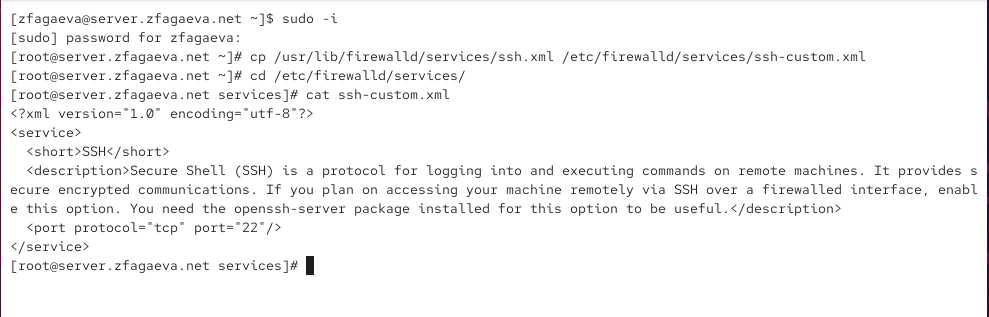
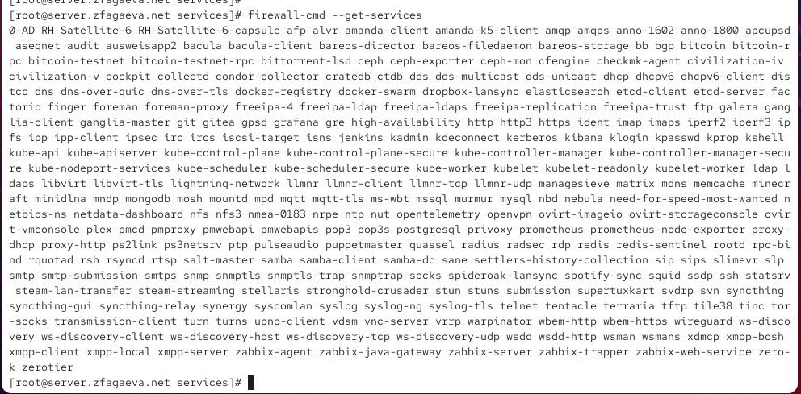
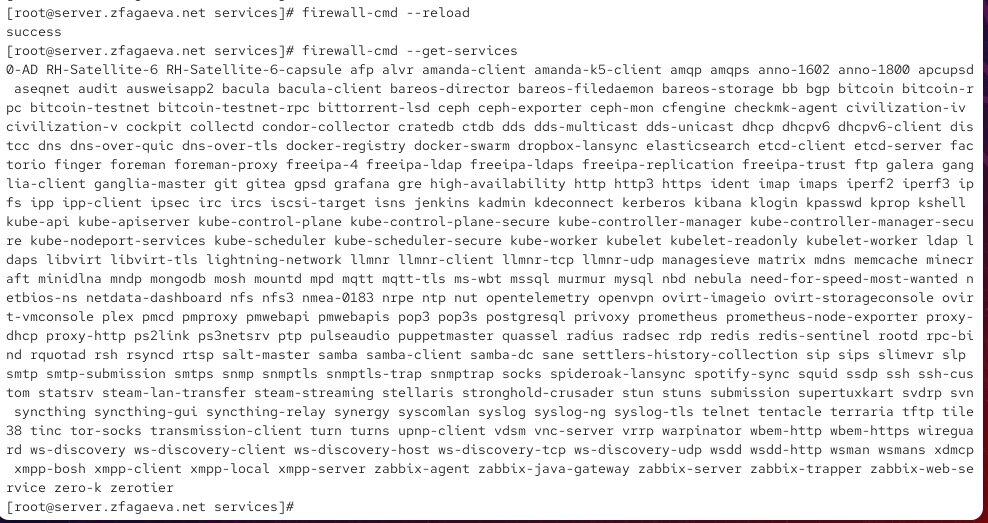
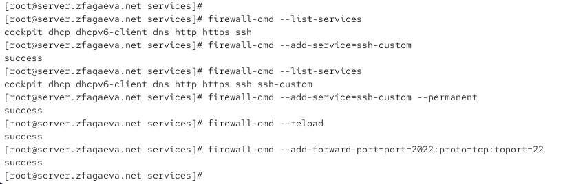
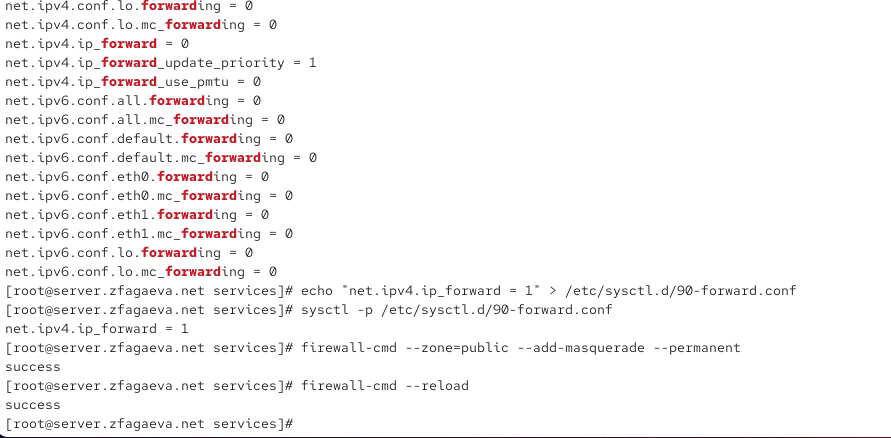
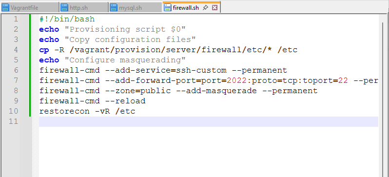

---
## Author
author:
  name: Агаева Зейнаб Фуад кызы
  email: 1032245473@rudn.ru
  affiliation:
    - name: Российский университет дружбы народов
      country: Российская Федерация
      postal-code: 117198
      city: Москва
      address: ул. Миклухо-Маклая, д. 6

## Title
title: Лабораторная работа №7
subtitle: Расширенные настройки межсетевого экрана
license: CC BY
date: today
date-format: "YYYY-MM-DD"
---

# Цели и задачи работы

## Цель лабораторной работы

Получить практические навыки расширенной настройки межсетевого экрана `FirewallD` на виртуальной машине `server`, создания пользовательской службы, настройки доступа к SSH через нестандартный порт, перенаправления портов, включения маршрутизации IPv4-пакетов, настройки маскарадинга и автоматизации выполненных действий средствами `Vagrant`.

# Процесс выполнения лабораторной работы

## Создаю пользовательский файл службы FirewallD

{ #fig:001 width=70% height=70% }

## Изменяю порт службы SSH на 2022

{ #fig:002 width=70% height=70% }

## Просматриваю список доступных служб FirewallD

{ #fig:003 width=70% height=70% }

## Перезагружаю FirewallD и проверяю появление новой службы

{ #fig:004 width=70% height=70% }

## Активирую службу ssh-custom и настраиваю перенаправление порта

{ #fig:005 width=70% height=70% }

## Проверяю SSH-подключение через порт 2022

{ #fig:006 width=70% height=70% }

## Включаю маршрутизацию IPv4 и маскарадинг

{ #fig:007 width=70% height=70% }

## Проверяю доступ клиента к сети Интернет

{ #fig:008 width=70% height=70% }

## Создаю provisioning-скрипт для FirewallD

{ #fig:009 width=70% height=70% }

# Выводы по проделанной работе

## Вывод

В ходе лабораторной работы была выполнена расширенная настройка межсетевого экрана `FirewallD` на виртуальной машине `server`.

Было настроено перенаправление входящих соединений с порта `2022` на стандартный порт SSH `22`.

Работоспособность настройки была проверена подключением с виртуальной машины `client` командой `ssh -p 2022 zfagaeva@server.zfagaeva.net`.

Для организации доступа клиента к сети Интернет на сервере было включено перенаправление IPv4-пакетов с помощью параметра `net.ipv4.ip_forward = 1`.