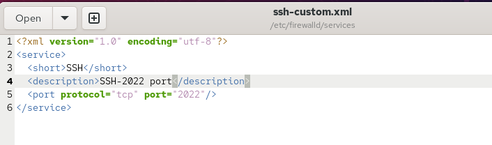
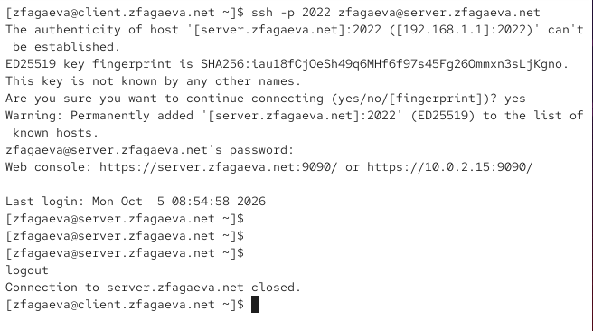
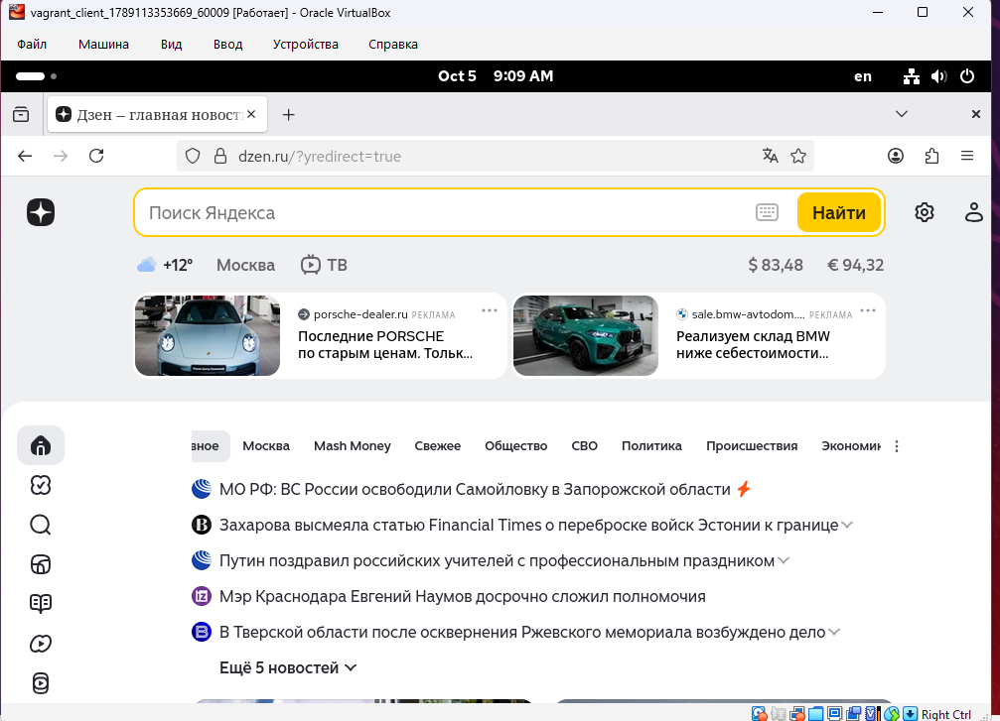

---
## Author
author:
  name: Агаева Зейнаб Фуад кызы
  email: 1032245473@rudn.ru
  affiliation:
    - name: Российский университет дружбы народов
      country: Российская Федерация
      postal-code: 117198
      city: Москва
      address: ул. Миклухо-Маклая, д. 6

## Title
title: "Отчёт по лабораторной работе №7"
subtitle: "Расширенные настройки межсетевого экрана"
license: "CC BY"
---

# Цель работы

Получить навыки настройки межсетевого экрана в Linux в части переадресации портов и настройки Masquerading.

# Выполнение лабораторной работы

На виртуальной машине `server` перехожу в режим суперпользователя командой `sudo -i`. Для создания собственной службы FirewallD копирую стандартный файл описания службы SSH `/usr/lib/firewalld/services/ssh.xml` в каталог пользовательских конфигураций FirewallD `/etc/firewalld/services/` под именем `ssh-custom.xml` командой `cp /usr/lib/firewalld/services/ssh.xml /etc/firewalld/services/ssh-custom.xml`. После этого перехожу в каталог `/etc/firewalld/services/` и просматриваю содержимое созданного файла командой `cat ssh-custom.xml` (см. рис. [@fig-001]).

Файл `ssh-custom.xml` имеет формат XML. Первая строка `<?xml version="1.0" encoding="utf-8"?>` является XML-декларацией: атрибут `version="1.0"` указывает используемую версию стандарта XML, а `encoding="utf-8"` определяет кодировку файла. Строка `<service>` открывает корневой элемент описания службы FirewallD, внутри которого задаются её параметры. Элемент `<short>SSH</short>` содержит краткое название службы, отображаемое средствами FirewallD. Элемент `<description>...</description>` содержит текстовое описание службы и поясняет её назначение. В исходном файле указывается, что SSH предназначен для удалённого входа в систему и выполнения команд с использованием защищённого соединения. Строка `<port protocol="tcp" port="22"/>` является самозакрывающимся XML-элементом и задаёт сетевые параметры службы: атрибут `protocol="tcp"` указывает использование транспортного протокола TCP, а атрибут `port="22"` определяет стандартный порт SSH. Завершающий тег `</service>` закрывает описание службы.

{ #fig-001 width=70% }

Открываю файл `/etc/firewalld/services/ssh-custom.xml` на редактирование. Для создаваемой пользовательской службы изменяю описание на `SSH-2022 port`, чтобы отличить её от стандартной службы SSH, а значение порта изменяю с `22` на `2022`. В результате элемент описания принимает вид `<description>SSH-2022 port</description>`, а правило порта — `<port protocol="tcp" port="2022"/>` (см. рис. [@fig-002]). При этом протокол остаётся TCP, поскольку SSH устанавливает соединения поверх TCP.

{ #fig-002 width=70% }

До перезагрузки конфигурации FirewallD просматриваю перечень известных служб командой `firewall-cmd --get-services` (см. рис. [@fig-003]). Команда выводит встроенные и ранее зарегистрированные службы, которые могут использоваться в правилах межсетевого экрана. В списке присутствует стандартная служба `ssh`, однако созданная служба `ssh-custom` ещё отсутствует. Причина заключается в том, что после добавления нового XML-файла работающий процесс FirewallD ещё не перечитал конфигурацию из каталога `/etc/firewalld/services/`.

{ #fig-003 width=70% }

Для применения изменений выполняю команду `firewall-cmd --reload`. Команда перечитывает постоянную конфигурацию FirewallD и применяет её без необходимости полной остановки службы. Полученное сообщение `success` подтверждает успешную перезагрузку правил. После этого повторно выполняю `firewall-cmd --get-services`. Теперь в перечне доступных служб присутствует `ssh-custom`, следовательно, файл `/etc/firewalld/services/ssh-custom.xml` успешно распознан FirewallD (см. рис. [@fig-004]).

{ #fig-004 width=70% }

Командой `firewall-cmd --list-services` просматриваю службы, активированные в текущей зоне межсетевого экрана. Изначально вывод содержит `cockpit`, `dhcp`, `dhcpv6-client`, `dns`, `http`, `https` и `ssh`, при этом `ssh-custom` ещё не активирована. Для её добавления в текущую конфигурацию выполняю `firewall-cmd --add-service=ssh-custom`. Сообщение `success` означает успешное добавление правила. При повторном выполнении `firewall-cmd --list-services` в списке появляется `ssh-custom`.

Чтобы настройка пользовательской службы сохранялась после перезапуска FirewallD или операционной системы, выполняю `firewall-cmd --add-service=ssh-custom --permanent`. Параметр `--permanent` записывает изменение в постоянную конфигурацию, после чего командой `firewall-cmd --reload` применяю сохранённые параметры.

Далее организую перенаправление входящих TCP-соединений с порта `2022` на стандартный порт SSH `22` командой `firewall-cmd --add-forward-port=port=2022:proto=tcp:toport=22`. Параметр `port=2022` задаёт внешний порт, на который обращается клиент, `proto=tcp` определяет транспортный протокол, а `toport=22` задаёт локальный порт назначения. Получение сообщения `success` подтверждает успешное создание правила перенаправления (см. рис. [@fig-005]).

Таким способом служба `sshd` продолжает работать на стандартном локальном порту `22`, однако клиенту для подключения к серверу можно использовать порт `2022`. Перенаправление выполняется средствами межсетевого экрана без необходимости изменения параметра `Port` в конфигурации самого SSH-сервера.

{ #fig-005 width=70% }

Для проверки созданного правила перехожу на виртуальную машину `client` и выполняю подключение к серверу командой `ssh -p 2022 zfagaeva@server.zfagaeva.net` (см. рис. [@fig-006]). Параметр `-p 2022` указывает SSH-клиенту использовать вместо стандартного порта `22` порт `2022`.

При первом соединении SSH сообщает, что подлинность узла `[server.zfagaeva.net]:2022` ранее не проверялась, и отображает отпечаток ключа ED25519. На запрос о продолжении соединения отвечаю `yes`, после чего информация о сервере добавляется в файл известных узлов. Далее ввожу пароль пользователя `zfagaeva`. После успешной аутентификации появляется приглашение командной строки `zfagaeva@server.zfagaeva.net`, что подтверждает успешное подключение к серверу через порт `2022`. После проверки завершаю удалённый сеанс командой `logout`, в результате появляется сообщение `Connection to server.zfagaeva.net closed.`.

{ #fig-006 width=70% }

Для дальнейшей организации маршрутизации трафика через виртуальную машину `server` проверяю параметры перенаправления пакетов ядра командой `sysctl -a | grep forward`. В выводе отображаются параметры IPv4 и IPv6, содержащие слово `forward`. В частности, значение `net.ipv4.ip_forward = 0` показывает, что глобальная маршрутизация IPv4-пакетов на данный момент выключена. При таком значении сервер не пересылает IPv4-пакеты между своими сетевыми интерфейсами.

Для включения маршрутизации создаю конфигурационный файл `/etc/sysctl.d/90-forward.conf` командой `echo "net.ipv4.ip_forward = 1" > /etc/sysctl.d/90-forward.conf`. Параметр `net.ipv4.ip_forward = 1` разрешает ядру Linux пересылать IPv4-пакеты между сетевыми интерфейсами. Для применения параметра без перезагрузки операционной системы выполняю `sysctl -p /etc/sysctl.d/90-forward.conf`. В выводе появляется строка `net.ipv4.ip_forward = 1`, подтверждающая включение IPv4 forwarding.

После включения маршрутизации настраиваю маскарадинг командой `firewall-cmd --zone=public --add-masquerade --permanent`. Параметр `--zone=public` задаёт зону FirewallD, для которой включается маскарадинг, `--add-masquerade` активирует преобразование исходного адреса для проходящего через сервер трафика, а `--permanent` сохраняет настройку в постоянной конфигурации. Полученное сообщение `success` подтверждает выполнение команды. Затем выполняю `firewall-cmd --reload`, чтобы применить постоянную конфигурацию межсетевого экрана (см. рис. [@fig-007]).

Маскарадинг позволяет клиентской виртуальной машине обращаться к внешней сети через сервер. При выходе пакета во внешнюю сеть исходный адрес клиента заменяется адресом внешнего интерфейса сервера, а для ответного трафика выполняется обратное преобразование. В сочетании с включённым параметром `net.ipv4.ip_forward` виртуальная машина `server` может выполнять функции маршрутизатора для клиента.

{ #fig-007 width=70% }

После настройки IP forwarding и маскарадинга проверяю доступ клиента к сети Интернет. На виртуальной машине `client` запускаю веб-браузер и открываю внешний веб-ресурс. Страница успешно загружается и отображает полученное из сети содержимое (см. рис. [@fig-008]). Успешная загрузка внешнего сайта подтверждает, что клиент получает доступ в Интернет через виртуальную машину `server`, а настроенные маршрутизация и маскарадинг работают корректно.

{ #fig-008 width=70% }

Для сохранения выполненной конфигурации в проекте Vagrant перехожу на сервере в каталог `/vagrant/provision/server`. Создаю структуру каталогов для конфигурационных файлов FirewallD и `sysctl` командами `mkdir -p /vagrant/provision/server/firewall/etc/firewalld/services` и `mkdir -p /vagrant/provision/server/firewall/etc/sysctl.d`. Параметр `-p` позволяет создать всю необходимую последовательность вложенных каталогов и не выдаёт ошибку, если часть каталогов уже существует.

{ #fig-009 width=70% }

# Вывод

В ходе лабораторной работы была выполнена расширенная настройка межсетевого экрана FirewallD на виртуальной машине `server`. На основе стандартного описания службы SSH был создан пользовательский файл `/etc/firewalld/services/ssh-custom.xml`. В нём для пользовательской службы был задан TCP-порт `2022`, после чего конфигурация FirewallD была перезагружена и новая служба `ssh-custom` стала доступна для использования.

Созданная служба `ssh-custom` была добавлена сначала во временную, а затем в постоянную конфигурацию FirewallD. Для организации доступа к SSH-серверу через нестандартный порт было настроено перенаправление входящих TCP-соединений с порта `2022` на стандартный порт SSH `22`. Работоспособность правила была проверена с виртуальной машины `client` подключением командой `ssh -p 2022 zfagaeva@server.zfagaeva.net`. Успешная авторизация подтвердила корректность настройки перенаправления портов.

Для использования виртуальной машины `server` в качестве маршрутизатора была проверена возможность перенаправления IPv4-пакетов. Параметр ядра `net.ipv4.ip_forward` был установлен в значение `1` посредством конфигурационного файла `/etc/sysctl.d/90-forward.conf`. Настройка была применена командой `sysctl -p`, благодаря чему сервер получил возможность пересылать IPv4-пакеты между своими сетевыми интерфейсами.

Для предоставления виртуальной машине `client` доступа к сети Интернет в зоне FirewallD `public` был включён маскарадинг. При использовании маскарадинга исходный IP-адрес пакетов клиента при выходе во внешнюю сеть заменяется адресом внешнего сетевого интерфейса сервера. После настройки была проверена доступность внешних сетевых ресурсов с виртуальной машины `client`, что подтвердило корректную работу маршрутизации и преобразования сетевых адресов.

Для автоматизации выполненных настроек необходимые конфигурационные файлы `ssh-custom.xml` и `90-forward.conf` были сохранены в каталоге `/vagrant/provision/server/firewall/`. В каталоге `/vagrant/provision/server` был создан исполняемый сценарий `firewall.sh`, содержащий команды копирования конфигурационных файлов, добавления пользовательской службы SSH, настройки перенаправления порта `2022` на `22`, включения маскарадинга и перезагрузки FirewallD.

В конфигурационный файл `Vagrantfile` был добавлен отдельный provisioning-этап, запускающий сценарий `provision/server/firewall.sh`. Благодаря этому расширенная настройка межсетевого экрана может автоматически воспроизводиться при развёртывании виртуальной машины `server`.

# Контрольные вопросы

1. Где хранятся пользовательские файлы firewalld?

Пользовательские конфигурационные файлы FirewallD хранятся в каталоге:

`/etc/firewalld/`

В частности, пользовательские описания служб располагаются в каталоге:

`/etc/firewalld/services/`

Например, созданная в лабораторной работе служба SSH хранится в файле:

`/etc/firewalld/services/ssh-custom.xml`

Системные файлы служб, устанавливаемые вместе с FirewallD и программными пакетами, располагаются отдельно — в каталоге `/usr/lib/firewalld/services/`. Файлы из `/etc/firewalld/` предназначены для пользовательских настроек и имеют приоритет над стандартными конфигурационными файлами.

2. Какую строку надо включить в пользовательский файл службы, чтобы указать порт TCP 2022?

Для указания TCP-порта `2022` в XML-файле пользовательской службы необходимо добавить строку:

`<port protocol="tcp" port="2022"/>`

Элемент `<port>` определяет сетевой порт службы. Атрибут `protocol="tcp"` указывает использование транспортного протокола TCP, а атрибут `port="2022"` задаёт номер разрешённого порта.

Например, фрагмент пользовательского файла службы может иметь вид:

~~~xml
<service>
  <short>SSH</short>
  <description>SSH-2022 port</description>
  <port protocol="tcp" port="2022"/>
</service>
~~~

3. Какая команда позволяет вам перечислить все службы, доступные в настоящее время на вашем сервере?

Для вывода всех служб, известных FirewallD, используется команда:

`firewall-cmd --get-services`

Она отображает как стандартные службы, поставляемые вместе с FirewallD и установленными пакетами, так и пользовательские службы, конфигурационные файлы которых были загружены FirewallD.

После создания нового файла службы может потребоваться перечитать конфигурацию:

`firewall-cmd --reload`

После этого повторное выполнение:

`firewall-cmd --get-services`

покажет созданную пользовательскую службу.

Команда `firewall-cmd --list-services` имеет другое назначение: она выводит не все доступные службы, а только службы, разрешённые в текущей активной зоне.

4. В чем разница между трансляцией сетевых адресов (NAT) и маскарадингом (masquerading)?

NAT (Network Address Translation) — общее название механизма преобразования сетевых адресов и, при необходимости, номеров портов при прохождении пакетов через маршрутизатор или межсетевой экран. NAT может использоваться как для изменения адреса источника пакета, так и для изменения адреса назначения.

Например, при SNAT можно явно указать внешний IP-адрес, которым должен заменяться внутренний адрес отправителя. Такой вариант удобен, когда внешний интерфейс маршрутизатора имеет постоянный IP-адрес.

Masquerading является разновидностью преобразования исходного адреса, то есть SNAT. Основное отличие заключается в том, что при маскарадинге внешний IP-адрес не требуется задавать вручную. Система автоматически использует текущий адрес выходного сетевого интерфейса.

Поэтому маскарадинг особенно удобен для интерфейсов, IP-адрес которых может изменяться, например при получении адреса по DHCP.

В лабораторной работе маскарадинг включается командой FirewallD, после чего пакеты от виртуальной машины `client`, проходящие через `server` во внешнюю сеть, получают в качестве исходного адреса адрес внешнего интерфейса сервера. Ответные пакеты автоматически сопоставляются с исходными соединениями и передаются обратно клиенту.

5. Какая команда разрешает входящий трафик на порт 4404 и перенаправляет его в службу ssh по IP-адресу 10.0.0.10?

Для перенаправления входящих TCP-соединений с порта `4404` на стандартный порт SSH `22` узла с IP-адресом `10.0.0.10` используется команда:

`firewall-cmd --add-forward-port=port=4404:proto=tcp:toport=22:toaddr=10.0.0.10`

Здесь:

- `port=4404` — входящий порт, на который поступает соединение;
- `proto=tcp` — используемый транспортный протокол;
- `toport=22` — порт назначения, соответствующий стандартной службе SSH;
- `toaddr=10.0.0.10` — IP-адрес узла, на который необходимо перенаправить соединение.

Для сохранения правила после перезагрузки FirewallD используется вариант:

`firewall-cmd --add-forward-port=port=4404:proto=tcp:toport=22:toaddr=10.0.0.10 --permanent`

После добавления постоянного правила необходимо применить конфигурацию:

`firewall-cmd --reload`

При перенаправлении трафика на другой узел также должна быть разрешена маршрутизация IPv4-пакетов, например посредством параметра:

`net.ipv4.ip_forward = 1`

6. Какая команда используется для включения маcкарадинга IP-пакетов для всех пакетов, выходящих в зону public?

Для включения маскарадинга в зоне `public` используется команда:

`firewall-cmd --zone=public --add-masquerade`

Она активирует маскарадинг в текущей конфигурации FirewallD.

Чтобы настройка сохранилась после перезапуска службы или операционной системы, используется команда:

`firewall-cmd --zone=public --add-masquerade --permanent`

После добавления настройки в постоянную конфигурацию необходимо выполнить:

`firewall-cmd --reload`

В результате для трафика, проходящего через соответствующий внешний интерфейс зоны `public`, FirewallD выполняет преобразование исходного IP-адреса с использованием адреса выходного интерфейса сервера.

# Список литературы

1. [Firewalld. Официальная документация: конфигурационные файлы служб](https://firewalld.org/documentation/man-pages/firewalld.service.html)

2. [Firewalld. Официальная документация: утилита firewall-cmd](https://firewalld.org/documentation/man-pages/firewall-cmd.html)

3. [Firewalld. Создание и добавление пользовательской службы](https://firewalld.org/documentation/howto/add-a-service.html)

4. [Firewalld. Параметры описания служб](https://firewalld.org/documentation/service/options.html)

5. [Firewalld. Примеры конфигурационных файлов служб](https://firewalld.org/documentation/service/examples.html)

6. [Red Hat Enterprise Linux 9. Использование и настройка firewalld](https://docs.redhat.com/en/documentation/red_hat_enterprise_linux/9/html/configuring_firewalls_and_packet_filters/using-and-configuring-firewalld_firewall-packet-filters)

7. [Red Hat Enterprise Linux 7. Настройка перенаправления портов в firewalld](https://docs.redhat.com/en/documentation/red_hat_enterprise_linux/7/html/security_guide/sec-port_forwarding)

8. [Linux Kernel Documentation. Параметры IPv4 и настройка ip_forward](https://www.kernel.org/doc/html/latest/networking/ip-sysctl.html)
