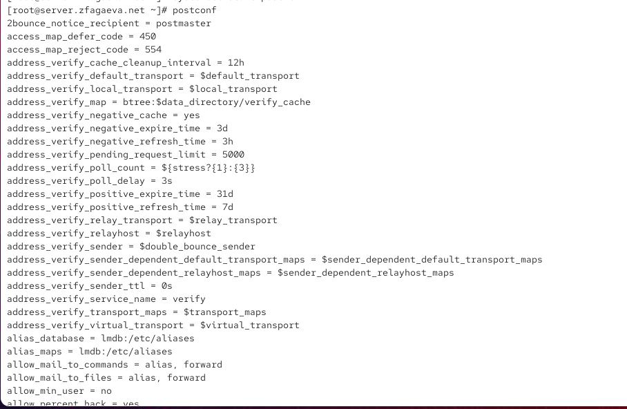
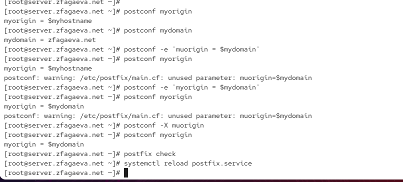
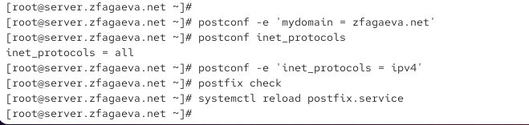
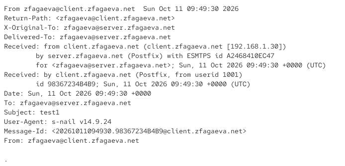
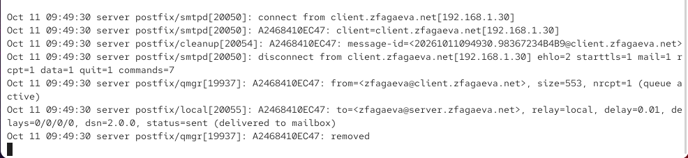
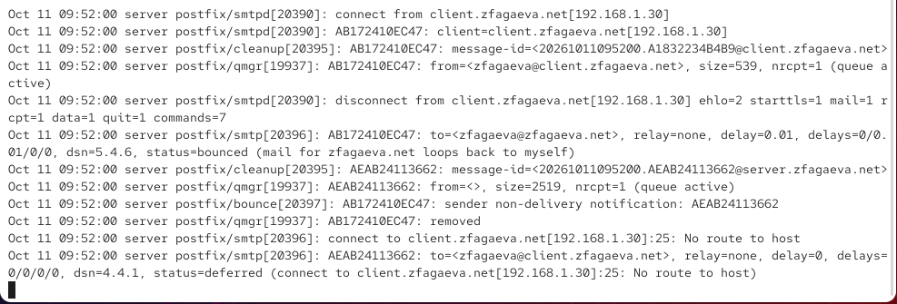
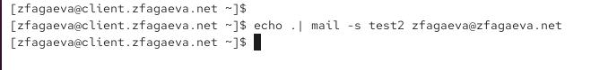
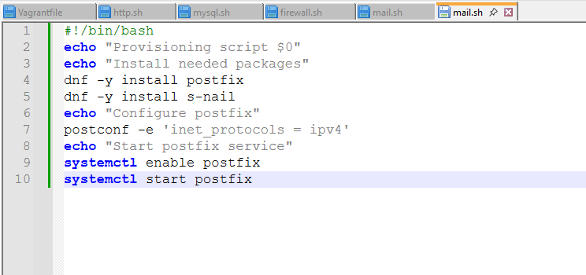

---
## Author
author:
  name: Агаева Зейнаб Фуад кызы
  email: 1032245473@rudn.ru
  affiliation:
    - name: Российский университет дружбы народов
      country: Российская Федерация
      postal-code: 117198
      city: Москва
      address: ул. Миклухо-Маклая, д. 6

## Title
title: Лабораторная работа №8
subtitle: Настройка SMTP-сервера
license: CC BY
date: today
date-format: "YYYY-MM-DD"
---

# Цели и задачи работы

## Цель лабораторной работы

Получить практические навыки установки и настройки почтового сервера `Postfix` на виртуальных машинах `server` и `client`, конфигурирования SMTP, настройки отправки и получения электронной почты в домене, проверки доставки сообщений и автоматизации выполненных действий средствами `Vagrant`.

# Процесс выполнения лабораторной работы

## Устанавливаю и запускаю Postfix на сервере

{ #fig:001 width=70% height=70% }

## Просматриваю текущие параметры Postfix

{ #fig:002 width=70% height=70% }

## Изменяю параметр myorigin и проверяю конфигурацию

{ #fig:003 width=70% height=70% }

## Просматриваю изменённые параметры Postfix

{ #fig:004 width=70% height=70% }

## Настраиваю домен zfagaeva.net и протокол IPv4

{ #fig:005 width=70% height=70% }

## Отправляю тестовое письмо с сервера

{ #fig:006 width=70% height=70% }

## Проверяю доставку письма в журнале Postfix

{ #fig:007 width=70% height=70% }

## Устанавливаю и настраиваю Postfix на клиенте

{ #fig:008 width=70% height=70% }

## Отправляю тестовое письмо с клиента на сервер

{ #fig:009 width=70% height=70% }

## Настраиваю сетевые интерфейсы и доверенную сеть Postfix

{ #fig:010 width=70% height=70% }

## Повторно отправляю письмо с клиента

{ #fig:011 width=70% height=70% }

## Проверяю получение письма на сервере

{ #fig:012 width=70% height=70% }

## Проверяю журнал доставки почты с клиента

{ #fig:013 width=70% height=70% }

## Отправляю письмо на доменный адрес

{ #fig:014 width=70% height=70% }

## Анализирую ошибку доставки на доменный адрес

{ #fig:015 width=70% height=70% }

## Настраиваю прямую DNS-зону и MX-запись

{ #fig:016 width=70% height=70% }

## Настраиваю обратную DNS-зону

{ #fig:017 width=70% height=70% }

## Настраиваю mydestination и проверяю очередь Postfix

{ #fig:018 width=70% height=70% }

## Повторно отправляю письмо на доменный адрес

{ #fig:019 width=70% height=70% }

## Проверяю получение письма на доменный адрес

{ #fig:020 width=70% height=70% }

## Подтверждаю успешную доставку в журнале Postfix

{ #fig:021 width=70% height=70% }

## Создаю скрипт автоматической настройки Postfix на сервере

{ #fig:022 width=70% height=70% }

## Создаю скрипт автоматической настройки Postfix на клиенте

{ #fig:023 width=70% height=70% }

# Выводы по проделанной работе

## Вывод

В ходе лабораторной работы была выполнена установка и настройка почтового сервера `Postfix` на виртуальных машинах `server` и `client`.

С помощью утилиты `postconf` был настроен почтовый домен `zfagaeva.net`, установлено использование протокола IPv4 и разрешён приём SMTP-соединений из внутренней сети.

Была проверена отправка электронных писем с сервера и клиента. Успешная доставка сообщений подтверждена содержимым почтового ящика `/var/spool/mail/zfagaeva` и записями `status=sent (delivered to mailbox)` в журнале `/var/log/maillog`.

Для организации доменной почты были настроены DNS-записи `MX`, `A` и `PTR`, а также изменён параметр `mydestination`. После этого была успешно проверена доставка сообщений на адрес `zfagaeva@zfagaeva.net`.
