---
## Author
author:
  name: Агаева Зейнаб Фуад кызы
  email: 1032245473@rudn.ru
  affiliation:
    - name: Российский университет дружбы народов
      country: Российская Федерация
      postal-code: 117198
      city: Москва
      address: ул. Миклухо-Маклая, д. 6

## Title
title: "Отчёт по лабораторной работе №8"
subtitle: "Настройка SMTP-сервера"
license: "CC BY"
---

# Цель работы

Приобретение практических навыков по установке и конфигурированию SMTPсервера.

# Выполнение лабораторной работы

На виртуальной машине `server` перехожу в режим суперпользователя командой `sudo -i`. Устанавливаю почтовый сервер Postfix и утилиту для работы с электронной почтой командами `dnf -y install postfix` и `dnf -y install s-nail`. Затем разрешаю SMTP-трафик в межсетевом экране командами `firewall-cmd --add-service=smtp` и `firewall-cmd --add-service=smtp --permanent`. Проверяю список разрешённых служб командой `firewall-cmd --list-services`, в котором присутствует `smtp`. Восстанавливаю контексты безопасности SELinux командой `restorecon -vR /etc`. После этого включаю автоматический запуск Postfix командой `systemctl enable postfix` и запускаю службу командой `systemctl start postfix` (см. рис. [@fig-001]).

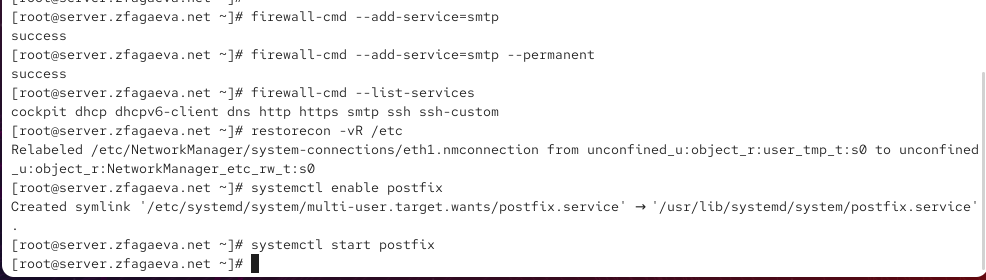{ #fig-001 width=70% }

Для первоначальной настройки Postfix использую утилиту `postconf`. Выполняю команду `postconf`, которая выводит текущие параметры почтового сервера. Конфигурация Postfix хранится преимущественно в файле `/etc/postfix/main.cf` и определяет параметры сетевого взаимодействия, доменные имена, обработку сообщений и способы доставки почты (см. рис. [@fig-002]).

{ #fig-002 width=70% }

Проверяю параметры `myorigin` и `mydomain` командами `postconf myorigin` и `postconf mydomain`. Первоначально `myorigin` имеет значение `$myhostname`, а `mydomain` — `zfagaeva.net`. Параметр `myorigin` определяет доменную часть адреса отправителя. Чтобы использовать основной домен вместо имени отдельного сервера, выполняю `postconf -e 'myorigin = $mydomain'`.

При настройке возникает предупреждение `unused parameter: muorigin=$mydomain`, связанное с опечаткой в имени параметра. Исправляю ошибку и повторно проверяю значение `myorigin`. После получения `myorigin = $mydomain` выполняю `postfix check` и `systemctl reload postfix.service` для проверки и применения конфигурации (см. рис. [@fig-003]).

{ #fig-003 width=70% }

Командой `postconf -n` просматриваю параметры, значения которых отличаются от настроек по умолчанию. В выводе присутствуют `inet_interfaces = localhost`, `inet_protocols = all` и `myorigin = $mydomain`. Параметр `inet_interfaces` определяет интерфейсы, принимающие SMTP-соединения, а `inet_protocols` задаёт используемые сетевые протоколы. Значение `localhost` означает, что первоначально Postfix принимает входящие соединения только с локального узла (см. рис. [@fig-004]).

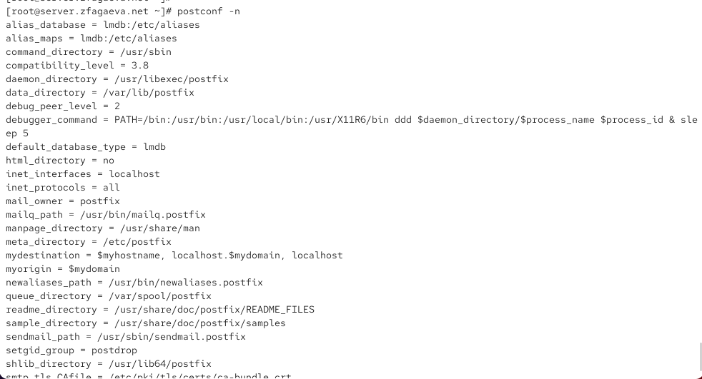{ #fig-004 width=70% }

Явно задаю домен командой `postconf -e 'mydomain = zfagaeva.net'`. Затем проверяю параметр `inet_protocols`, который первоначально имеет значение `all`, и изменяю его командой `postconf -e 'inet_protocols = ipv4'`. Это ограничивает сетевое взаимодействие Postfix протоколом IPv4. Проверяю конфигурацию командой `postfix check` и применяю изменения через `systemctl reload postfix.service` (см. рис. [@fig-005]).

{ #fig-005 width=70% }

Для проверки отправки почты на виртуальной машине `server` под пользователем `zfagaeva` выполняю команду `echo . | mail -s test1 zfagaeva@server.zfagaeva.net`. Параметр `-s` задаёт тему письма, а последний аргумент определяет адрес получателя. После отправки появляется уведомление о новой почте в `/var/spool/mail/zfagaeva`.

Командой `cat /var/spool/mail/zfagaeva` просматриваю полученное сообщение. В заголовках присутствуют `Delivered-To: zfagaeva@server.zfagaeva.net`, `Subject: test1` и `From: zfagaeva@zfagaeva.net`. Это подтверждает успешную локальную доставку письма и использование домена `zfagaeva.net` при формировании адреса отправителя (см. рис. [@fig-006]).

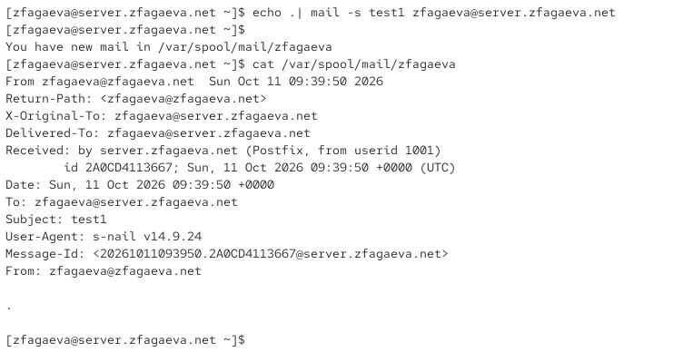{ #fig-006 width=70% }

Для проверки работы почтовой службы выполняю `tail -f /var/log/maillog`. В журнале отображаются этапы обработки сообщения компонентами `postfix/pickup`, `postfix/cleanup` и `postfix/qmgr`. Запись `status=sent (delivered to mailbox)` при `relay=local` подтверждает успешную доставку письма в локальный почтовый ящик. Последующая запись `removed` означает удаление доставленного сообщения из очереди. Также появляется предупреждение о необходимости полного перезапуска Postfix после изменения `inet_protocols` (см. рис. [@fig-007]).

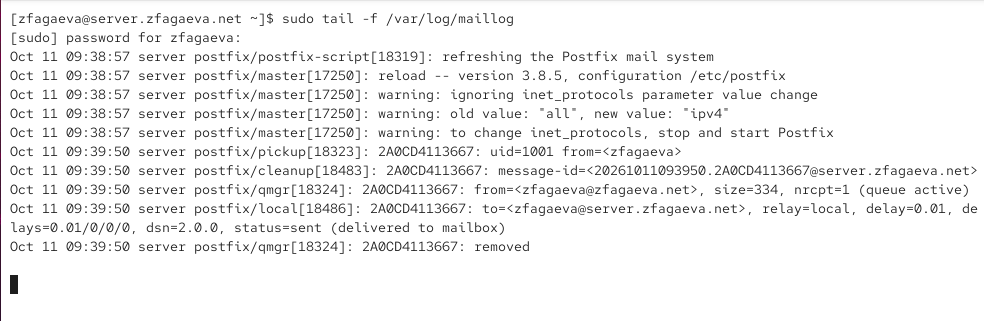{ #fig-007 width=70% }

На виртуальной машине `client` перехожу в режим суперпользователя командой `sudo -i` и устанавливаю пакеты `postfix` и `s-nail` с помощью `dnf -y install`. Проверяю значение `inet_protocols` и задаю использование IPv4 командой `postconf -e 'inet_protocols = ipv4'`. Затем включаю автоматический запуск почтовой службы командой `systemctl enable postfix.service` и запускаю её через `systemctl start postfix.service` (см. рис. [@fig-008]).

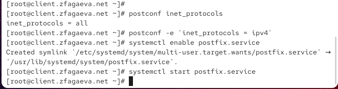{ #fig-008 width=70% }

На клиентской машине под пользователем `zfagaeva` отправляю письмо командой `echo . | mail -s test1 zfagaeva@server.zfagaeva.net`. Команда завершается без ошибок, однако это подтверждает только передачу сообщения локальному почтовому агенту. Поскольку на сервере ещё установлено `inet_interfaces = localhost`, приём SMTP-соединений с других узлов сети не разрешён. Для обеспечения доставки необходимо изменить сетевые параметры сервера (см. рис. [@fig-009]).

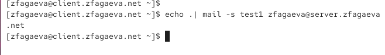{ #fig-009 width=70% }

На виртуальной машине `server` проверяю значения `inet_interfaces` и `mynetworks`. Первоначально они равны `localhost` и `127.0.0.0/32`. Чтобы разрешить подключение других узлов, выполняю `postconf -e 'inet_interfaces = all'`. Затем командой `postconf -e 'mynetworks = 127.0.0.0/8, 192.168.0.0/16'` добавляю внутреннюю сеть в список доверенных адресов.

Проверяю настройки командой `postfix check`, перечитываю конфигурацию через `systemctl reload postfix.service` и полностью перезапускаю службу командами `systemctl stop postfix.service` и `systemctl start postfix.service`. После этого Postfix может принимать соединения через сетевые интерфейсы сервера (см. рис. [@fig-010]).

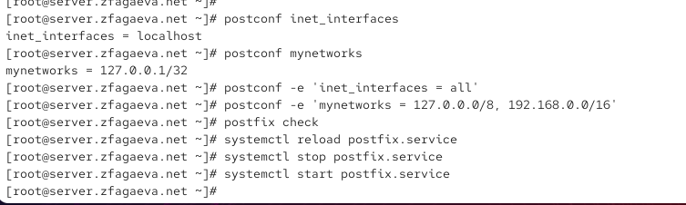{ #fig-010 width=70% }

Возвращаюсь на виртуальную машину `client` и повторно выполняю `echo . | mail -s test1 zfagaeva@server.zfagaeva.net`. Письмо направляется пользователю `zfagaeva` на сервере `server.zfagaeva.net`. Команда завершается без сообщений об ошибках. Для проверки результата перехожу на сервер и просматриваю почтовый ящик получателя (см. рис. [@fig-011]).

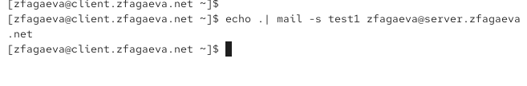{ #fig-011 width=70% }

На сервере проверяю содержимое `/var/spool/mail/zfagaeva`. В почтовом ящике присутствует сообщение с темой `test1`, отправленное с клиентской машины. Заголовок `From` содержит адрес `zfagaeva@client.zfagaeva.net`, а `Delivered-To` указывает `zfagaeva@server.zfagaeva.net`. В поле `Received` отображается подключение от `client.zfagaeva.net` с IP-адресом `192.168.1.30`. Наличие письма подтверждает успешную передачу сообщения между виртуальными машинами (см. рис. [@fig-012]).

{ #fig-012 width=70% }

Дополнительно просматриваю журнал `/var/log/maillog`. Запись `connect from client.zfagaeva.net[192.168.1.30]` подтверждает входящее SMTP-соединение с клиента. Затем Postfix принимает сообщение и выполняет локальную доставку получателю `zfagaeva@server.zfagaeva.net`. Строка `status=sent (delivered to mailbox)` подтверждает, что письмо успешно записано в почтовый ящик. Следовательно, настройка `inet_interfaces` и `mynetworks` позволила организовать обмен почтой между сервером и клиентом (см. рис. [@fig-013]).

{ #fig-013 width=70% }

Для проверки доставки почты на доменный адрес с виртуальной машины `client` выполняю команду `echo . | mail -s test2 zfagaeva@zfagaeva.net`. В отличие от предыдущей проверки, получатель указывается без имени конкретного узла `server`. Для успешной доставки почтовый сервер должен распознавать домен `zfagaeva.net` как обслуживаемый (см. рис. [@fig-014]).

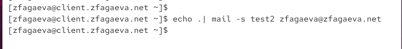{ #fig-014 width=70% }

На сервере просматриваю журнал почтовой службы. Сообщение принимается от клиента, однако при обработке возникает ошибка `status=bounced (mail for zfagaeva.net loops back to myself)`. Это означает, что Postfix пытается перенаправить письмо на собственный сервер, поскольку домен `zfagaeva.net` ещё не включён в список локальных адресов доставки.

Дополнительно формируется уведомление о недоставке, передача которого завершается ошибкой `No route to host` и статусом `deferred`. Для устранения проблемы необходимо настроить DNS-записи почтового домена и добавить домен в параметр `mydestination` (см. рис. [@fig-015]).

{ #fig-015 width=70% }

Для настройки доменной почты открываю файл прямой DNS-зоны `/var/named/master/fz/zfagaeva.net`. В нём присутствует MX-запись `MX 10 mail.zfagaeva.net.`, указывающая почтовый сервер домена с приоритетом `10`. Запись `mail A 192.168.1.1` связывает его имя с IP-адресом сервера. Также в зоне определены адреса узлов `server`, `ns`, `dhcp`, `www` и `client`. Совместное использование записей `MX` и `A` позволяет определять сервер, принимающий электронную почту для домена `zfagaeva.net` (см. рис. [@fig-016]).

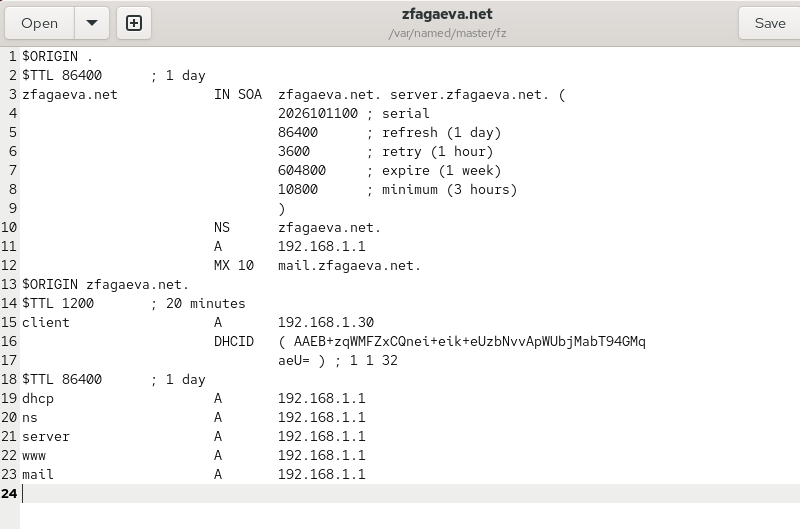{ #fig-016 width=70% }

Затем просматриваю файл обратной DNS-зоны `/var/named/master/rz/192.168.1`. В нём содержатся записи `PTR`, сопоставляющие IP-адреса с доменными именами. Запись `1 PTR mail.zfagaeva.net.` соответствует адресу `192.168.1.1`, а `30 PTR client.zfagaeva.net.` — адресу `192.168.1.30`. Также присутствует MX-запись почтового сервера. Конфигурация обратной зоны обеспечивает разрешение имён узлов по IP-адресам (см. рис. [@fig-017]).

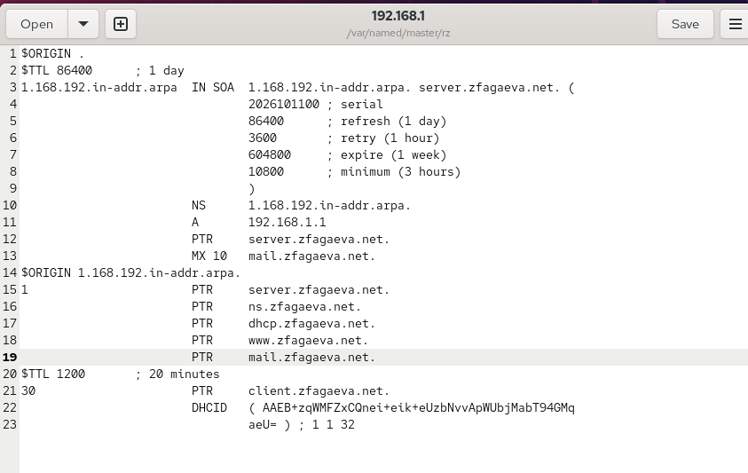{ #fig-017 width=70% }

Командой `postqueue -p` просматриваю очередь Postfix. В ней присутствует отложенное уведомление о недоставке с ошибкой `No route to host`. Для исправления обработки доменной почты выполняю `postconf -e 'mydestination = $myhostname, localhost.$mydomain, localhost, $mydomain'`. Добавление `$mydomain` означает, что сервер принимает почту для домена `zfagaeva.net` и доставляет её локальным пользователям.

После изменения параметра выполняю `postfix check` и `systemctl reload postfix.service`. Затем восстанавливаю контексты SELinux командами `restorecon -vR /etc/` и `restorecon -vR /var/named/`, перезапускаю DNS-сервер командой `systemctl restart named` и инициирую повторную отправку сообщений из очереди с помощью `postqueue -f` (см. рис. [@fig-018]).

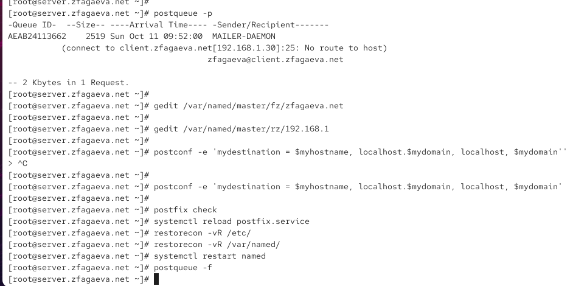{ #fig-018 width=70% }

После изменения конфигурации на клиентской машине повторно отправляю письмо командой `echo . | mail -s test2 zfagaeva@zfagaeva.net`. Теперь сервер должен распознавать домен `zfagaeva.net` как локальный и доставлять сообщения соответствующим пользователям. Команда выполняется без ошибок, после чего проверяю почтовый ящик получателя (см. рис. [@fig-019]).

{ #fig-019 width=70% }

На сервере просматриваю полученное сообщение в файле `/var/spool/mail/zfagaeva`. В заголовках письма присутствуют `X-Original-To: zfagaeva@zfagaeva.net`, `Delivered-To: zfagaeva@zfagaeva.net` и `Subject: test2`. Поле `Received` подтверждает отправку сообщения с узла `client.zfagaeva.net` с адресом `192.168.1.30`. Письмо успешно доставлено на доменный адрес без указания имени сервера (см. рис. [@fig-020]).

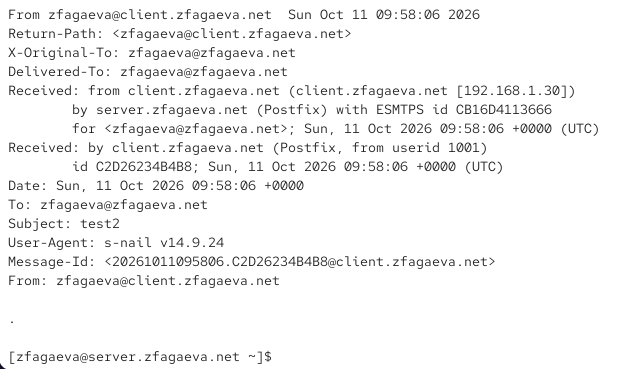{ #fig-020 width=70% }

Для окончательной проверки анализирую журнал `/var/log/maillog`. В нём отображается соединение от `client.zfagaeva.net[192.168.1.30]`, после чего сообщение принимается и передаётся компоненту локальной доставки Postfix. Запись `to=<zfagaeva@zfagaeva.net>, relay=local` подтверждает обработку доменного адреса как локального, а `status=sent (delivered to mailbox)` указывает на успешную доставку. Ошибка `mail for zfagaeva.net loops back to myself` при повторной отправке больше не возникает (см. рис. [@fig-021]).

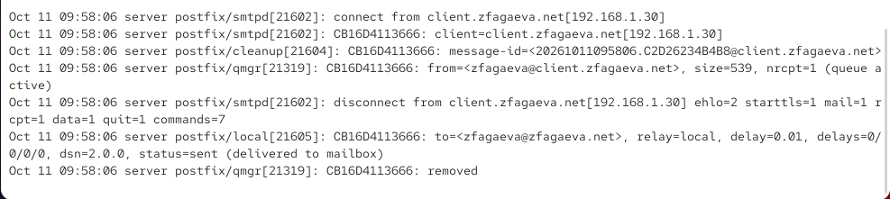{ #fig-021 width=70% }

## Внесение изменений в настройки внутреннего окружения виртуальной машины

Для автоматизации настройки Postfix на виртуальной машине `server` в каталоге `/vagrant/provision/server/` создаю исполняемый скрипт `mail.sh`, содержащий команды установки пакетов, настройки FirewallD, параметров Postfix, восстановления контекстов SELinux и запуска почтовой службы (см. рис. [@fig-022]).

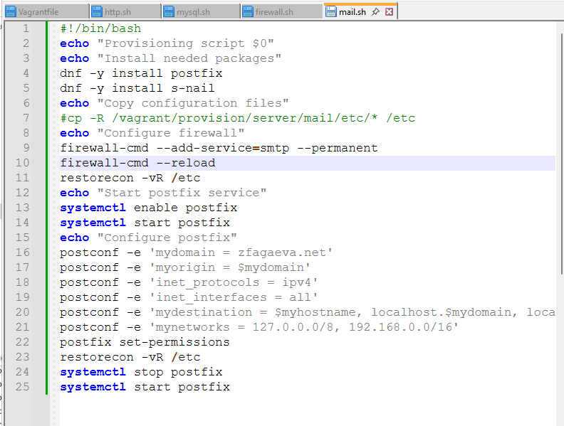{ #fig-022 width=70% }

На виртуальной машине `client` в каталоге `/vagrant/provision/client/` создаю аналогичный скрипт `mail.sh` для установки Postfix, настройки IPv4 и запуска службы; для автоматического выполнения подготовленных скриптов предусматриваю их подключение в `Vagrantfile` через параметры `server.vm.provision` и `client.vm.provision` (см. рис. [@fig-023]).

{ #fig-023 width=70% }

# Вывод

В ходе лабораторной работы была выполнена установка и настройка почтового сервера Postfix на виртуальных машинах `server` и `client`. Установлены пакеты `postfix` и `s-nail`, настроен межсетевой экран FirewallD для работы SMTP и включён автоматический запуск почтовой службы.

С помощью утилиты `postconf` был настроен домен `zfagaeva.net`, установлено использование IPv4, разрешён приём соединений через все сетевые интерфейсы и добавлена внутренняя сеть `192.168.0.0/16` в список доверенных адресов.

Работоспособность Postfix была проверена отправкой тестовых писем с сервера и клиента. Успешная доставка подтверждена содержимым почтового ящика `/var/spool/mail/zfagaeva` и записями `status=sent (delivered to mailbox)` в журнале `/var/log/maillog`.

Для работы с доменными адресами были настроены DNS-записи `MX`, `A` и `PTR`, а домен `zfagaeva.net` добавлен в параметр `mydestination`. После этого успешно проверена отправка почты на адрес `zfagaeva@zfagaeva.net`.

Для автоматизации настройки Postfix были созданы скрипты `mail.sh` для виртуальных машин `server` и `client`, а также предусмотрено их подключение в `Vagrantfile`.

# Контрольные вопросы

1. В каком каталоге и в каком файле следует смотреть конфигурацию Postfix?

Основная конфигурация Postfix находится в файле `/etc/postfix/main.cf`. Дополнительный файл `/etc/postfix/master.cf` определяет параметры запуска служб Postfix.

Для просмотра текущей конфигурации используется команда `postconf`, а для просмотра изменённых параметров — `postconf -n`.

2. Каким образом можно проверить корректность синтаксиса в конфигурационном файле Postfix?

Для проверки конфигурации используется команда:

`postfix check`

Она проверяет настройки Postfix и некоторые параметры файлов и каталогов. После устранения возможных ошибок изменения применяются командой:

`systemctl reload postfix`

3. В каких параметрах конфигурации Postfix требуется внести изменения для настройки отправки писем на доменные адреса?

Для работы с доменной почтой необходимо настроить основные параметры:

- `mydomain = zfagaeva.net` — определяет почтовый домен.
- `myorigin = $mydomain` — задаёт домен отправителя.
- `mydestination = $myhostname, localhost.$mydomain, localhost, $mydomain` — разрешает локальную доставку писем на доменный адрес.
- `inet_interfaces = all` — разрешает приём SMTP-соединений на всех интерфейсах.
- `mynetworks = 127.0.0.0/8, 192.168.0.0/16` — определяет доверенные сети.

Дополнительно в DNS необходимо создать MX-запись `MX 10 mail.zfagaeva.net.`, указывающую почтовый сервер домена.

4. Приведите примеры работы с утилитой mail по отправке письма, просмотру имеющихся писем, удалению письма.

**Отправка письма:**

`echo "Тестовое сообщение" | mail -s "test1" zfagaeva@zfagaeva.net`

Параметр `-s` задаёт тему, а последний аргумент — адрес получателя.

**Просмотр писем:**

`mail`

В интерактивном режиме команда `headers` показывает список писем, а `p 1` — содержимое первого письма.

**Удаление письма:**

`d 1`

Команда помечает первое письмо для удаления. Для сохранения изменений и выхода используется `q`.

5. Приведите примеры работы с утилитой postqueue. Как посмотреть очередь сообщений, определить их количество, отправить все сообщения и удалить письмо?

Утилита `postqueue` предназначена для просмотра и управления очередью сообщений Postfix.

**Просмотр очереди:**

`postqueue -p`

**Определение количества сообщений:**

`postqueue -j | wc -l`

Команда подсчитывает количество сообщений в очереди.

**Повторная отправка всех сообщений:**

`postqueue -f`

Команда инициирует повторную попытку доставки сообщений из очереди.

**Удаление отдельного письма:**

`postsuper -d ID_сообщения`

Для удаления всех сообщений используется `postsuper -d ALL`. Утилита `postsuper` выполняет административные операции с очередью Postfix и требует прав суперпользователя.

# Список литературы

1. [Postfix. Официальная документация почтового сервера](https://www.postfix.org/documentation.html)

2. [Postfix. Руководство по настройке параметров с помощью postconf](https://www.postfix.org/postconf.1.html)

3. [Postfix. Управление очередью почтовых сообщений — postqueue](https://www.postfix.org/postqueue.1.html)

4. [Postfix. Администрирование и удаление сообщений из очереди — postsuper](https://www.postfix.org/postsuper.1.html)

5. [Red Hat Enterprise Linux 9. Установка и настройка почтового сервера Postfix](https://docs.redhat.com/en/documentation/red_hat_enterprise_linux/9/html-single/deploying_mail_servers/index)

6. [S-nail. Руководство по отправке, просмотру и удалению электронной почты](https://manpages.debian.org/testing/s-nail/s-nail.1.en.html)

7. [BIND 9. Официальная документация по настройке DNS-зон и почтовых записей MX](https://bind9.readthedocs.io/en/stable/chapter3.html)

8. [HashiCorp Vagrant. Автоматизация настройки виртуальных машин с помощью Shell Provisioner](https://developer.hashicorp.com/vagrant/docs/provisioning/shell)