---
## Author
author:
  name: Агаева Зейнаб Фуад кызы
  email: 1032245473@rudn.ru
  affiliation:
    - name: Российский университет дружбы народов
      country: Российская Федерация
      postal-code: 117198
      city: Москва
      address: ул. Миклухо-Маклая, д. 6

## Title
title: Лабораторная работа №9
subtitle: Настройка POP3/IMAP сервера
license: CC BY
date: today
date-format: "YYYY-MM-DD"
---

# Цели и задачи работы

## Цель лабораторной работы

Получить практические навыки установки и настройки почтового сервера `Dovecot` на виртуальной машине `server`, конфигурирования протоколов `POP3` и `IMAP`, настройки почтового клиента `Evolution`, проверки отправки и получения электронной почты, а также автоматизации выполненных действий средствами `Vagrant`.

# Процесс выполнения лабораторной работы

## Устанавливаю Dovecot и Telnet на сервере

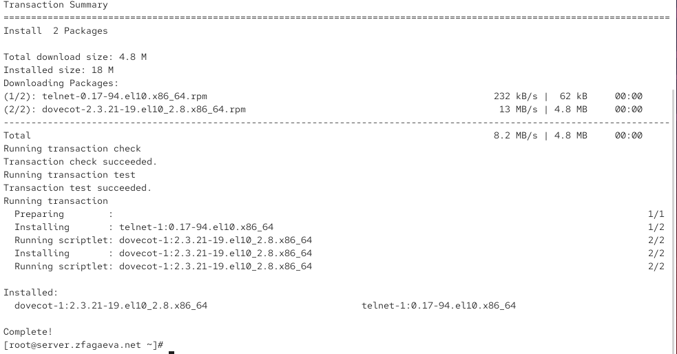{ #fig:001 width=70% height=70% }

## Настраиваю протоколы IMAP и POP3

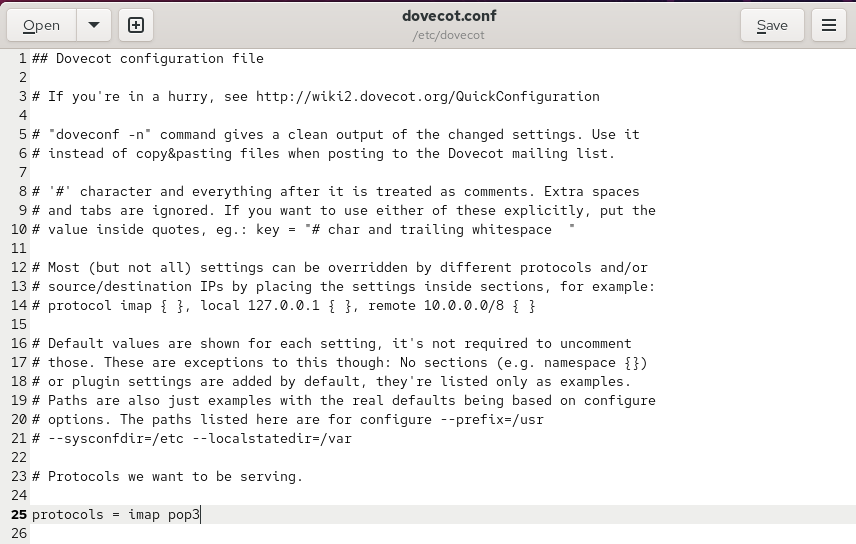{ #fig:002 width=70% height=70% }

## Проверяю механизм аутентификации Dovecot

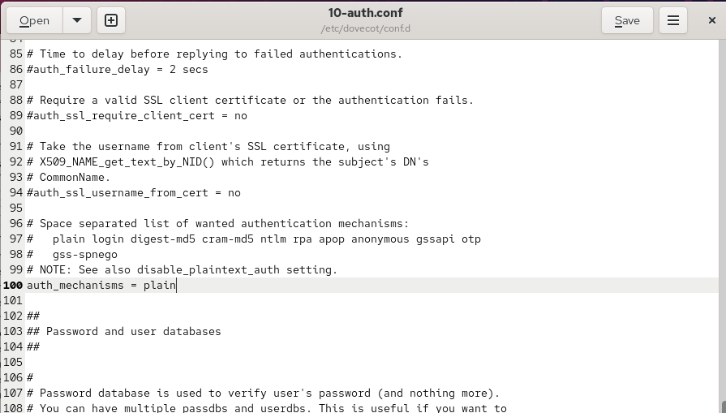{ #fig:003 width=70% height=70% }

## Настраиваю аутентификацию через PAM и passwd

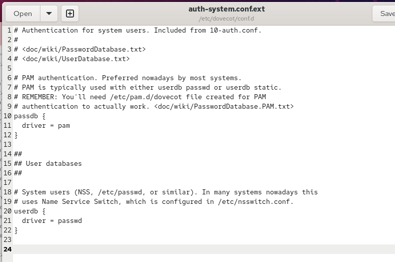{ #fig:004 width=70% height=70% }

## Настраиваю хранение почты в формате Maildir

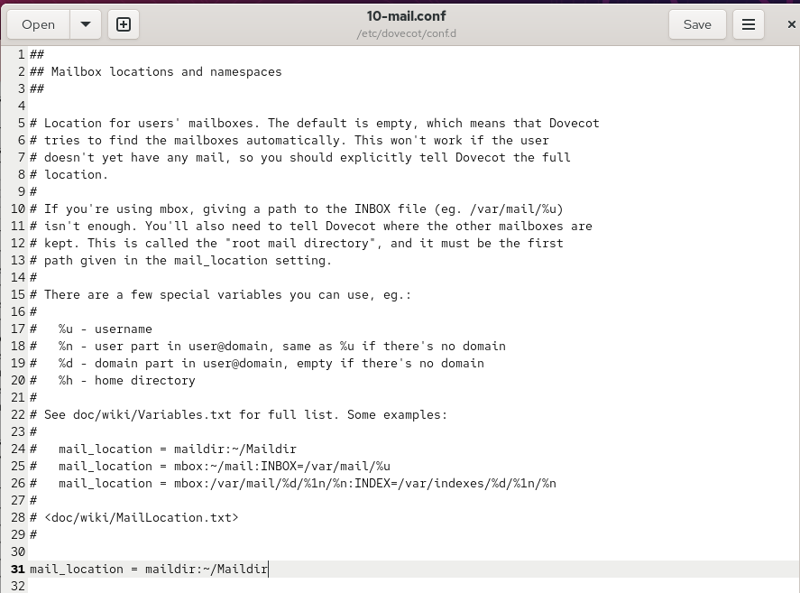{ #fig:005 width=70% height=70% }

## Настраиваю FirewallD и запускаю Dovecot

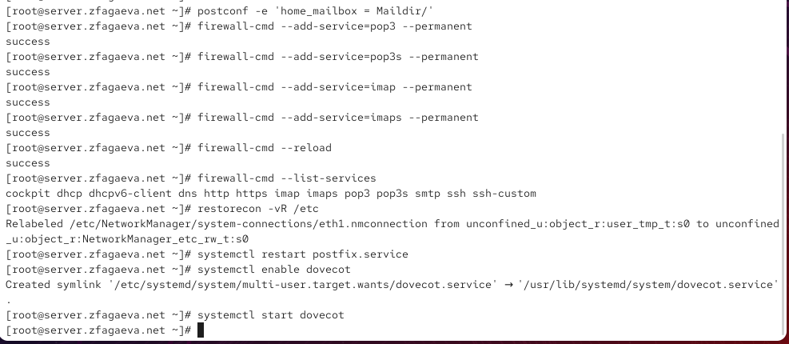{ #fig:006 width=70% height=70% }

## Устанавливаю и настраиваю Evolution на клиенте

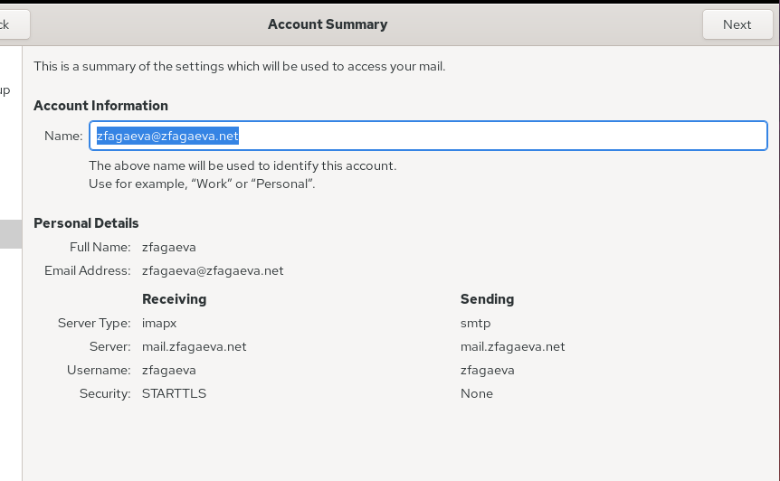{ #fig:007 width=70% height=70% }

## Отправляю и получаю тестовое письмо в Evolution

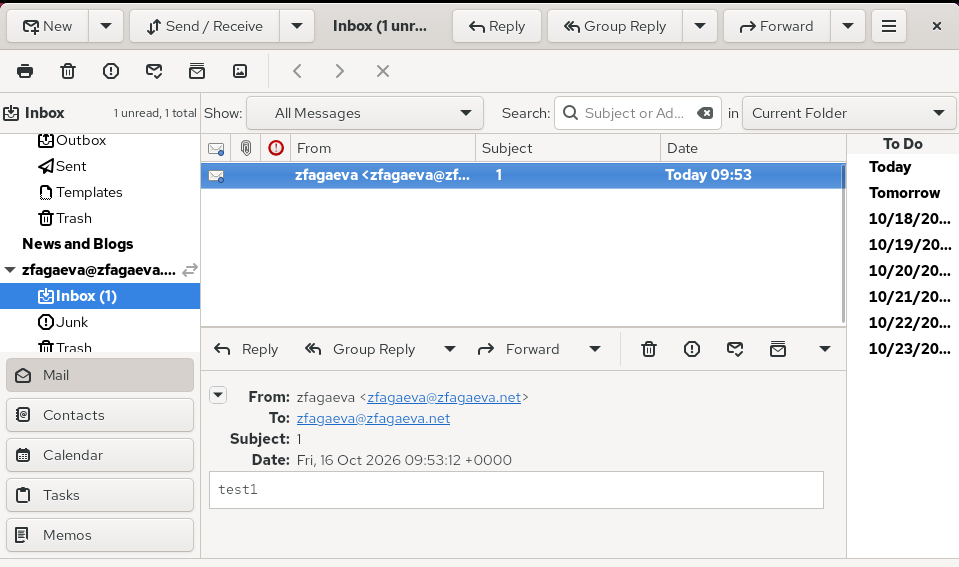{ #fig:008 width=70% height=70% }

## Проверяю доставку писем в журнале почтового сервера

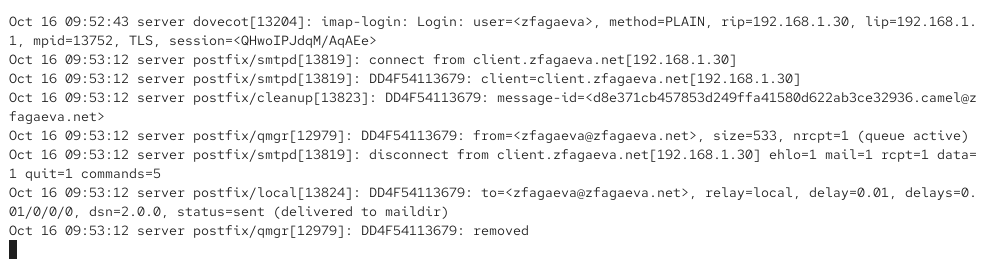{ #fig:009 width=70% height=70% }

## Просматриваю почтовые сообщения и проверяю ящик через doveadm

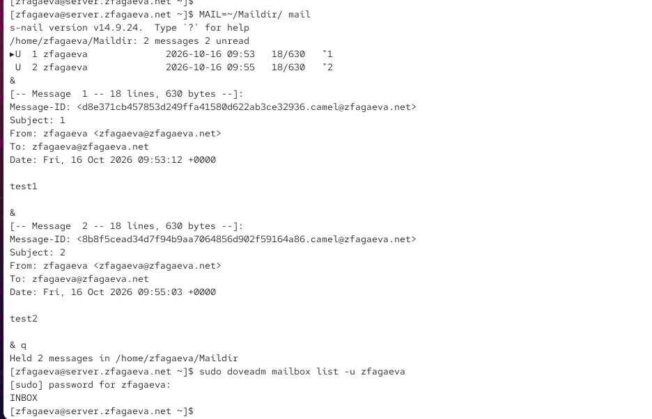{ #fig:010 width=70% height=70% }

## Проверяю работу протокола POP3 через Telnet

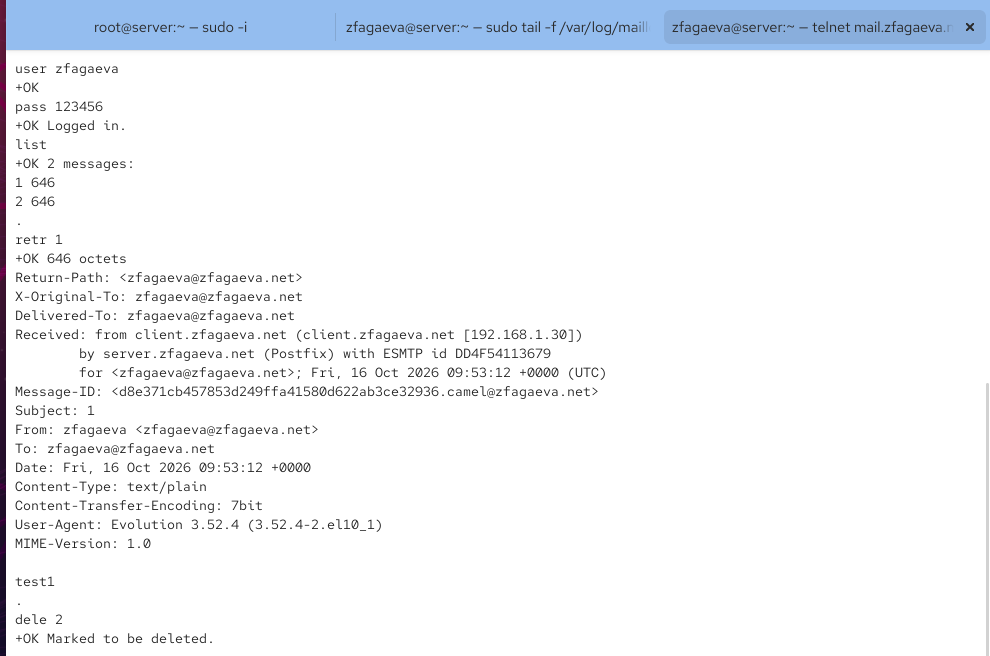{ #fig:011 width=70% height=70% }

## Изменяю скрипт автоматической настройки Postfix и Dovecot на сервере

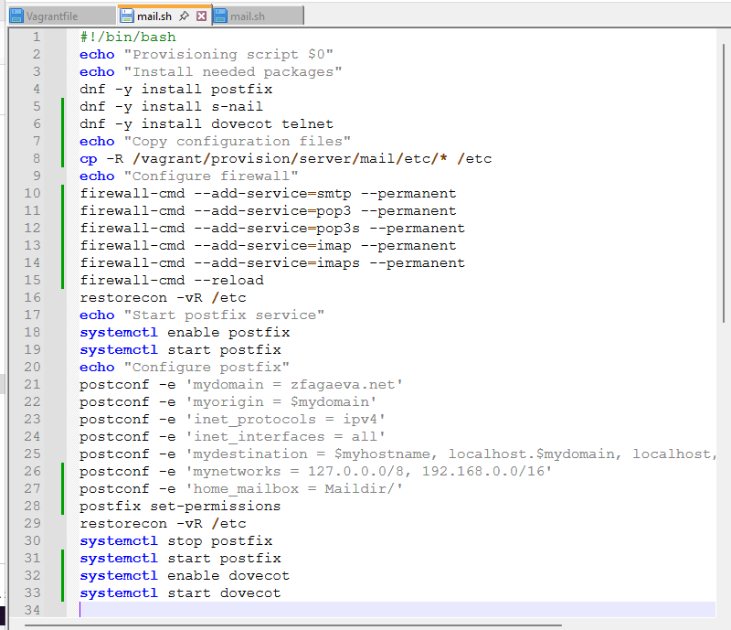{ #fig:012 width=70% height=70% }

## Изменяю скрипт установки Evolution на клиенте

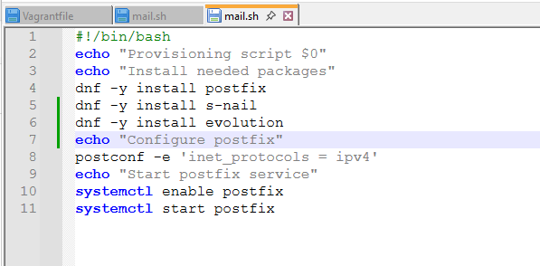{ #fig:013 width=70% height=70% }

# Выводы по проделанной работе

## Вывод

В ходе лабораторной работы была выполнена установка и настройка почтового сервера `Dovecot` на виртуальной машине `server`. Настроены протоколы `IMAP` и `POP3`, а также аутентификация пользователей через `PAM`.

Для хранения почтовых сообщений настроен формат `Maildir` в каталоге `~/Maildir`. В конфигурации `Postfix` задан параметр `home_mailbox = Maildir/`, а в межсетевом экране `FirewallD` разрешены службы `pop3`, `pop3s`, `imap` и `imaps`.

На виртуальной машине `client` установлен и настроен почтовый клиент `Evolution`. Проверена отправка и получение тестовых писем через `SMTP` и `IMAP`. Успешная доставка подтверждена содержимым почтового ящика и записями `status=sent` в журнале `/var/log/maillog`.

Дополнительно проверена работа почтового сервера с помощью утилит `doveadm`, `mail` и `Telnet`. Успешно выполнены аутентификация пользователя, просмотр списка сообщений, чтение и удаление писем по протоколу `POP3`.
