---
## Author
author:
  name: Агаева Зейнаб Фуад кызы
  email: 1032245473@rudn.ru
  affiliation:
    - name: Российский университет дружбы народов
      country: Российская Федерация
      postal-code: 117198
      city: Москва
      address: ул. Миклухо-Маклая, д. 6

## Title
title: "Отчёт по лабораторной работе №9"
subtitle: "Настройка POP3/IMAP сервера"
license: "CC BY"
---

# Цель работы

Приобретение практических навыков по установке и простейшему конфигурированию POP3/IMAP-сервера.


# Выполнение лабораторной работы

На виртуальной машине `server` перехожу в режим суперпользователя командой `sudo -i`. Устанавливаю почтовый сервер Dovecot и утилиту Telnet командой `dnf -y install dovecot telnet`. Установка завершается успешно, что подтверждается сообщением `Complete!` (см. рис. [@fig-001]).

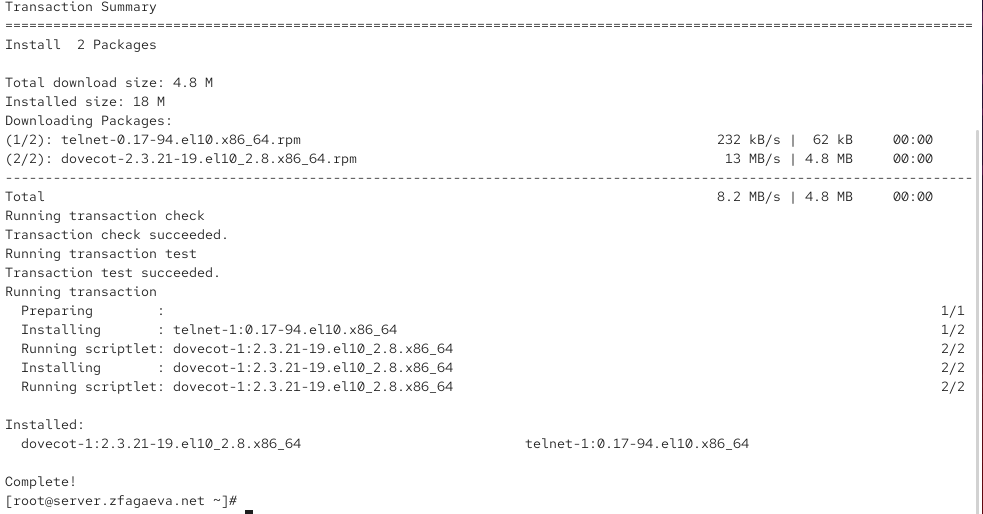{ #fig-001 width=70% }

Открываю конфигурационный файл `/etc/dovecot/dovecot.conf` и задаю параметр `protocols = imap pop3`. Это разрешает работу Dovecot по протоколам IMAP и POP3, предназначенным для получения электронной почты (см. рис. [@fig-002]).

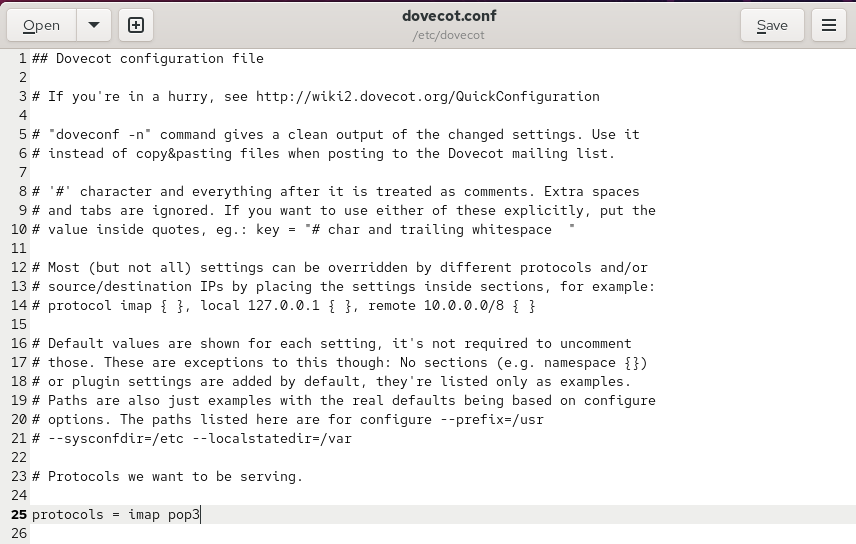{ #fig-002 width=70% }

В конфигурационном файле `/etc/dovecot/conf.d/10-auth.conf` проверяю параметр `auth_mechanisms = plain`, который устанавливает механизм аутентификации пользователей по обычному паролю (см. рис. [@fig-003]).

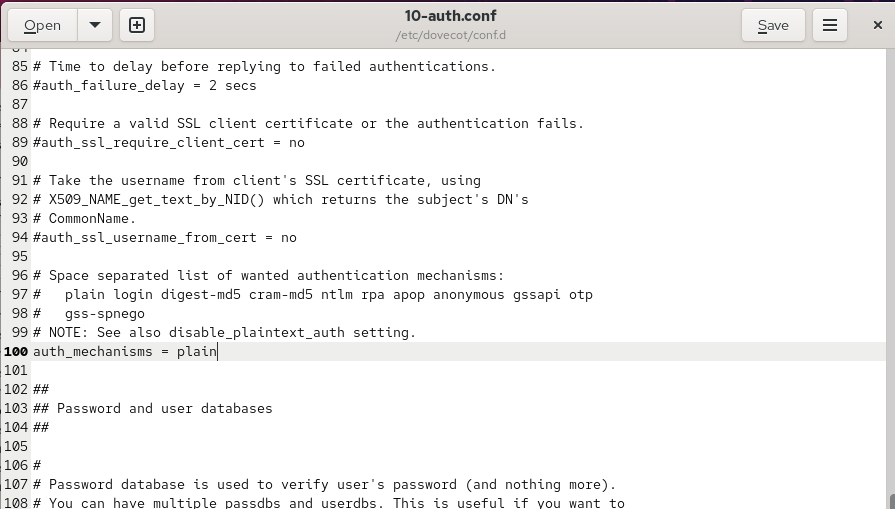{ #fig-003 width=70% }

В файле `/etc/dovecot/conf.d/auth-system.conf.ext` проверяю параметры `driver = pam` в разделе `passdb` и `driver = passwd` в разделе `userdb`. Эти настройки позволяют использовать системные учётные записи для аутентификации пользователей (см. рис. [@fig-004]).

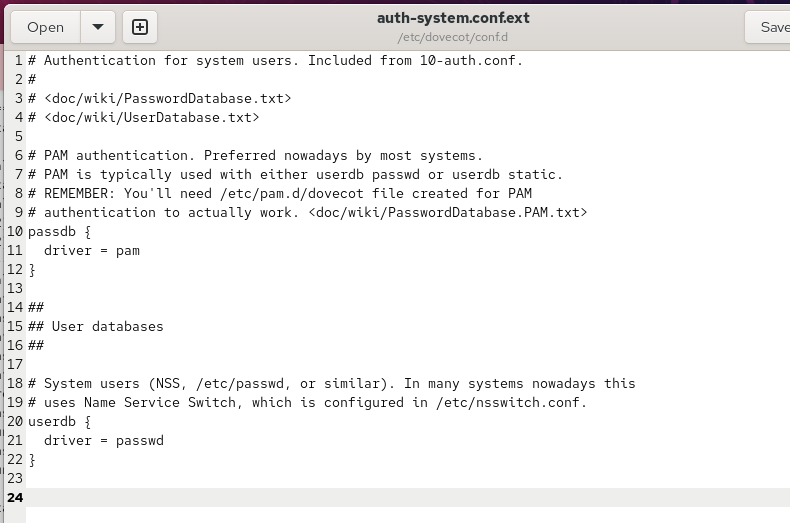{ #fig-004 width=70% }

В файле `/etc/dovecot/conf.d/10-mail.conf` устанавливаю параметр `mail_location = maildir:~/Maildir`. Он задаёт хранение почтовых сообщений в формате Maildir в домашнем каталоге пользователя (см. рис. [@fig-005]).

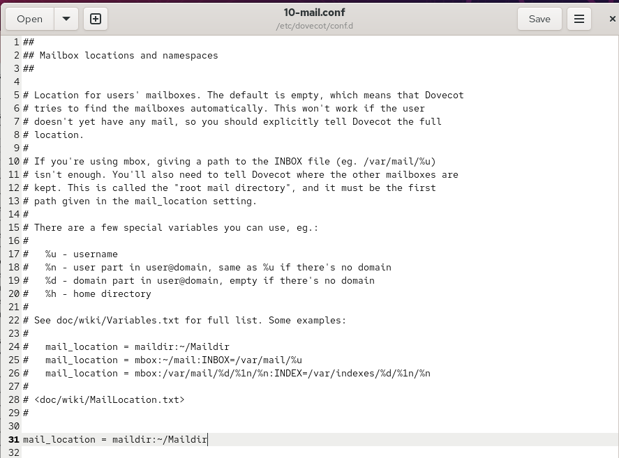{ #fig-005 width=70% }

Для согласования работы Postfix и Dovecot выполняю команду `postconf -e 'home_mailbox = Maildir/'`. Затем разрешаю почтовые протоколы в FirewallD командами `firewall-cmd --add-service=pop3 --permanent`, `firewall-cmd --add-service=pop3s --permanent`, `firewall-cmd --add-service=imap --permanent` и `firewall-cmd --add-service=imaps --permanent`. Применяю изменения командой `firewall-cmd --reload` и проверяю разрешённые службы через `firewall-cmd --list-services`.

Восстанавливаю контексты SELinux командой `restorecon -vR /etc`. Перезапускаю Postfix командой `systemctl restart postfix.service`, включаю автозапуск Dovecot через `systemctl enable dovecot` и запускаю его командой `systemctl start dovecot` (см. рис. [@fig-006]).

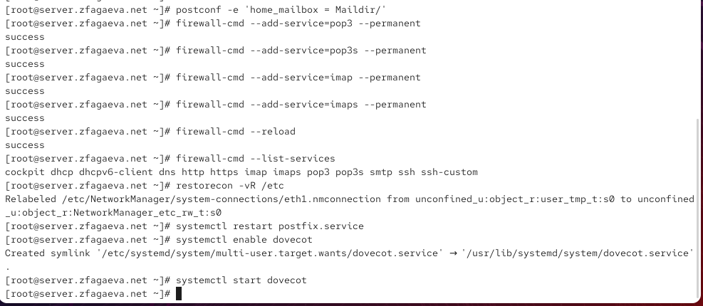{ #fig-006 width=70% }

На виртуальной машине `client` устанавливаю почтовый клиент Evolution командой `dnf -y install evolution`. При настройке учётной записи указываю адрес `zfagaeva@zfagaeva.net` и почтовый сервер `mail.zfagaeva.net`. Для входящей почты выбираю IMAP с портом `143`, шифрованием `STARTTLS` и аутентификацией по паролю. Для исходящей почты использую SMTP с портом `25`, без шифрования и аутентификации. Проверяю параметры учётной записи (см. рис. [@fig-007]).

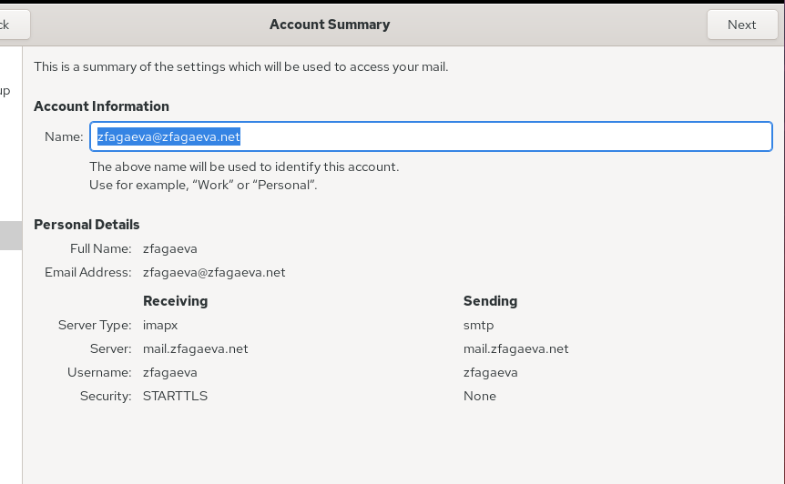{ #fig-007 width=70% }

Для проверки работы почтового клиента отправляю тестовое письмо на собственный адрес `zfagaeva@zfagaeva.net`. Указываю тему `1` и текст `test1`. После отправки письмо появляется в папке входящих сообщений `Inbox`, что подтверждает успешную отправку и получение почты через Evolution (см. рис. [@fig-008]).

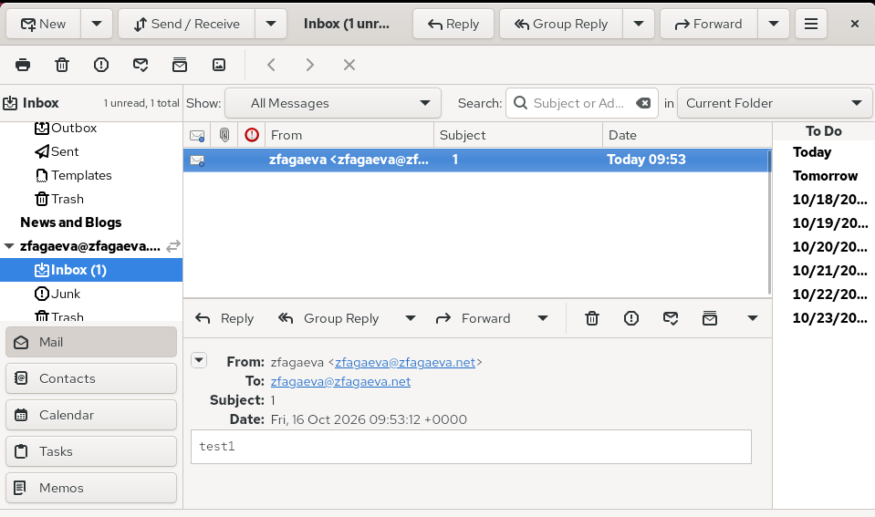{ #fig-008 width=70% }

На виртуальной машине `server` запускаю мониторинг почтового журнала командой `tail -f /var/log/maillog`. В выводе отображаются записи об успешной аутентификации пользователя `zfagaeva` через IMAP и подключении клиента `client.zfagaeva.net` к Postfix. Сообщения `status=sent` и `delivered to maildir` подтверждают успешную доставку письма в почтовый ящик пользователя (см. рис. [@fig-009]).

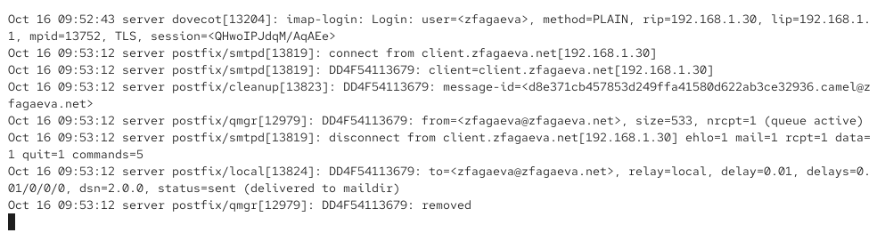{ #fig-009 width=70% }

Для просмотра почты на сервере выполняю команду `MAIL=~/Maildir/ mail`. В почтовом ящике отображаются два тестовых письма с темами `1` и `2` и содержимым `test1` и `test2`. После просмотра выхожу командой `q`. Затем выполняю `sudo doveadm mailbox list -u zfagaeva`, которая выводит почтовый ящик `INBOX` и подтверждает его доступность через Dovecot (см. рис. [@fig-010]).

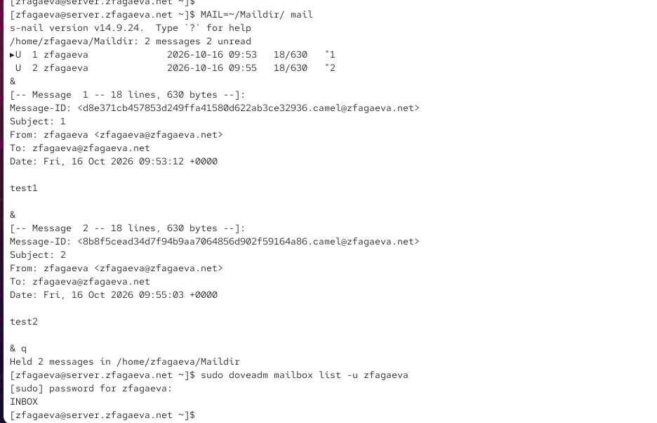{ #fig-010 width=70% }

Для проверки протокола POP3 подключаюсь к серверу командой `telnet mail.zfagaeva.net 110`. Выполняю аутентификацию командами `user zfagaeva` и `pass` с паролем пользователя. Сервер возвращает `+OK Logged in.`, подтверждая успешный вход.

Командой `list` получаю список из двух писем. Затем выполняю `retr 1` для просмотра первого сообщения с текстом `test1`. Командой `dele 2` помечаю второе письмо для удаления, получая ответ `+OK Marked to be deleted.`. Завершаю сеанс командой `quit`. Проверка подтверждает корректную работу POP3-сервера (см. рис. [@fig-011]).

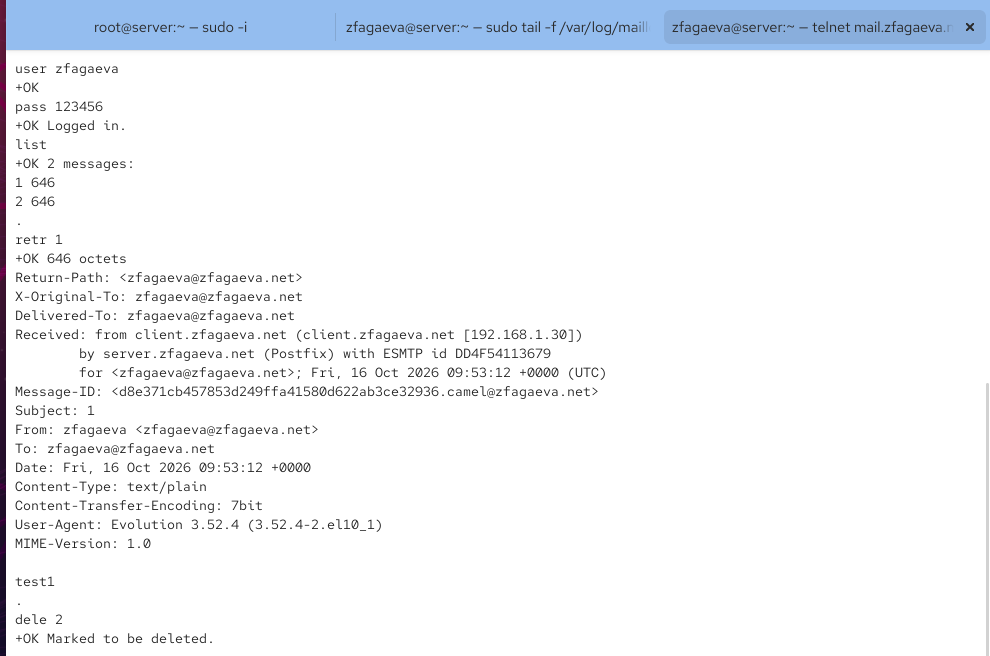{ #fig-011 width=70% }

На виртуальной машине `server` сохраняю конфигурационные файлы Dovecot в каталоге `/vagrant/provision/server/mail/etc/dovecot/` и изменяю скрипт `/vagrant/provision/server/mail.sh`, добавляя установку Dovecot и Telnet, настройку FirewallD, Postfix и запуск почтовых служб (см. рис. [@fig-012]).

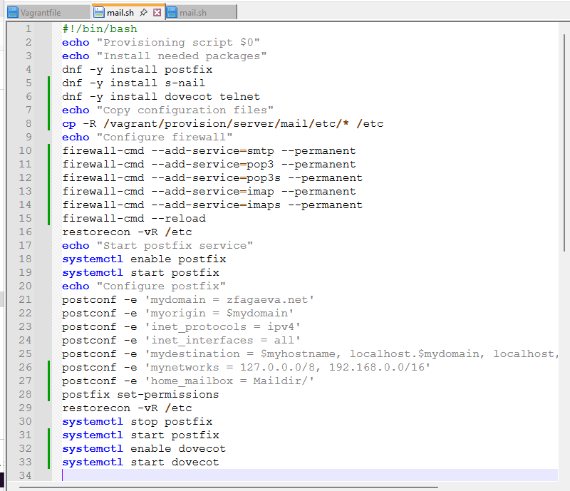{ #fig-012 width=70% }

На виртуальной машине `client` редактирую файл `/vagrant/provision/client/mail.sh`, добавляя команду `dnf -y install evolution` для автоматической установки почтового клиента при настройке виртуальной машины (см. рис. [@fig-013]).

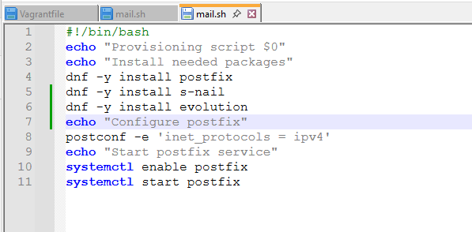{ #fig-013 width=70% }


# Вывод

В ходе лабораторной работы была выполнена установка и настройка почтового сервера Dovecot на виртуальной машине `server`. Установлены пакеты `dovecot` и `telnet`, настроены протоколы IMAP и POP3, а также аутентификация пользователей через PAM.

Для хранения почтовых сообщений настроен формат Maildir в каталоге `~/Maildir`. В конфигурации Postfix задан параметр `home_mailbox = Maildir/`, обеспечивающий доставку почты в соответствующий каталог. В межсетевом экране FirewallD разрешены службы `pop3`, `pop3s`, `imap` и `imaps`.

На виртуальной машине `client` установлен и настроен почтовый клиент Evolution для работы с учётной записью `zfagaeva@zfagaeva.net`. Проверена отправка и получение тестовых писем через SMTP и IMAP. Успешная доставка подтверждена содержимым почтового ящика и записями `status=sent` в журнале `/var/log/maillog`.

Дополнительно проверена работа Dovecot с помощью команд `doveadm`, `mail` и подключения по протоколу POP3 через Telnet. Выполнены просмотр списка сообщений, чтение письма и удаление сообщения.

Для автоматизации установки и настройки почтовых служб внесены изменения в скрипты `mail.sh` для виртуальных машин `server` и `client`.

# Контрольные вопросы

1. За что отвечает протокол SMTP?

SMTP (Simple Mail Transfer Protocol) — протокол, предназначенный для отправки электронной почты и передачи сообщений между почтовыми серверами. Обычно использует порт `25` для межсерверной передачи и порт `587` для отправки почты клиентами.

2. За что отвечает протокол IMAP?

IMAP (Internet Message Access Protocol) — протокол для доступа к электронной почте, хранящейся на сервере. Позволяет просматривать сообщения, управлять папками и синхронизировать состояние почтового ящика между несколькими устройствами. Использует порт `143` или `993` для защищённого соединения.

3. За что отвечает протокол POP3?

POP3 (Post Office Protocol version 3) — протокол для получения электронной почты с сервера. Позволяет загружать письма на локальный компьютер и при необходимости удалять их с сервера. Использует порт `110` или `995` для защищённого соединения.

4. В чём назначение Dovecot?

Dovecot — почтовый сервер, обеспечивающий доступ пользователей к электронной почте по протоколам IMAP и POP3. Он отвечает за аутентификацию пользователей, чтение сообщений и управление почтовыми ящиками. Обычно работает совместно с Postfix, который обеспечивает отправку и доставку почты.

5. В каких файлах обычно находятся настройки работы Dovecot? За что отвечает каждый из файлов?

Основные конфигурационные файлы Dovecot находятся в каталоге `/etc/dovecot/`:

- `/etc/dovecot/dovecot.conf` — основной конфигурационный файл, определяющий общие настройки и используемые протоколы.
- `/etc/dovecot/conf.d/10-auth.conf` — параметры аутентификации пользователей.
- `/etc/dovecot/conf.d/auth-system.conf.ext` — настройка проверки пользователей через PAM и системную базу учётных записей.
- `/etc/dovecot/conf.d/10-mail.conf` — расположение и формат хранения почтовых ящиков.
- `/etc/dovecot/conf.d/10-master.conf` — настройка служб, сокетов и портов Dovecot.
- `/etc/dovecot/conf.d/10-ssl.conf` — параметры SSL/TLS для защиты соединений.

6. В чём назначение Postfix?

Postfix — почтовый сервер, предназначенный для приёма, отправки, маршрутизации и доставки электронной почты по протоколу SMTP. Он обрабатывает сообщения, управляет очередью доставки и передаёт письма локальным пользователям или другим почтовым серверам.

Основная конфигурация находится в файле `/etc/postfix/main.cf`.

7. Какие методы аутентификации пользователей можно использовать в Dovecot и в чём их отличие?

Dovecot поддерживает несколько механизмов аутентификации:

- `PLAIN` — передача имени пользователя и пароля в рамках процедуры аутентификации. Требует защищённого TLS-соединения для предотвращения перехвата данных.
- `LOGIN` — передача имени пользователя и пароля отдельными этапами. Также требует TLS для безопасного использования.
- `CRAM-MD5` — проверка подлинности с использованием механизма запрос-ответ, при котором пароль не передаётся напрямую. Считается устаревшим механизмом.

Для проверки учётных данных Dovecot может использовать PAM, файлы паролей, LDAP и SQL-базы данных. В лабораторной работе используется механизм `PLAIN` с проверкой пароля через PAM.

8. Приведите пример заголовка письма с пояснениями его полей.

Пример заголовка электронного письма:

```
From: zfagaeva@zfagaeva.net
To: zfagaeva@zfagaeva.net
Subject: test1
Date: Fri, 16 Oct 2026 12:00:00 +0300
Message-ID: <12345@zfagaeva.net>
MIME-Version: 1.0
Content-Type: text/plain; charset=UTF-8
```

Назначение основных полей:

- `From` — адрес отправителя.
- `To` — адрес получателя.
- `Subject` — тема письма.
- `Date` — дата и время отправки.
- `Message-ID` — уникальный идентификатор сообщения.
- `MIME-Version` — версия стандарта MIME.
- `Content-Type` — тип содержимого письма и кодировка текста.

9. Приведите примеры использования команд для работы с почтовыми протоколами через терминал (например через telnet).

Для подключения к POP3-серверу используется команда:

`telnet mail.zfagaeva.net 110`

После подключения выполняются команды:

- `user zfagaeva` — указание имени пользователя.
- `pass пароль` — ввод пароля пользователя.
- `list` — получение списка писем.
- `retr 1` — просмотр первого письма.
- `dele 2` — пометка второго письма для удаления.
- `quit` — завершение сеанса с применением удаления.

Для проверки SMTP можно подключиться командой:

`telnet mail.zfagaeva.net 25`

После подключения используются команды:

- `EHLO client.zfagaeva.net` — представление клиента серверу.
- `MAIL FROM:<zfagaeva@zfagaeva.net>` — указание отправителя.
- `RCPT TO:<zfagaeva@zfagaeva.net>` — указание получателя.
- `DATA` — начало передачи содержимого письма.
- `.` — завершение передачи письма отдельной строкой с точкой.
- `QUIT` — завершение соединения.

Telnet не обеспечивает шифрование, поэтому для защищённого подключения и передачи пароля необходимо использовать TLS.

10. Приведите примеры с пояснениями по работе с doveadm.

`doveadm` — утилита командной строки для администрирования и диагностики почтового сервера Dovecot.

Примеры использования:

- `doveadm mailbox list -u zfagaeva` — вывод списка почтовых ящиков пользователя.
- `doveadm mailbox status -u zfagaeva messages INBOX` — получение количества сообщений в папке `INBOX`.
- `doveadm user zfagaeva` — просмотр информации о пользователе, полученной из базы пользователей Dovecot.
- `doveadm auth test zfagaeva` — проверка аутентификации пользователя с вводом пароля.
- `doveadm who` — просмотр активных пользовательских сеансов Dovecot.
- `doveadm search -u zfagaeva mailbox INBOX ALL` — поиск всех сообщений в папке `INBOX`.

Эти команды позволяют проверять доступность почтовых ящиков, состояние сообщений, аутентификацию пользователей и работу почтового сервера.

# Список литературы

1. [Dovecot. Официальная документация почтового сервера](https://doc.dovecot.org/2.3/)

2. [Dovecot. Руководство по базовой настройке и конфигурации](https://doc.dovecot.org/2.3/configuration_manual/basic_configuration/)

3. [Dovecot. Настройка механизмов аутентификации пользователей](https://doc.dovecot.org/2.3/configuration_manual/authentication/authentication_mechanisms/)

4. [Dovecot. Аутентификация системных пользователей с помощью PAM](https://doc.dovecot.org/2.3/configuration_manual/authentication/pam/)

5. [Dovecot. Администрирование почтовых ящиков с помощью doveadm](https://doc.dovecot.org/2.3/admin_manual/doveadm_mailbox_commands/)

6. [Postfix. Настройка параметров почтового сервера и хранения сообщений в Maildir](https://www.postfix.org/postconf.5.html)

7. [GNOME Evolution. Настройка почтовой учётной записи и протокола IMAP](https://help.gnome.org/evolution/mail-account-manage-imap-plus.html)

8. [GNOME Evolution. Настройка отправки электронной почты по протоколу SMTP](https://help.gnome.org/evolution/mail-sending-options-smtp.html)

9. [FirewallD. Настройка межсетевого экрана и разрешение сетевых служб](https://firewalld.org/documentation/howto/open-a-port-or-service)

10. [HashiCorp Vagrant. Автоматизация установки и настройки программного обеспечения с помощью Shell Provisioner](https://developer.hashicorp.com/vagrant/docs/provisioning/shell)
