---
## Author
author:
  name: Агаева Зейнаб Фуад кызы
  email: 1032245473@rudn.ru
  affiliation:
    - name: Российский университет дружбы народов
      country: Российская Федерация
      postal-code: 117198
      city: Москва
      address: ул. Миклухо-Маклая, д. 6

## Title
title: Лабораторная работа №10
subtitle: Расширенные настройки SMTP-сервера
license: CC BY
date: today
date-format: "YYYY-MM-DD"
---

# Цели и задачи работы

## Цель лабораторной работы

Получить практические навыки расширенной настройки почтового сервера `Postfix` и `Dovecot`, организации доставки электронной почты по протоколу `LMTP`, настройки SMTP-аутентификации с использованием `SASL`, обеспечения защищённой передачи сообщений через `TLS`, проверки работы почтовых служб и автоматизации настроек средствами `Vagrant`.

# Процесс выполнения лабораторной работы

## Добавляю протокол LMTP в конфигурацию Dovecot

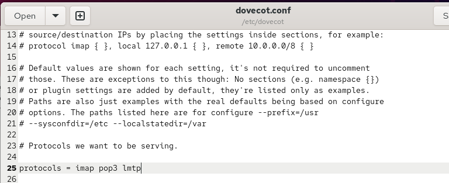{ #fig:001 width=70% height=70% }

## Настраиваю службу LMTP и Unix-сокет для Postfix

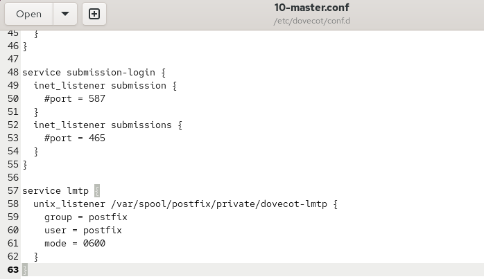{ #fig:002 width=70% height=70% }

## Настраиваю формат имени пользователя в Dovecot

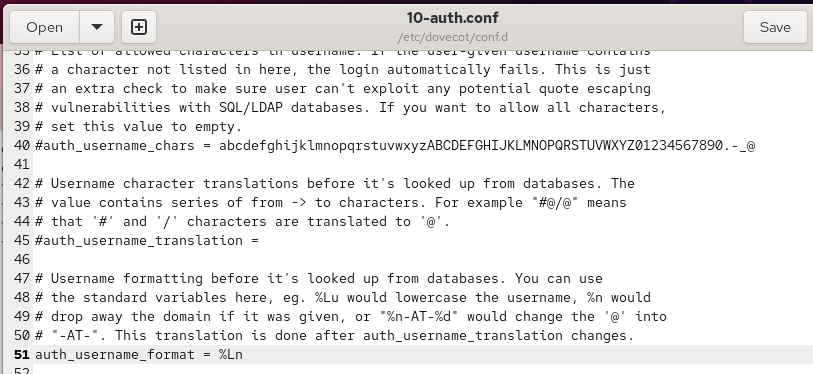{ #fig:003 width=70% height=70% }

## Настраиваю передачу почты через LMTP и перезапускаю службы

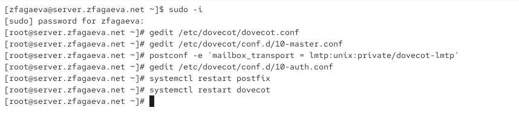{ #fig:004 width=70% height=70% }

## Отправляю тестовое письмо для проверки LMTP

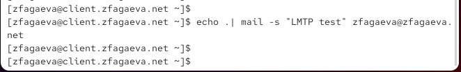{ #fig:005 width=70% height=70% }

## Проверяю доставку сообщения в журнале почтового сервера

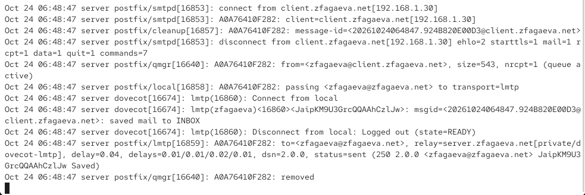{ #fig:006 width=70% height=70% }

## Проверяю получение тестового письма в почтовом ящике

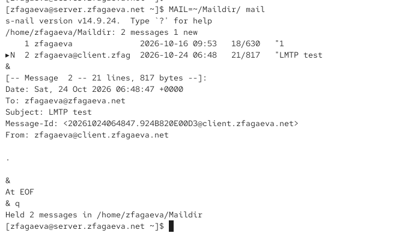{ #fig:007 width=70% height=70% }

## Настраиваю службу SASL-аутентификации Dovecot

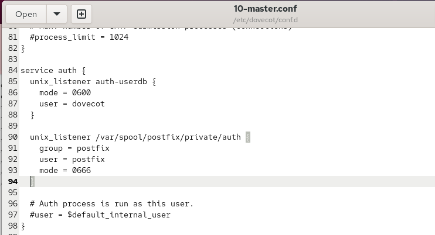{ #fig:008 width=70% height=70% }

## Настраиваю SMTP-аутентификацию в файле master.cf

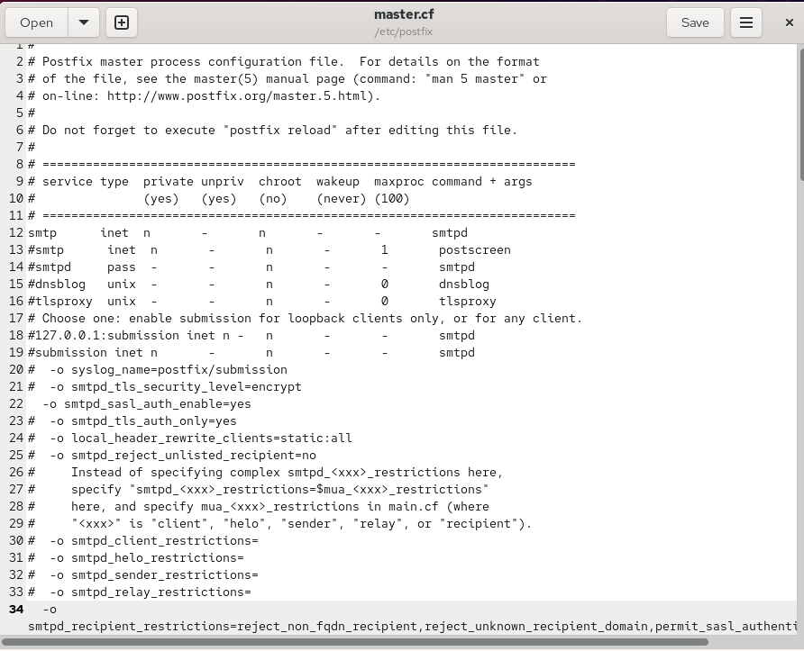{ #fig:009 width=70% height=70% }

## Настраиваю SASL и ограничения пересылки почты в Postfix

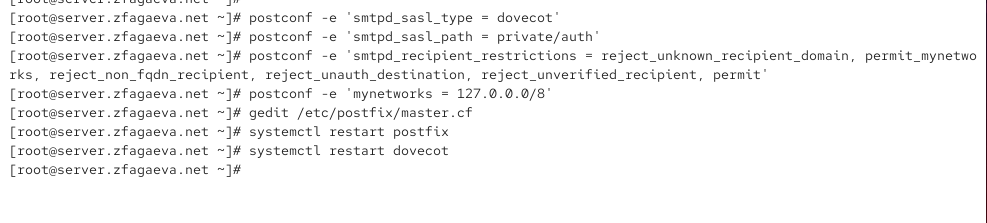{ #fig:010 width=70% height=70% }

## Проверяю SMTP-аутентификацию через Telnet

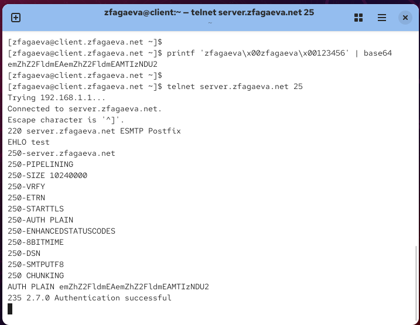{ #fig:011 width=70% height=70% }

## Настраиваю сертификат и параметры TLS в Postfix

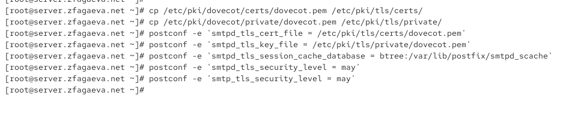{ #fig:012 width=70% height=70% }

## Настраиваю службу SMTP Submission на порту 587

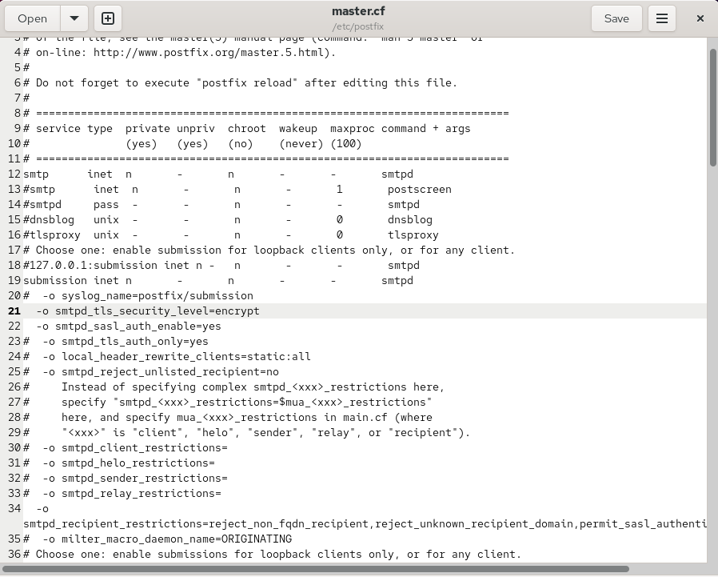{ #fig:013 width=70% height=70% }

## Разрешаю SMTP Submission в FirewallD и перезапускаю Postfix

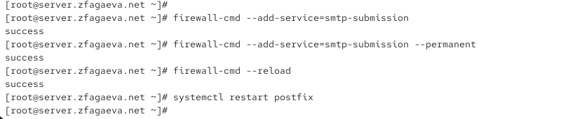{ #fig:014 width=70% height=70% }

## Проверяю защищённое SMTP-соединение через OpenSSL

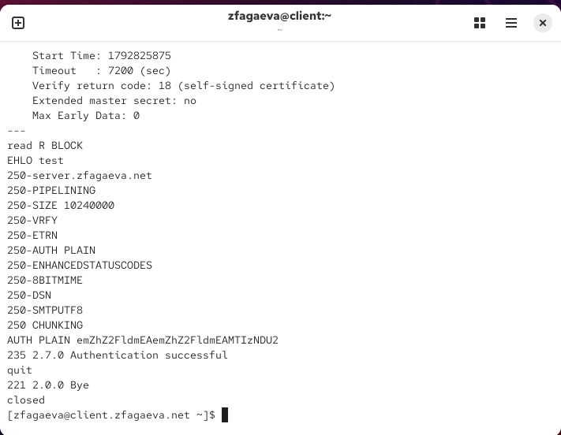{ #fig:015 width=70% height=70% }

## Настраиваю SMTP с STARTTLS в почтовом клиенте Evolution

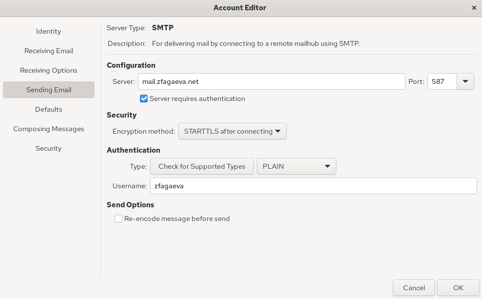{ #fig:016 width=70% height=70% }

## Проверяю отправку и получение тестовых писем в Evolution

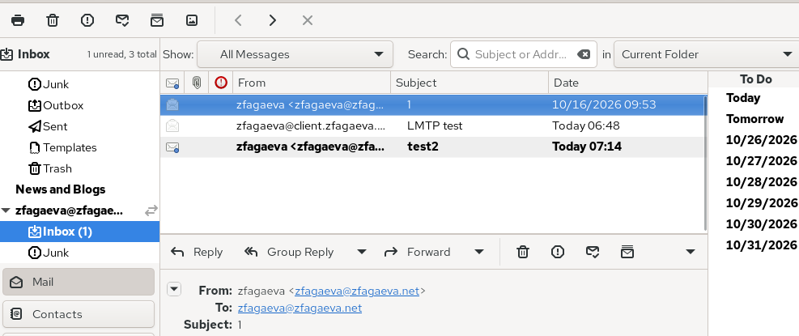{ #fig:017 width=70% height=70% }

## Проверяю доставку сообщений через STARTTLS в журнале Postfix

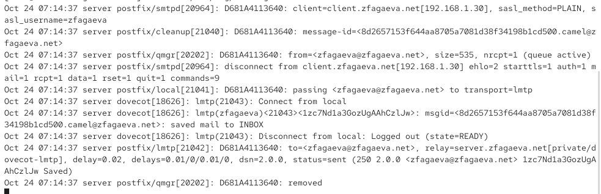{ #fig:018 width=70% height=70% }

## Изменяю скрипт автоматической настройки почтового сервера

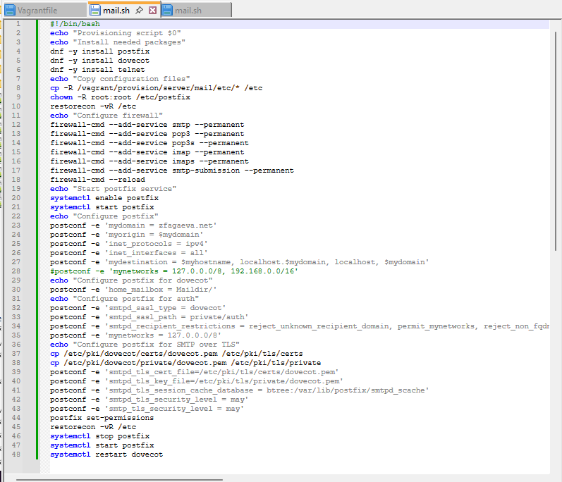{ #fig:019 width=70% height=70% }

## Изменяю скрипт автоматической настройки почтового клиента

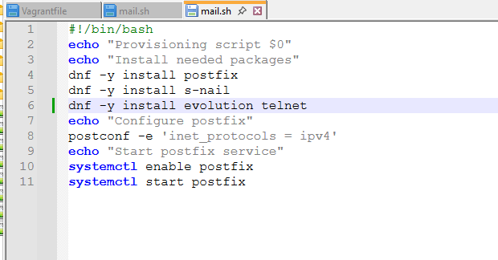{ #fig:020 width=70% height=70% }

# Выводы по проделанной работе

## Вывод

В ходе лабораторной работы была выполнена расширенная настройка почтового сервера `Postfix` и `Dovecot` на виртуальной машине `server`. Настроена доставка электронной почты по протоколу `LMTP` через Unix-сокет `/var/spool/postfix/private/dovecot-lmtp`. Успешная доставка тестового письма подтверждена содержимым почтового ящика и журналом `/var/log/maillog`.

Для SMTP-сервера настроена аутентификация пользователей через `SASL` с использованием Dovecot. Установлены ограничения на приём и пересылку сообщений для предотвращения несанкционированного использования сервера в качестве открытого Relay-сервера. Работа аутентификации проверена через `Telnet` на порту `25`.

Настроено шифрование SMTP-соединений с использованием `TLS` и сертификата Dovecot. Для защищённой отправки почты настроена служба `SMTP Submission` на порту `587`, а в межсетевом экране `FirewallD` разрешена служба `smtp-submission`. Работа защищённого соединения и SASL-аутентификации проверена с помощью `OpenSSL`.

На виртуальной машине `client` настроен почтовый клиент `Evolution` для отправки сообщений через `SMTP` с использованием `STARTTLS` и аутентификации `PLAIN`. Успешная отправка и получение тестовых писем подтверждены содержимым почтового ящика и записями в журнале почтового сервера.
