---
## Author
author:
  name: Агаева Зейнаб Фуад кызы
  email: 1032245473@rudn.ru
  affiliation:
    - name: Российский университет дружбы народов
      country: Российская Федерация
      postal-code: 117198
      city: Москва
      address: ул. Миклухо-Маклая, д. 6

## Title
title: "Отчёт по лабораторной работе №10"
subtitle: "Расширенные настройки SMTP-сервера"
license: "CC BY"
---

# Цель работы

Приобретение практических навыков по конфигурированию SMTP-сервера в части настройки аутентификации.

# Выполнение лабораторной работы

## Настройка LMTP в Dovecot

На виртуальной машине `server` перехожу в режим суперпользователя командой `sudo -i`. Открываю конфигурационный файл `/etc/dovecot/dovecot.conf` и изменяю параметр `protocols = imap pop3 lmtp`. Добавление протокола LMTP позволяет Dovecot принимать почтовые сообщения от Postfix для последующей доставки в почтовые ящики пользователей (см. рис. [@fig-001]).

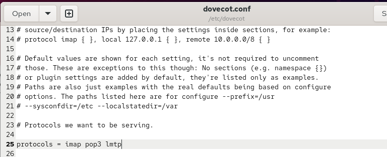{ #fig-001 width=70% }

В файле `/etc/dovecot/conf.d/10-master.conf` настраиваю службу `lmtp`, указывая путь к Unix-сокету `/var/spool/postfix/private/dovecot-lmtp`. Для сокета задаю параметры `group = postfix`, `user = postfix` и `mode = 0600`. Эти настройки определяют владельца сокета, его группу и права доступа, обеспечивая взаимодействие Postfix с Dovecot при доставке сообщений (см. рис. [@fig-002]).

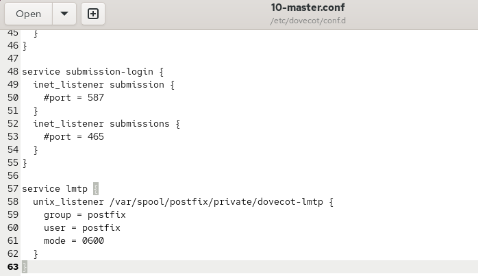{ #fig-002 width=70% }

Открываю конфигурационный файл `/etc/dovecot/conf.d/10-auth.conf` и устанавливаю параметр `auth_username_format = %Ln`. Эта настройка преобразует имя пользователя к нижнему регистру и удаляет доменную часть адреса, позволяя использовать системный логин при аутентификации (см. рис. [@fig-003]).

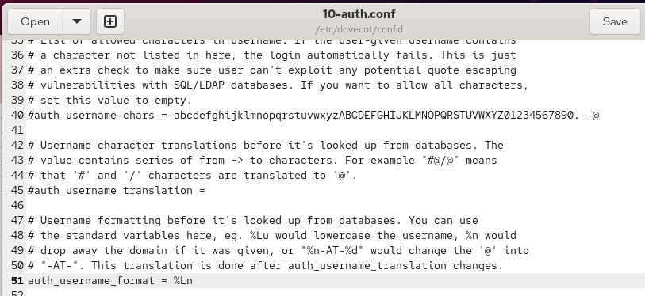{ #fig-003 width=70% }

В терминале сервера выполняю команду `postconf -e 'mailbox_transport = lmtp:unix:private/dovecot-lmtp'`, которая перенаправляет доставку почтовых сообщений из Postfix в Dovecot через настроенный Unix-сокет. После внесения изменений перезапускаю службы командами `systemctl restart postfix` и `systemctl restart dovecot`. Команды выполняются без сообщений об ошибках (см. рис. [@fig-004]).

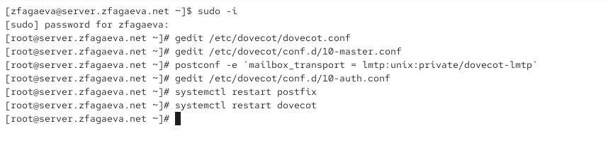{ #fig-004 width=70% }

На виртуальной машине `client` из-под учётной записи пользователя отправляю тестовое письмо командой `echo . | mail -s "LMTP test" zfagaeva@zfagaeva.net`. В качестве темы сообщения указываю `LMTP test`. Команда завершается без вывода ошибок, после чего проверяю доставку сообщения на сервере (см. рис. [@fig-005]).

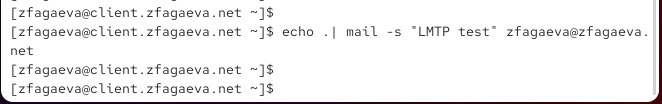{ #fig-005 width=70% }

На сервере просматриваю журнал почтовой службы `/var/log/maillog` с помощью команды `tail -f /var/log/maillog`. В журнале отображается подключение клиента `client.zfagaeva.net` к Postfix, приём письма и передача сообщения в Dovecot по протоколу LMTP. Запись `saved mail to INBOX` подтверждает сохранение письма во входящем почтовом ящике, а ответ `250 2.0.0` указывает на успешную доставку. Сообщение `removed` свидетельствует об удалении обработанного письма из очереди Postfix (см. рис. [@fig-006]).

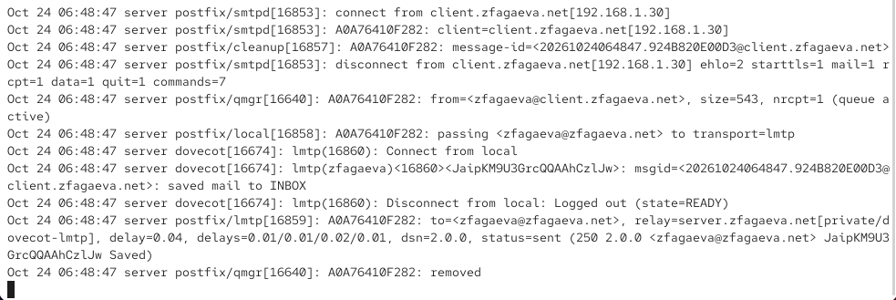{ #fig-006 width=70% }

На виртуальной машине `server` под учётной записью пользователя выполняю команду `MAIL=~/Maildir/ mail` для просмотра содержимого почтового ящика в формате Maildir. В списке сообщений нахожу письмо с темой `LMTP test`, открываю его и проверяю заголовки отправителя и получателя. Наличие сообщения во входящем ящике подтверждает корректную работу доставки почты через LMTP (см. рис. [@fig-007]).

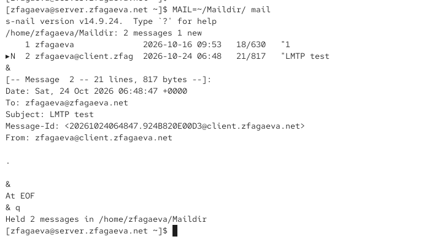{ #fig-007 width=70% }

## Настройка SMTP-аутентификации

В конфигурационном файле `/etc/dovecot/conf.d/10-master.conf` настраиваю службу `auth`, отвечающую за аутентификацию пользователей. Для сокета `auth-userdb` устанавливаю параметр `mode = 0600`, ограничивающий доступ владельцем, и `user = dovecot`, определяющий владельца сокета. Для взаимодействия с Postfix создаю сокет `/var/spool/postfix/private/auth`, задаю `group = postfix` и `user = postfix`. На скриншоте для него указано `mode = 0666`, разрешающее чтение и запись всем пользователям системы. Для ограничения доступа в соответствии с заданием рекомендуется использовать `mode = 0660`, разрешающее доступ только владельцу и группе (см. рис. [@fig-008]).

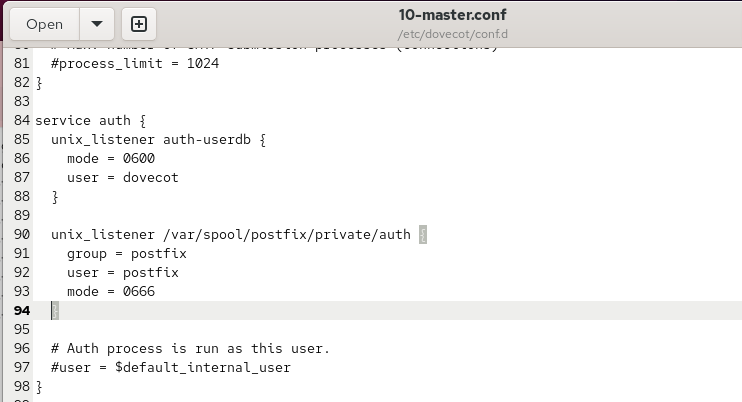{ #fig-008 width=70% }

Открываю конфигурационный файл `/etc/postfix/master.cf` и редактирую параметры службы `smtp`, работающей на порту 25. Добавляю настройки SMTP-аутентификации и ограничений получателей с использованием параметров `smtpd_sasl_auth_enable=yes` и `smtpd_recipient_restrictions`. Для авторизованных пользователей предусматриваю разрешение отправки почты через `permit_sasl_authenticated`, а для остальных подключений устанавливаю ограничения. Это необходимо для проверки SASL-аутентификации и предотвращения несанкционированной пересылки сообщений (см. рис. [@fig-009]).

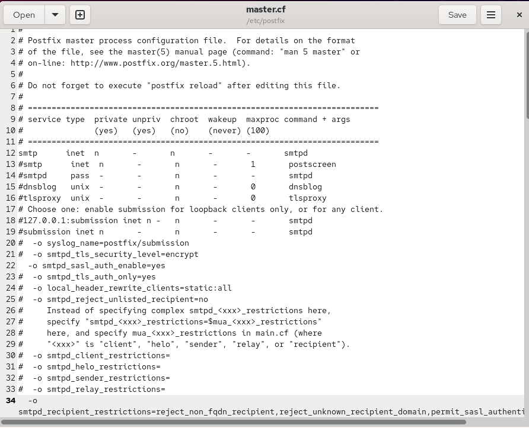{ #fig-009 width=70% }

В терминале сервера выполняю команды `postconf -e 'smtpd_sasl_type = dovecot'` и `postconf -e 'smtpd_sasl_path = private/auth'`. Первая команда указывает Dovecot в качестве механизма SASL-аутентификации, вторая задаёт путь к Unix-сокету, через который Postfix обращается к службе аутентификации.

Затем настраиваю параметр `smtpd_recipient_restrictions`, последовательно указывая `reject_unknown_recipient_domain`, `permit_mynetworks`, `reject_non_fqdn_recipient`, `reject_unauth_destination`, `reject_unverified_recipient` и `permit`. Параметр `reject_unknown_recipient_domain` отклоняет письма с неизвестным доменом получателя, `permit_mynetworks` разрешает подключения из доверенных сетей, `reject_non_fqdn_recipient` запрещает адреса получателей без полного доменного имени, `reject_unauth_destination` предотвращает несанкционированную ретрансляцию почты, `reject_unverified_recipient` отклоняет непроверенных получателей, а `permit` разрешает обработку сообщений, прошедших предыдущие проверки.

Командой `postconf -e 'mynetworks = 127.0.0.0/8'` ограничиваю список доверенных сетей локальным интерфейсом сервера. После изменения конфигурации перезапускаю службы командами `systemctl restart postfix` и `systemctl restart dovecot` (см. рис. [@fig-010]).

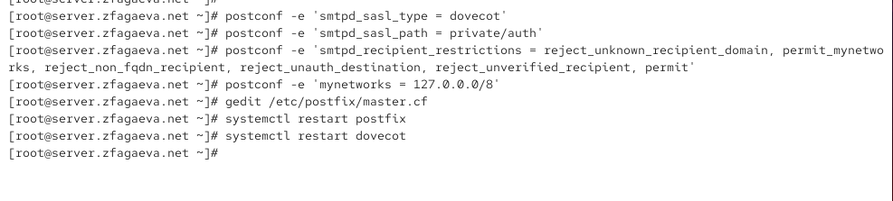{ #fig-010 width=70% }

На виртуальной машине `client` формирую строку аутентификации в формате Base64 с помощью команды `printf 'username\x00username\x00password' | base64`, подставляя логин и пароль пользователя. Затем подключаюсь к SMTP-серверу командой `telnet server.zfagaeva.net 25`. После установления соединения отправляю команду `EHLO test` и получаю список возможностей SMTP-сервера, включая `AUTH PLAIN` и `STARTTLS`. Для проверки аутентификации ввожу `AUTH PLAIN` с полученной строкой Base64. Сервер возвращает ответ `235 2.7.0 Authentication successful`, подтверждающий успешную аутентификацию пользователя через SASL (см. рис. [@fig-011]).

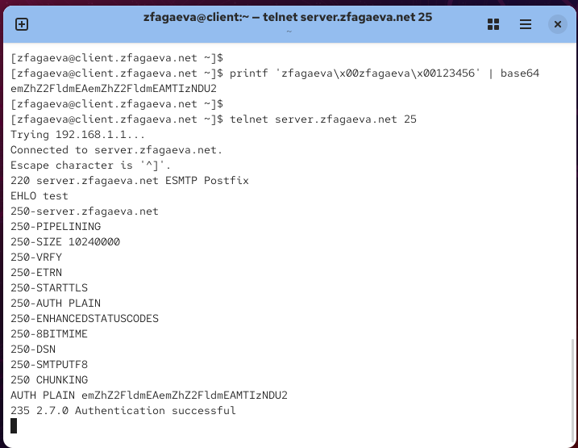{ #fig-011 width=70% }

## Настройка SMTP over TLS

На виртуальной машине `server` настраиваю шифрование SMTP-соединений с использованием временного сертификата Dovecot. Копирую сертификат командой `cp /etc/pki/dovecot/certs/dovecot.pem /etc/pki/tls/certs/` и закрытый ключ командой `cp /etc/pki/dovecot/private/dovecot.pem /etc/pki/tls/private/`. Размещение файлов в стандартных каталогах TLS позволяет избежать проблем с политиками SELinux.

Затем с помощью `postconf` задаю параметры `smtpd_tls_cert_file = /etc/pki/tls/certs/dovecot.pem` и `smtpd_tls_key_file = /etc/pki/tls/private/dovecot.pem`, определяющие пути к сертификату и закрытому ключу. Параметр `smtpd_tls_session_cache_database = btree:/var/lib/postfix/smtpd_scache` задаёт хранилище кэша TLS-сессий. Устанавливаю `smtpd_tls_security_level = may` и `smtp_tls_security_level = may`, разрешая использование TLS при входящих и исходящих SMTP-соединениях при наличии поддержки шифрования (см. рис. [@fig-012]).

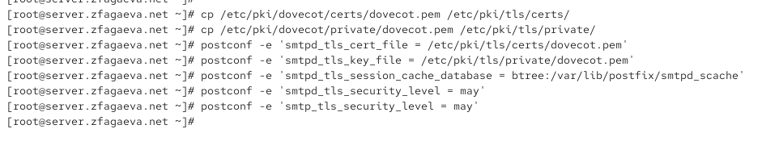{ #fig-012 width=70% }

Открываю файл `/etc/postfix/master.cf` и настраиваю службу `submission` для приёма почтовых сообщений на порту 587. Включаю соответствующую запись `submission inet n - n - - smtpd` и устанавливаю параметры `smtpd_tls_security_level=encrypt` и `smtpd_sasl_auth_enable=yes`. Первый параметр требует использования TLS для передачи данных, второй разрешает SASL-аутентификацию пользователей. Дополнительно задаю ограничения получателей через `smtpd_recipient_restrictions`, разрешая отправку сообщений авторизованным пользователям (см. рис. [@fig-013]).

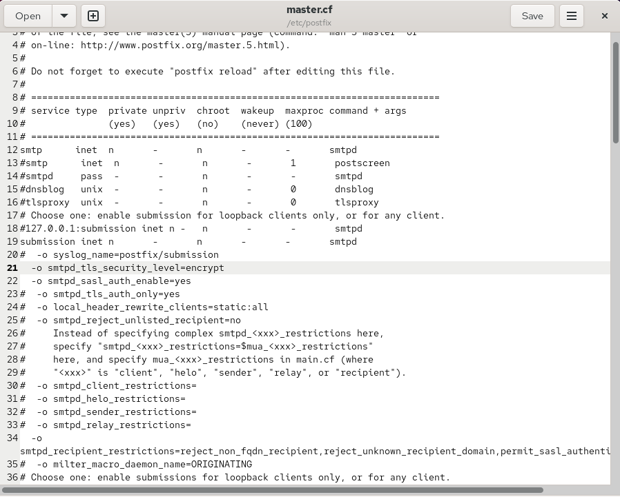{ #fig-013 width=70% }

Для разрешения подключений к SMTP Submission настраиваю межсетевой экран. Выполняю команду `firewall-cmd --add-service=smtp-submission`, разрешающую службу в текущей конфигурации, затем `firewall-cmd --add-service=smtp-submission --permanent` для сохранения правила после перезагрузки. Применяю изменения командой `firewall-cmd --reload`. После настройки межсетевого экрана перезапускаю Postfix командой `systemctl restart postfix`. Все команды завершаются сообщением `success` либо без вывода ошибок (см. рис. [@fig-014]).

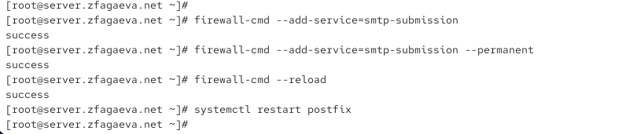{ #fig-014 width=70% }

На виртуальной машине `client` проверяю защищённое подключение к SMTP-серверу с помощью команды `openssl s_client -starttls smtp -crlf -connect server.zfagaeva.net:587`. После установления TLS-соединения выполняю `EHLO test` и получаю список поддерживаемых возможностей сервера. Затем отправляю команду `AUTH PLAIN` с предварительно подготовленной строкой аутентификации. Ответ `235 2.7.0 Authentication successful` подтверждает успешную авторизацию пользователя. При проверке сертификата отображается `Verify return code: 18 (self-signed certificate)`, поскольку для лабораторной работы используется самоподписанный сертификат. Соединение и аутентификация при этом выполняются успешно (см. рис. [@fig-015]).

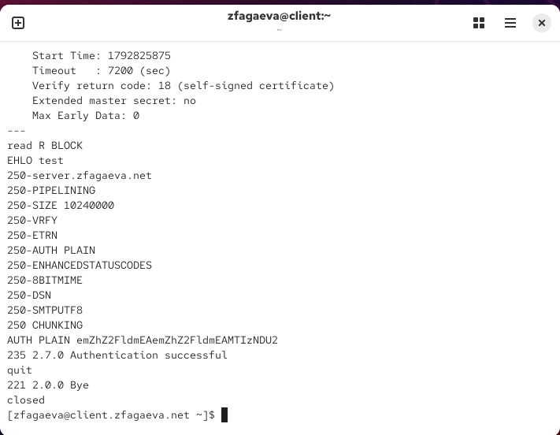{ #fig-015 width=70% }

Для проверки отправки почты через графический клиент открываю настройки учётной записи в Evolution. В разделе `Sending Email` выбираю SMTP-сервер `mail.zfagaeva.net` и указываю порт `587`. Активирую параметр `Server requires authentication`, устанавливаю метод шифрования `STARTTLS after connecting` и тип аутентификации `PLAIN`, соответствующий использованию обычного пароля. В качестве имени пользователя указываю `zfagaeva`. Эти параметры позволяют Evolution отправлять сообщения через защищённое соединение с обязательной аутентификацией (см. рис. [@fig-016]).

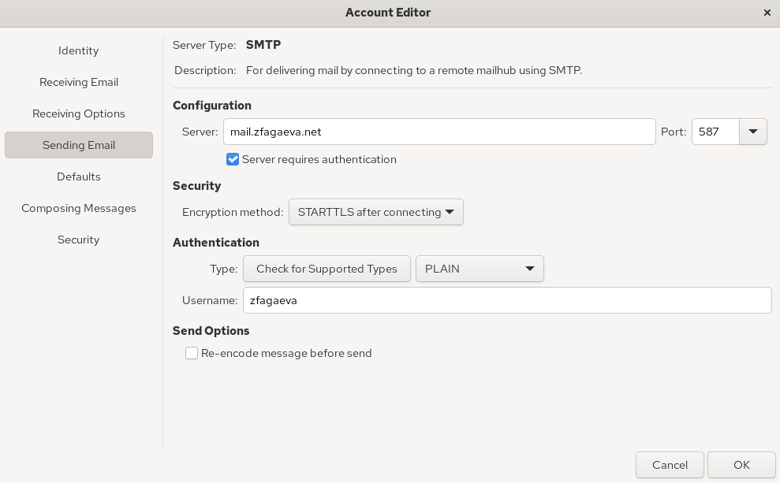{ #fig-016 width=70% }

В почтовом клиенте Evolution проверяю работу настроенной учётной записи, отправляя тестовое сообщение. В списке входящих писем отображаются ранее полученное сообщение `LMTP test` и новое письмо с темой `test2`. Наличие тестовых сообщений подтверждает работоспособность отправки и получения почты после настройки SMTP Submission и TLS (см. рис. [@fig-017]).

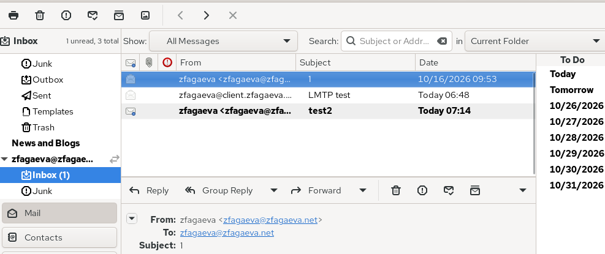{ #fig-017 width=70% }

На виртуальной машине `server` повторно просматриваю журнал `/var/log/maillog` для анализа обработки сообщения, отправленного через Evolution. В журнале отображается подключение клиента к Postfix с использованием аутентификации `sasl_method=PLAIN` и учётной записи `sasl_username=zfagaeva`. Запись `starttls=1` подтверждает использование STARTTLS. Далее Postfix передаёт сообщение службе Dovecot через LMTP, после чего появляется запись `saved mail to INBOX`. Статус `250 2.0.0` указывает на успешную доставку письма, а запись `removed` подтверждает удаление обработанного сообщения из очереди Postfix (см. рис. [@fig-018]).

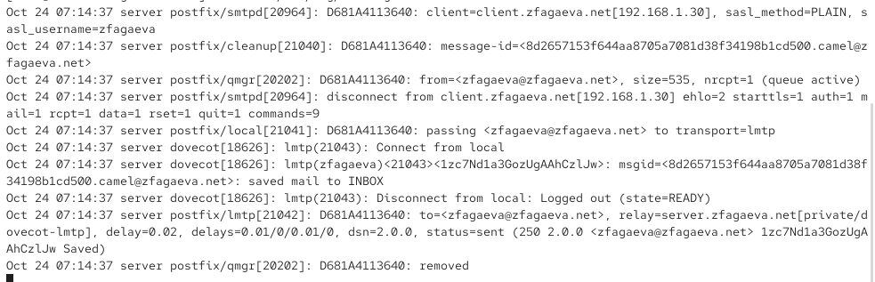{ #fig-018 width=70% }

## Внесение изменений в настройки внутреннего окружения виртуальной машины

На виртуальной машине `server` сохраняю конфигурационные файлы Dovecot и Postfix в каталоге `/vagrant/provision/server/mail/etc/` и редактирую скрипт `/vagrant/provision/server/mail.sh`, добавляя команды установки пакетов, настройки SMTP-аутентификации, TLS, межсетевого экрана и запуска почтовых служб (см. рис. [@fig-019]).

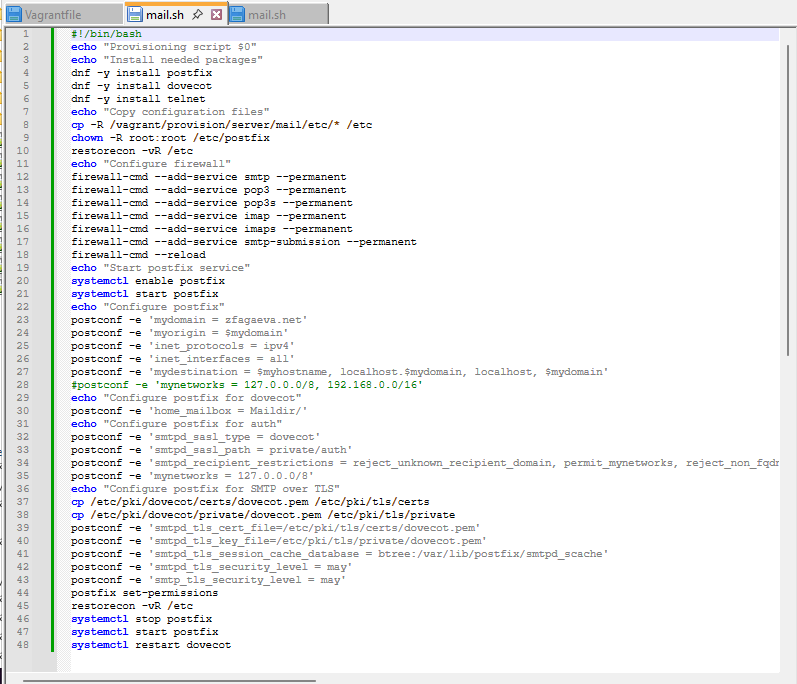{ #fig-019 width=70% }

На виртуальной машине `client` изменяю скрипт `/vagrant/provision/client/mail.sh`, добавляя установку `evolution` и `telnet` для работы с электронной почтой и проверки SMTP-соединений (см. рис. [@fig-020]).

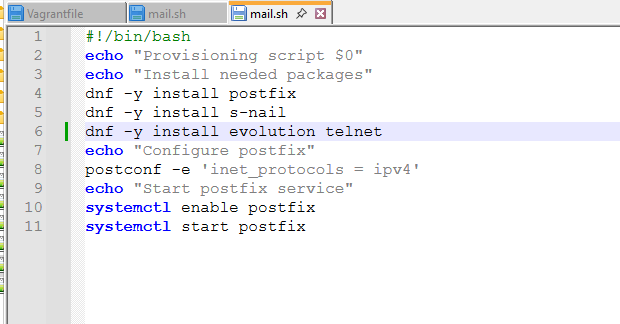{ #fig-020 width=70% }

# Вывод

В ходе лабораторной работы была выполнена расширенная настройка почтового сервера на виртуальной машине `server`. В Dovecot добавлена поддержка протокола LMTP для передачи почтовых сообщений от Postfix в почтовые ящики пользователей. Настроен Unix-сокет `/var/spool/postfix/private/dovecot-lmtp`, обеспечивающий взаимодействие почтовых служб.

Для SMTP-сервера Postfix настроена аутентификация пользователей через SASL с использованием Dovecot. Установлены ограничения на приём и пересылку почтовых сообщений, предотвращающие несанкционированное использование сервера в качестве открытого Relay-сервера. Успешная аутентификация проверена через Telnet на порту `25`.

Настроено шифрование SMTP-соединений с использованием TLS и сертификата Dovecot. Для отправки почты через защищённое соединение настроена служба SMTP Submission на порту `587`, а в межсетевом экране FirewallD разрешена служба `smtp-submission`. Работа STARTTLS и SASL-аутентификации проверена с помощью OpenSSL.

На виртуальной машине `client` настроен почтовый клиент Evolution для отправки сообщений через SMTP с использованием STARTTLS. Успешная доставка тестовых писем подтверждена содержимым почтового ящика и записями в журнале `/var/log/maillog`.

Для автоматизации расширенной настройки почтового сервера внесены изменения в скрипты `mail.sh` для виртуальных машин `server` и `client`.

# Контрольные вопросы

1. Приведите пример задания формата аутентификации пользователя в Dovecot в форме логина с указанием домена.

В конфигурационном файле `/etc/dovecot/conf.d/10-auth.conf` необходимо указать параметр `auth_username_format = %Lu`. Данная настройка сохраняет полное имя пользователя вместе с доменом и преобразует его в нижний регистр, например `user@user.net`.

2. Какие функции выполняет почтовый Relay-сервер?

Relay-сервер — промежуточный почтовый сервер, предназначенный для приёма и пересылки электронных сообщений между почтовыми серверами. Он обеспечивает маршрутизацию почты к получателям, передачу сообщений другим SMTP-серверам, временное хранение писем в очереди при недоступности получателя и повторные попытки доставки.

3. Какие угрозы безопасности могут возникнуть в случае настройки почтового сервера как Relay-сервера?

При неправильной настройке почтовый сервер может превратиться в открытый Relay-сервер (Open Relay), позволяющий неавторизованным пользователям пересылать сообщения через него. Это создаёт угрозы массовой рассылки спама, фишинговых писем и вредоносных вложений. Дополнительно возможны перегрузка сервера, расход сетевых ресурсов, попадание IP-адреса в чёрные списки и блокировка исходящей почты другими почтовыми системами. Для защиты необходимо использовать SMTP-аутентификацию SASL и ограничения пересылки сообщений в Postfix.

# Список литературы

1. [Dovecot. Настройка взаимодействия Postfix и Dovecot по протоколу LMTP](https://doc.dovecot.org/2.3/configuration_manual/howto/postfix_dovecot_lmtp/)

2. [Dovecot. Настройка SASL-аутентификации Postfix через Dovecot](https://doc.dovecot.org/2.3/configuration_manual/howto/postfix_and_dovecot_sasl/)

3. [Postfix. Руководство по настройке SMTP-аутентификации SASL](https://www.postfix.org/SASL_README.html)

4. [Postfix. Настройка TLS-шифрования и защищённого SMTP-соединения](https://www.postfix.org/TLS_README.html)

5. [Postfix. Управление пересылкой почты и ограничение доступа к SMTP Relay](https://www.postfix.org/SMTPD_ACCESS_README.html)

6. [Postfix. Справочник параметров конфигурации почтового сервера](https://www.postfix.org/postconf.5.html)