---
## Author
author:
  name: Агаева Зейнаб Фуад кызы
  email: 1032245473@rudn.ru
  affiliation:
    - name: Российский университет дружбы народов
      country: Российская Федерация
      postal-code: 117198
      city: Москва
      address: ул. Миклухо-Маклая, д. 6

## Title
title: Лабораторная работа №11
subtitle: Настройка безопасного удалённого доступа по протоколу SSH
license: CC BY
date: today
date-format: "YYYY-MM-DD"
---

# Цели и задачи работы

## Цель лабораторной работы

Получить практические навыки настройки безопасного удалённого доступа к серверу по протоколу `SSH`, ограничения доступа пользователей, настройки дополнительных TCP-портов, организации аутентификации по SSH-ключам, создания SSH-туннелей, удалённого выполнения консольных и графических приложений, а также автоматизации конфигурации SSH-сервера средствами `Vagrant`.

# Процесс выполнения лабораторной работы

## Проверяю удалённое подключение к серверу от имени root

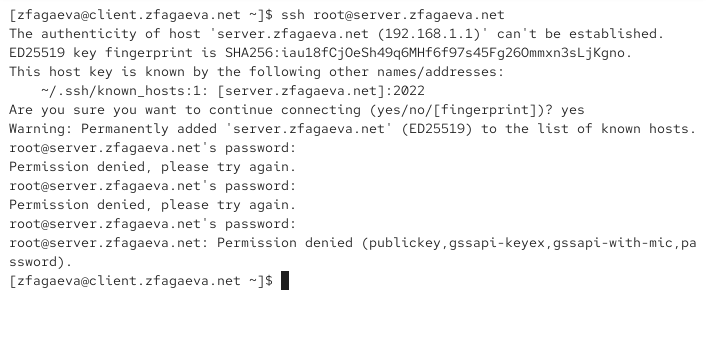{ #fig:001 width=70% height=70% }

## Запрещаю удалённый доступ пользователю root

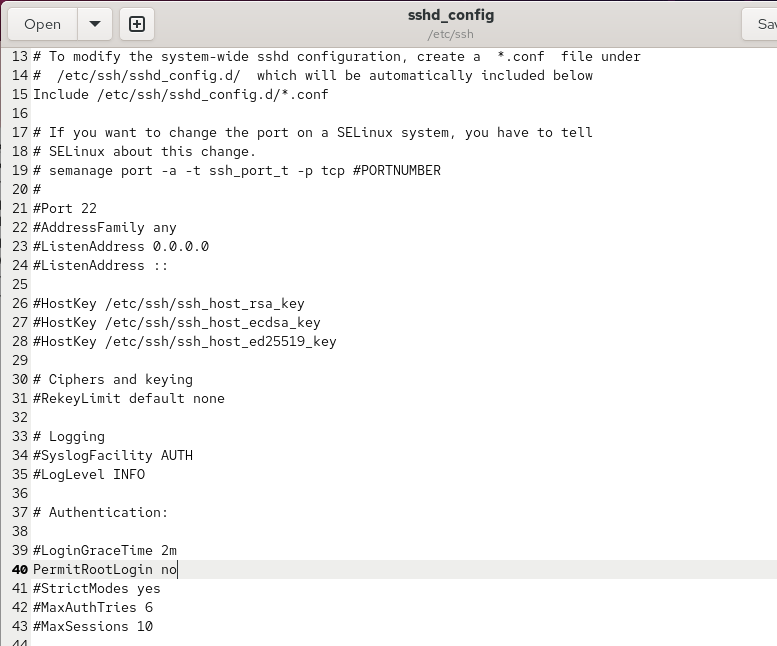{ #fig:002 width=70% height=70% }

## Проверяю запрет SSH-подключения пользователю root

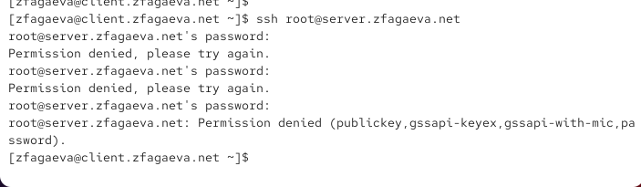{ #fig:003 width=70% height=70% }

## Проверяю подключение к серверу под пользователем zfagaeva

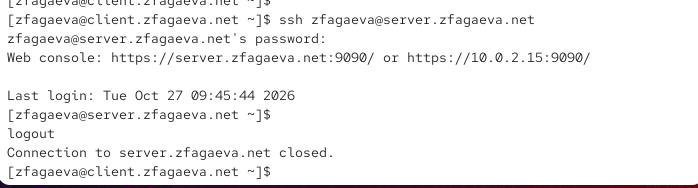{ #fig:004 width=70% height=70% }

## Ограничиваю SSH-доступ только пользователем vagrant

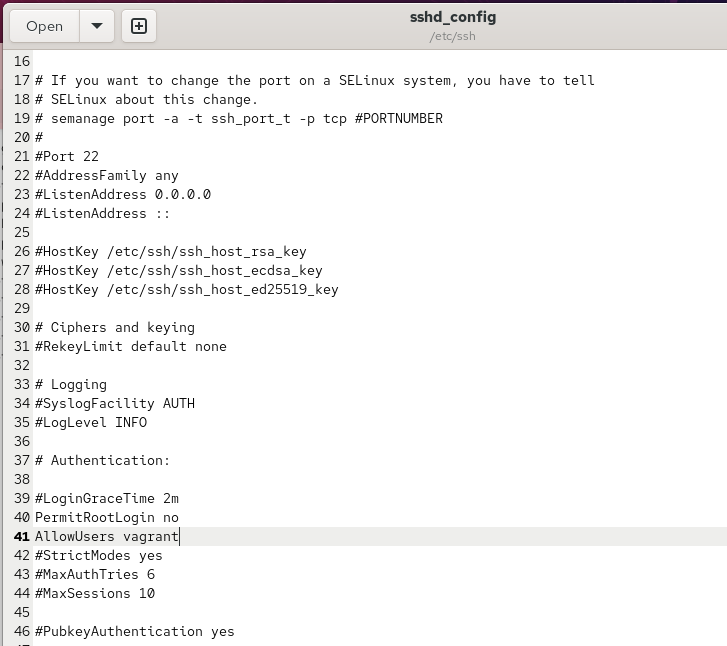{ #fig:005 width=70% height=70% }

## Проверяю отказ в подключении пользователю zfagaeva

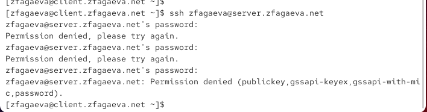{ #fig:006 width=70% height=70% }

## Разрешаю SSH-доступ пользователям vagrant и zfagaeva

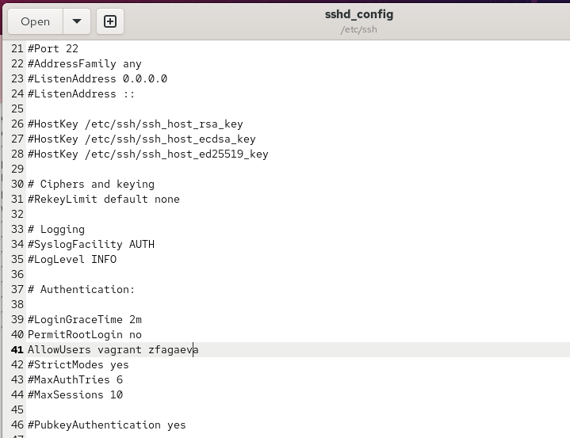{ #fig:007 width=70% height=70% }

## Проверяю подключение после изменения AllowUsers

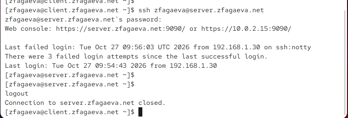{ #fig:008 width=70% height=70% }

## Настраиваю дополнительные порты SSH 22 и 2022

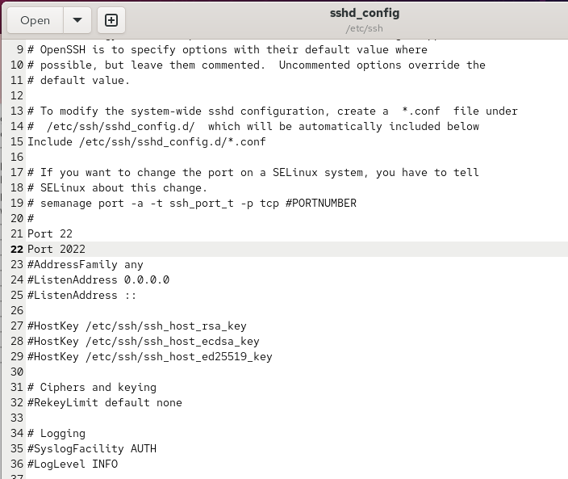{ #fig:009 width=70% height=70% }

## Проверяю состояние sshd и обнаруживаю ошибку доступа к порту 2022

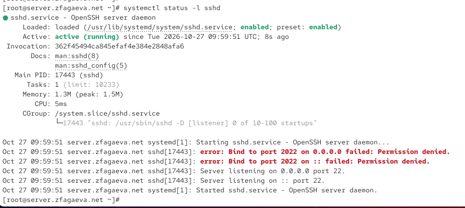{ #fig:010 width=70% height=70% }

## Анализирую сообщения SELinux о блокировке порта 2022

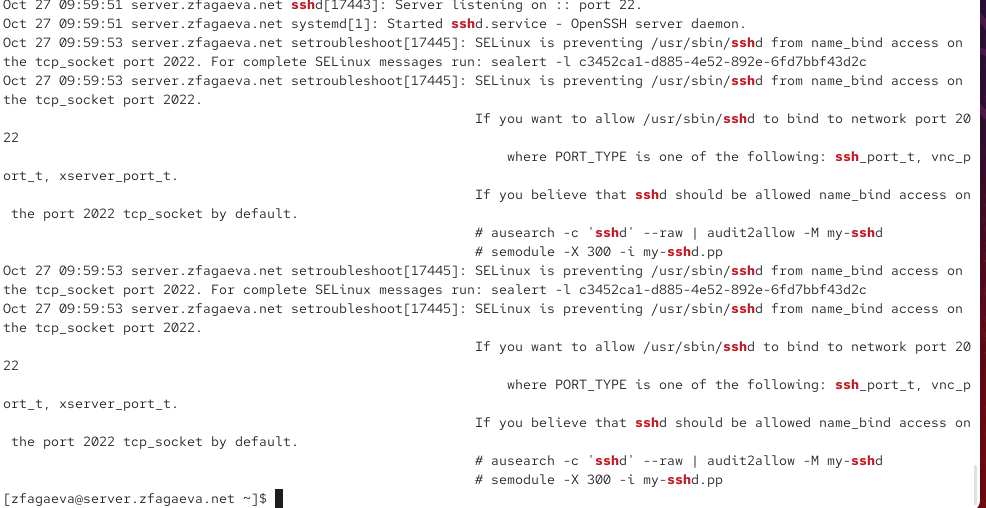{ #fig:011 width=70% height=70% }

## Настраиваю SELinux и FirewallD для порта 2022

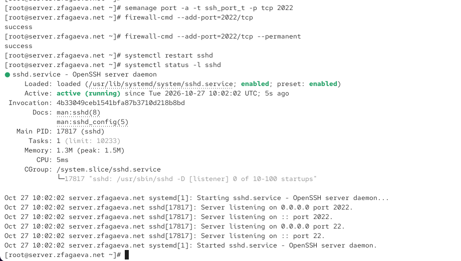{ #fig:012 width=70% height=70% }

## Проверяю SSH-подключения через порты 22 и 2022

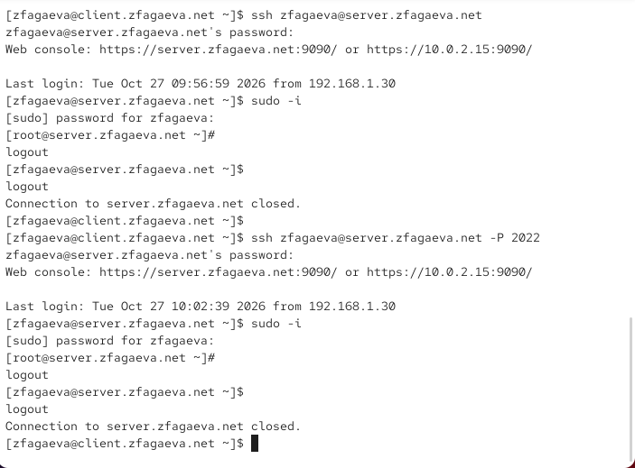{ #fig:013 width=70% height=70% }

## Разрешаю аутентификацию пользователей по SSH-ключу

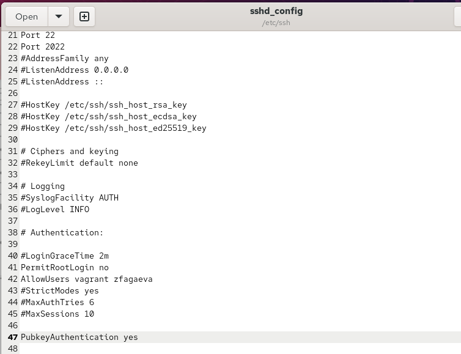{ #fig:014 width=70% height=70% }

## Копирую открытый SSH-ключ и проверяю подключение без пароля

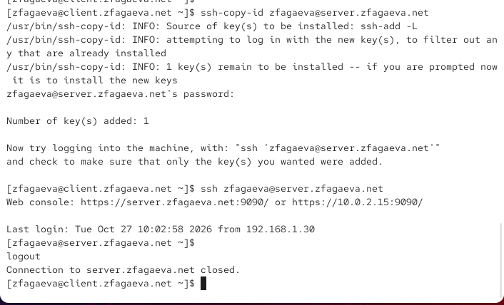{ #fig:015 width=70% height=70% }

## Создаю SSH-туннель с перенаправлением TCP-портов

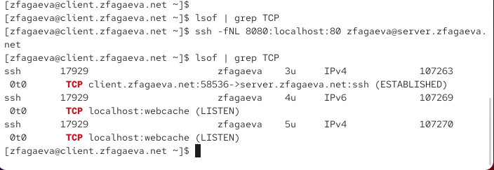{ #fig:016 width=70% height=70% }

## Проверяю работу SSH-туннеля через веб-браузер

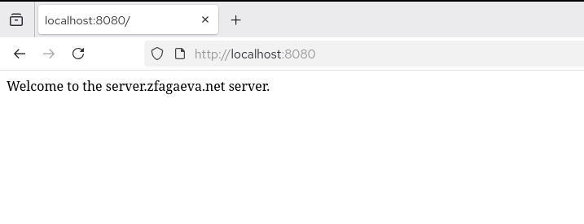{ #fig:017 width=70% height=70% }

## Выполняю консольные команды на сервере через SSH

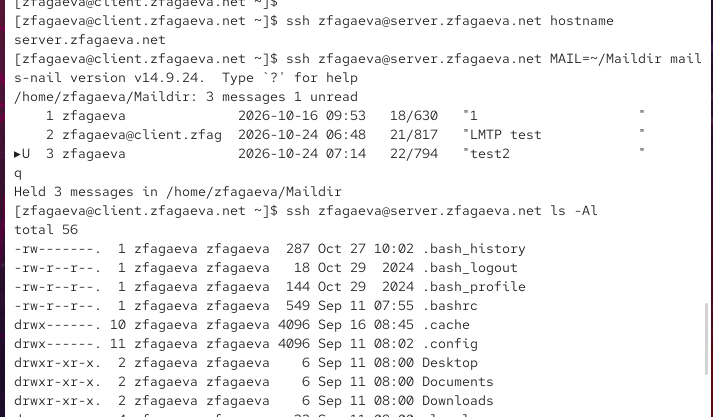{ #fig:018 width=70% height=70% }

## Разрешаю перенаправление графических приложений X11

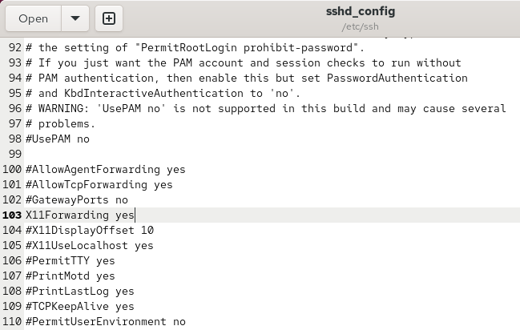{ #fig:019 width=70% height=70% }

## Проверяю удалённый запуск Firefox через SSH

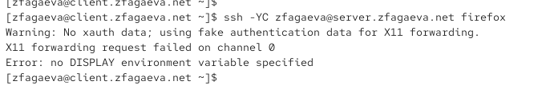{ #fig:020 width=70% height=70% }

## Создаю скрипт автоматической настройки SSH-сервера

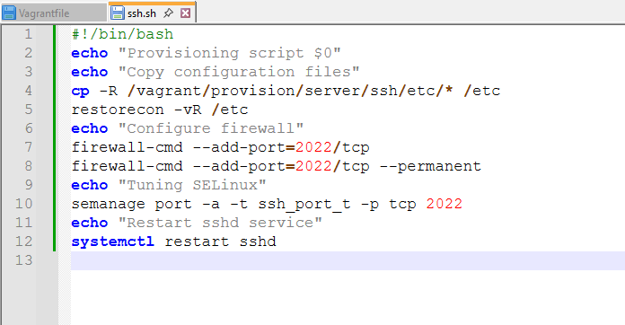{ #fig:021 width=70% height=70% }

# Выводы по проделанной работе

## Вывод

В ходе лабораторной работы была выполнена настройка безопасного удалённого доступа к виртуальной машине `server` по протоколу `SSH`. В конфигурационном файле `/etc/ssh/sshd_config` запрещён удалённый вход пользователю `root` с помощью параметра `PermitRootLogin no`. Доступ к серверу ограничен учётными записями `vagrant` и `zfagaeva` с использованием директивы `AllowUsers`.

Настроена работа SSH-сервера через стандартный порт `22` и дополнительный порт `2022`. Для использования дополнительного порта внесены изменения в настройки `SELinux` и межсетевого экрана `FirewallD`. Работоспособность обоих портов подтверждена успешными SSH-подключениями с виртуальной машины `client`.

Настроена аутентификация по SSH-ключу с использованием параметра `PubkeyAuthentication yes`. Открытый ключ скопирован на сервер с помощью команды `ssh-copy-id`, после чего выполнено подключение без ввода пароля пользователя. Также организован SSH-туннель с перенаправлением локального порта `8080` на порт `80` сервера. Работа туннеля проверена открытием приветственной страницы веб-сервера в браузере клиента.
