---
## Author
author:
  name: Агаева Зейнаб Фуад кызы
  email: 1032245473@rudn.ru
  affiliation:
    - name: Российский университет дружбы народов
      country: Российская Федерация
      postal-code: 117198
      city: Москва
      address: ул. Миклухо-Маклая, д. 6

## Title
title: "Отчёт по лабораторной работе №11"
subtitle: "Настройка безопасного удалённого доступа по протоколу SSH"
license: "CC BY"
---

# Цель работы

Приобретение практических навыков по настройке удалённого доступа к серверу с помощью SSH.

# Выполнение лабораторной работы

## Запрет удалённого доступа по SSH для пользователя root

На виртуальной машине `client` под учётной записью пользователя `zfagaeva` проверяю возможность удалённого подключения к серверу от имени суперпользователя. Для этого выполняю команду `ssh root@server.zfagaeva.net`. При первом подключении SSH запрашивает подтверждение подлинности удалённого узла, после чего добавляет его открытый ключ в файл известных хостов. Подтверждаю подключение вводом `yes`. Далее система запрашивает пароль пользователя `root`, однако после нескольких попыток аутентификации выводится сообщение `Permission denied (publickey,gssapi-keyex,gssapi-with-mic,password)`. Это означает, что получить доступ к серверу от имени `root` не удалось (см. рис. [@fig-001]).

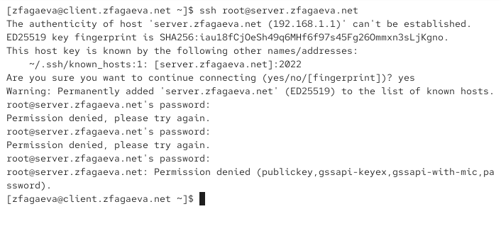{ #fig-001 width=70% }

На виртуальной машине `server` открываю конфигурационный файл SSH-сервера `/etc/ssh/sshd_config` и устанавливаю параметр `PermitRootLogin no`. Этот параметр запрещает удалённый вход непосредственно под учётной записью суперпользователя независимо от правильности введённого пароля. Ограничение позволяет повысить безопасность сервера, поскольку для административного доступа необходимо сначала подключиться под обычным пользователем, а затем получить необходимые привилегии. После изменения конфигурации перезапускаю службу командой `systemctl restart sshd` (см. рис. [@fig-002]).

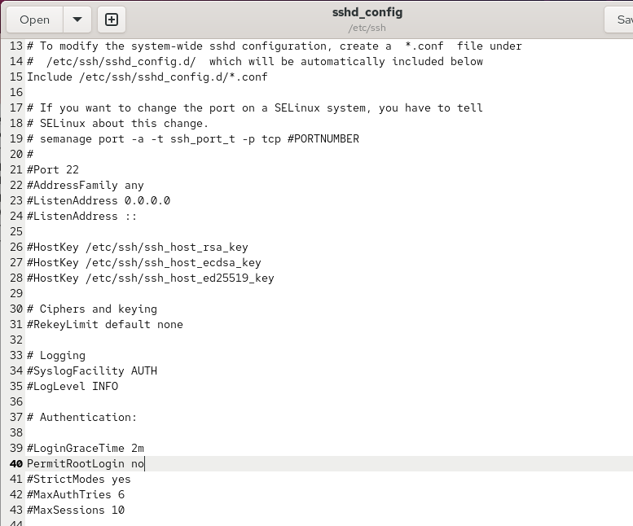{ #fig-002 width=70% }

На виртуальной машине `client` повторно выполняю команду `ssh root@server.zfagaeva.net` для проверки установленного ограничения. SSH-сервер запрашивает пароль пользователя `root`, однако после нескольких попыток возвращает сообщение `Permission denied`. Подключение не устанавливается, и терминал возвращается к командной строке локального пользователя. Это подтверждает, что непосредственный удалённый вход на сервер под учётной записью `root` запрещён (см. рис. [@fig-003]).

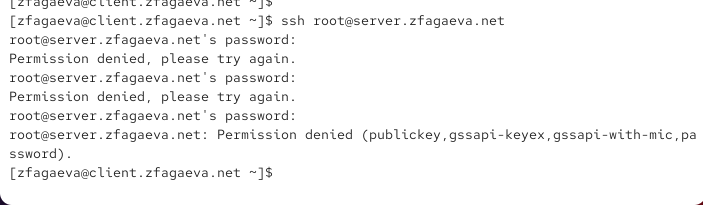{ #fig-003 width=70% }

## Ограничение списка пользователей для удалённого доступа по SSH

На виртуальной машине `client` проверяю возможность подключения к серверу под обычной учётной записью `zfagaeva`. Выполняю команду `ssh zfagaeva@server.zfagaeva.net` и ввожу пароль пользователя. После успешной аутентификации открывается удалённая командная оболочка на узле `server.zfagaeva.net`. В терминале отображается информация о сервере и приглашение командной строки пользователя. Для завершения сеанса выполняю команду `logout`, после чего соединение закрывается. Успешное подключение подтверждает, что обычному пользователю разрешён удалённый доступ по SSH (см. рис. [@fig-004]).

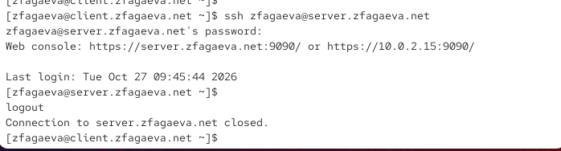{ #fig-004 width=70% }

На сервере открываю конфигурационный файл `/etc/ssh/sshd_config` и добавляю параметр `AllowUsers vagrant`. Директива `AllowUsers` определяет список учётных записей, которым разрешено подключаться к серверу по SSH. В данном случае доступ предоставляется только пользователю `vagrant`, а остальные пользователи, включая `zfagaeva`, исключаются из списка разрешённых. При этом сохраняю ранее установленный параметр `PermitRootLogin no`, запрещающий удалённый вход суперпользователя. После сохранения конфигурации перезапускаю службу `sshd` (см. рис. [@fig-005]).

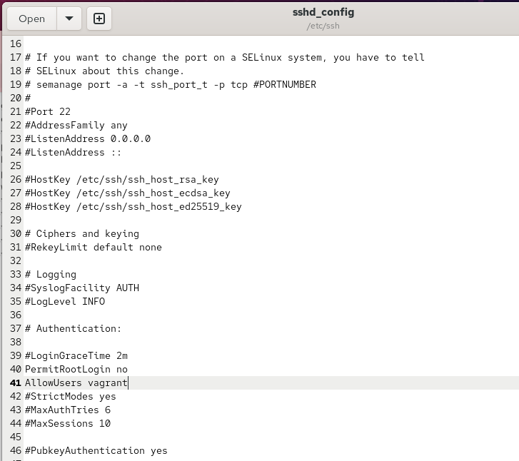{ #fig-005 width=70% }

На клиенте повторно пытаюсь подключиться к серверу командой `ssh zfagaeva@server.zfagaeva.net`. Несмотря на ввод пароля пользователя `zfagaeva`, сервер отклоняет попытки аутентификации и выводит сообщение `Permission denied`. Причиной отказа является директива `AllowUsers vagrant`, которая запрещает SSH-подключения для учётных записей, отсутствующих в списке разрешённых. Полученный результат подтверждает корректную работу ограничения доступа на уровне конфигурации SSH-сервера (см. рис. [@fig-006]).

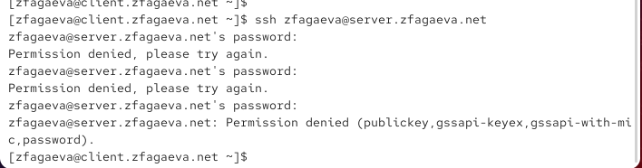{ #fig-006 width=70% }

На сервере повторно открываю файл `/etc/ssh/sshd_config` и изменяю параметр на `AllowUsers vagrant zfagaeva`. Теперь удалённый доступ по SSH разрешается двум учётным записям: `vagrant` и `zfagaeva`. Все остальные пользователи не смогут пройти аутентификацию через SSH, если для них не предусмотрены дополнительные разрешения. Параметр `PermitRootLogin no` оставляю без изменений. После сохранения файла перезапускаю SSH-сервер командой `systemctl restart sshd` для применения новых настроек (см. рис. [@fig-007]).

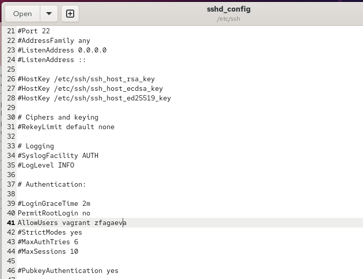{ #fig-007 width=70% }

На виртуальной машине `client` снова выполняю команду `ssh zfagaeva@server.zfagaeva.net`. После ввода пароля соединение успешно устанавливается, и открывается удалённая оболочка пользователя `zfagaeva`. В терминале также отображается информация о предыдущих неудачных попытках входа. Это объясняется тем, что ранее пользователь отсутствовал в списке `AllowUsers`. Завершаю соединение командой `logout`. Успешная авторизация подтверждает, что добавление пользователя `zfagaeva` в список разрешённых восстановило для него возможность удалённого доступа (см. рис. [@fig-008]).

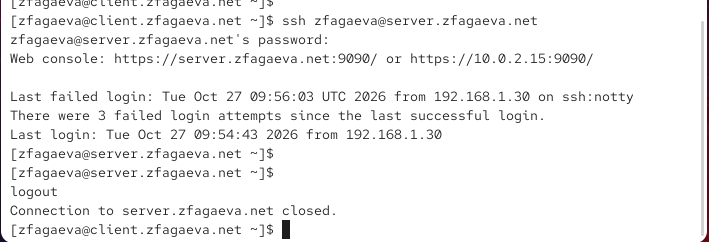{ #fig-008 width=70% }

## Настройка дополнительных портов для удалённого доступа по SSH

На сервере открываю конфигурационный файл `/etc/ssh/sshd_config` и в разделе сетевых настроек добавляю параметры `Port 22` и `Port 2022`. Порт `22` является стандартным портом службы SSH, а порт `2022` добавляется в качестве дополнительного. Использование двух портов позволяет сохранить возможность подключения к серверу через стандартный порт во время настройки дополнительного соединения. После внесения изменений перезапускаю службу `sshd` командой `systemctl restart sshd` (см. рис. [@fig-009]).

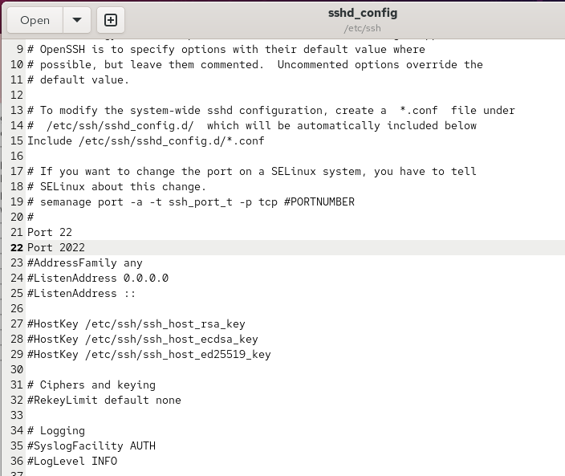{ #fig-009 width=70% }

На сервере выполняю команду `systemctl status -l sshd` для просмотра расширенного состояния службы SSH. В выводе отображается состояние `active (running)`, свидетельствующее о работе процесса `sshd`. Однако в журнале присутствуют сообщения `Bind to port 2022 on 0.0.0.0 failed: Permission denied` и `Bind to port 2022 on :: failed: Permission denied`. Это означает, что SSH-сервер не смог открыть дополнительный порт `2022` из-за ограничений безопасности системы. При этом сообщения `Server listening on 0.0.0.0 port 22` и `Server listening on :: port 22` подтверждают, что сервер продолжает принимать подключения через стандартный порт `22` (см. рис. [@fig-010]).

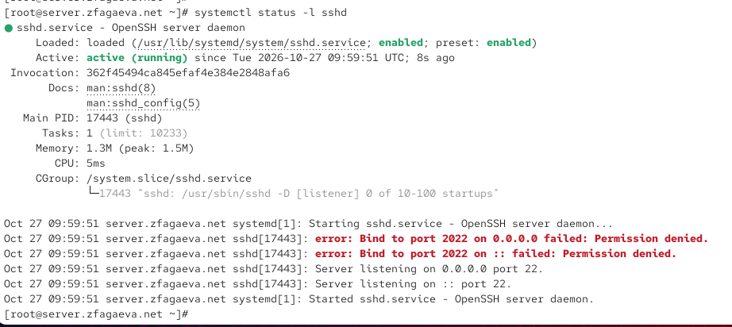{ #fig-010 width=70% }

Дополнительно анализирую системные сообщения, связанные с работой SELinux. В журнале отображаются предупреждения `SELinux is preventing /usr/sbin/sshd from name_bind access on the tcp_socket port 2022`. Они указывают, что политика SELinux запрещает процессу `sshd` привязку к TCP-порту `2022`. В сообщениях также приводится рекомендация зарегистрировать дополнительный порт с контекстом безопасности `ssh_port_t`. Следовательно, для корректной работы SSH через новый порт необходимо изменить правила SELinux, разрешив службе `sshd` его использование (см. рис. [@fig-011]).

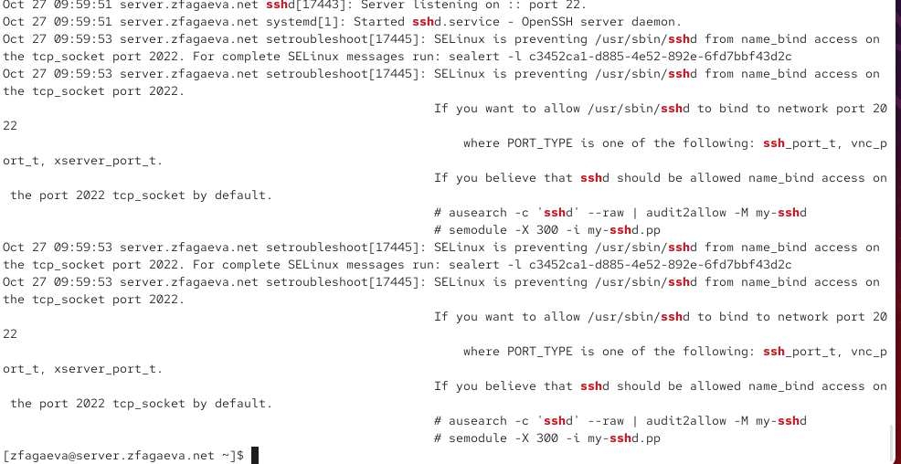{ #fig-011 width=70% }

Для устранения ограничения SELinux на сервере выполняю команду `semanage port -a -t ssh_port_t -p tcp 2022`. Она добавляет TCP-порт `2022` в список портов, разрешённых для службы SSH политикой SELinux. Далее открываю порт в межсетевом экране командой `firewall-cmd --add-port=2022/tcp`, а для сохранения настройки после перезагрузки выполняю `firewall-cmd --add-port=2022/tcp --permanent`. Обе команды возвращают `success`, подтверждая применение правил межсетевого экрана. После этого перезапускаю службу командой `systemctl restart sshd` и проверяю её состояние с помощью `systemctl status -l sshd`. В журнале появляются сообщения `Server listening on 0.0.0.0 port 2022`, `Server listening on :: port 2022`, а также аналогичные записи для порта `22`. Состояние `active (running)` подтверждает успешный запуск SSH-сервера с поддержкой обоих портов (см. рис. [@fig-012]).

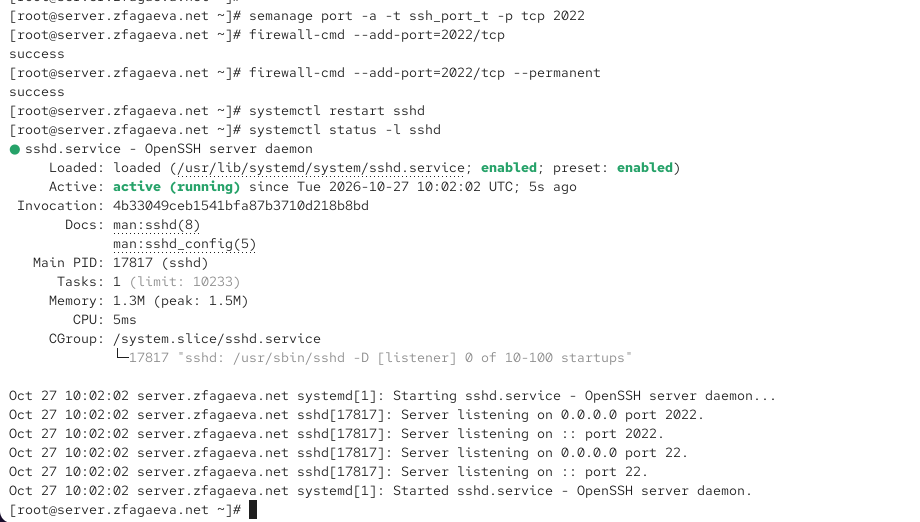{ #fig-012 width=70% }

На виртуальной машине `client` проверяю доступность сервера через оба настроенных порта. Сначала выполняю команду `ssh zfagaeva@server.zfagaeva.net`, которая устанавливает соединение через стандартный порт `22`. После успешного входа выполняю `sudo -i` для получения привилегий суперпользователя и убеждаюсь, что административные команды можно выполнять из удалённого сеанса. Последовательно выхожу из оболочки `root` и пользовательской оболочки командами `logout`. Затем повторяю подключение с указанием дополнительного порта командой `ssh zfagaeva@server.zfagaeva.net -p 2022`. Соединение также успешно устанавливается, после чего проверяю возможность перехода в режим `root` командой `sudo -i`. Завершаю сеанс двумя командами `logout`. Успешные подключения подтверждают, что SSH-сервер принимает соединения через порты `22` и `2022` (см. рис. [@fig-013]).

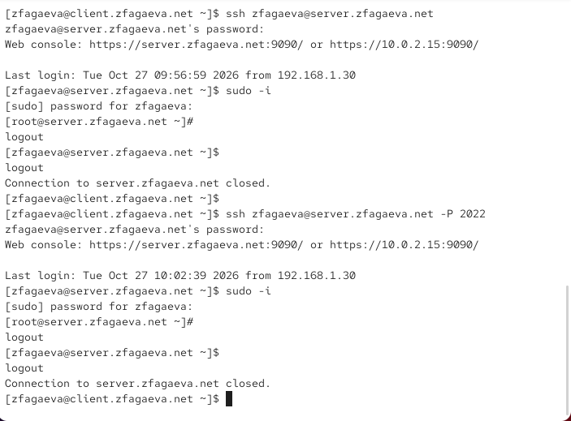{ #fig-013 width=70% }

## Настройка удалённого доступа по SSH по ключу

На виртуальной машине `server` открываю конфигурационный файл `/etc/ssh/sshd_config` и устанавливаю параметр `PubkeyAuthentication yes`. Эта настройка разрешает использование асимметричной криптографии для аутентификации пользователей при подключении по SSH. При аутентификации по ключу сервер проверяет, что клиент владеет закрытым ключом, соответствующим открытому ключу, зарегистрированному для удалённой учётной записи. После сохранения изменений перезапускаю службу SSH командой `systemctl restart sshd` (см. рис. [@fig-014]).

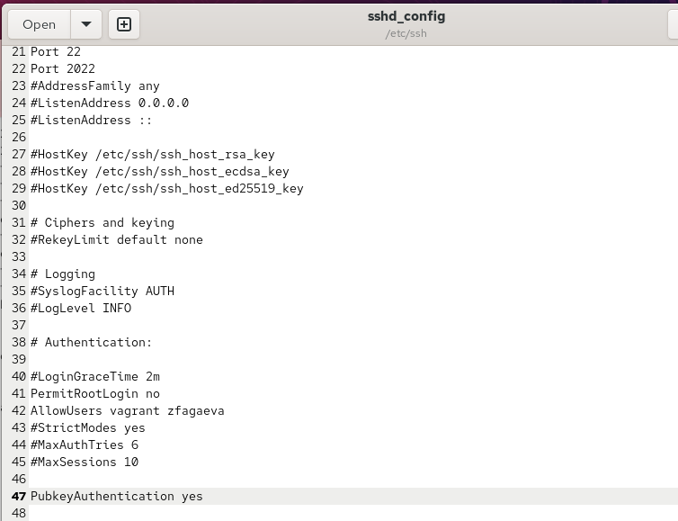{ #fig-014 width=70% }

На виртуальной машине `client` под пользователем `zfagaeva` для организации аутентификации по ключу используется пара SSH-ключей, создаваемая командой `ssh-keygen`. Закрытый ключ остаётся на клиентском компьютере, а открытый ключ необходимо скопировать на сервер. Для этого выполняю команду `ssh-copy-id zfagaeva@server.zfagaeva.net`. Утилита проверяет доступные ключи и сообщает о необходимости установить один новый ключ. После ввода пароля пользователя `zfagaeva` появляется сообщение `Number of key(s) added: 1`, подтверждающее успешное добавление открытого ключа на сервер. Далее выполняю команду `ssh zfagaeva@server.zfagaeva.net`. Подключение устанавливается без запроса пароля удалённой учётной записи, после чего открывается командная оболочка пользователя. Завершаю сеанс командой `logout`. Результат подтверждает корректную настройку аутентификации по SSH-ключу (см. рис. [@fig-015]).

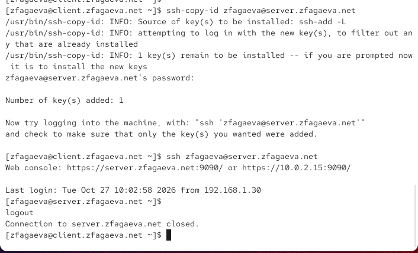{ #fig-015 width=70% }

## Организация SSH-туннеля и перенаправление TCP-портов

На виртуальной машине `client` проверяю активные TCP-соединения командой `lsof | grep TCP`. Затем создаю SSH-туннель командой `ssh -fNL 8080:localhost:80 zfagaeva@server.zfagaeva.net`. Параметр `-f` переводит SSH-процесс в фоновый режим, `-N` запрещает выполнение удалённой команды, а `-L` задаёт локальное перенаправление портов. В результате обращения клиента к локальному порту `8080` передаются через защищённое SSH-соединение на порт `80` удалённого сервера. После запуска туннеля повторно выполняю `lsof | grep TCP`. В выводе появляется процесс `ssh` с TCP-соединением к `server.zfagaeva.net:ssh`, находящимся в состоянии `ESTABLISHED`. Также отображаются локальные сокеты `localhost:webcache` в состоянии `LISTEN` для IPv4 и IPv6. Имя службы `webcache` соответствует TCP-порту `8080`. Эти записи подтверждают, что SSH-туннель создан и ожидает локальные подключения (см. рис. [@fig-016]).

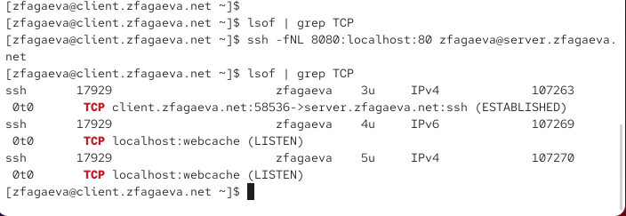{ #fig-016 width=70% }

На виртуальной машине `client` открываю веб-браузер и перехожу по адресу `http://localhost:8080`. Благодаря настроенному SSH-туннелю запрос, отправленный на локальный порт `8080`, передаётся через зашифрованное соединение на HTTP-службу сервера, работающую на порту `80`. В браузере отображается приветственная страница с текстом `Welcome to the server.zfagaeva.net server.`. Появление страницы подтверждает работоспособность перенаправления портов и возможность доступа к веб-серверу через SSH-туннель (см. рис. [@fig-017]).

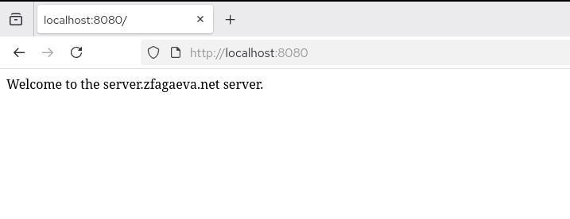{ #fig-017 width=70% }

## Запуск консольных приложений через SSH

На виртуальной машине `client` проверяю возможность удалённого выполнения команд на сервере без перехода в интерактивную оболочку. Сначала выполняю команду `ssh zfagaeva@server.zfagaeva.net hostname`, в результате которой сервер возвращает своё имя `server.zfagaeva.net`. Затем проверяю почтовый ящик пользователя командой `ssh zfagaeva@server.zfagaeva.net MAIL=~/Maildir/ mail`. В терминале запускается почтовая программа `s-nail`, отображающая содержимое каталога `/home/zfagaeva/Maildir`. В списке присутствуют три сообщения, включая письмо с темой `LMTP test`, а одно сообщение отмечено как непрочитанное. После выхода из почтовой программы выполняю команду `ssh zfagaeva@server.zfagaeva.net ls -Al`. Сервер возвращает подробный список файлов и каталогов домашней директории пользователя, включая `.bash_history`, `.bash_profile`, `.bashrc`, `.config`, `Desktop`, `Documents` и `Downloads`. Выполнение команд подтверждает возможность удалённого запуска консольных приложений через SSH с передачей их вывода на клиентский компьютер (см. рис. [@fig-018]).

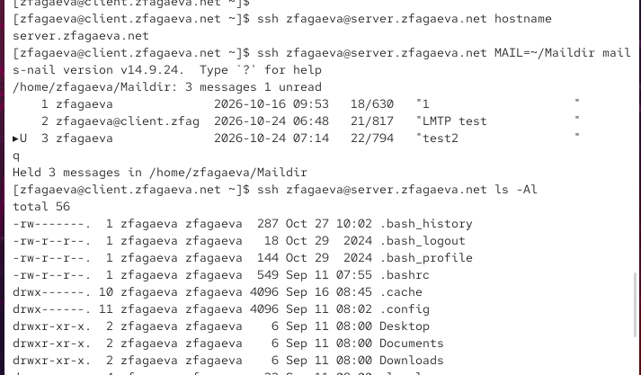{ #fig-018 width=70% }

## Запуск графических приложений через SSH с использованием X11Forwarding

На виртуальной машине `server` открываю конфигурационный файл `/etc/ssh/sshd_config` и нахожу параметр `X11Forwarding`. Устанавливаю значение `X11Forwarding yes`, разрешающее перенаправление графических приложений X11 через SSH-соединение. При использовании этой функции приложение выполняется на удалённом сервере, а его графический интерфейс передаётся на клиентский компьютер. После сохранения конфигурации перезапускаю службу SSH командой `systemctl restart sshd`, чтобы применить изменения (см. рис. [@fig-019]).

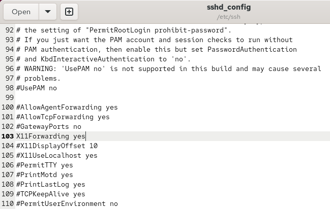{ #fig-019 width=70% }

На виртуальной машине `client` пытаюсь запустить графическое приложение `firefox` на удалённом сервере командой `ssh -YC zfagaeva@server.zfagaeva.net firefox`. Параметр `-Y` включает доверенное перенаправление X11, а `-C` активирует сжатие передаваемых данных. Однако при выполнении команды отображается предупреждение `Warning: No xauth data; using fake authentication data for X11 forwarding`. Далее появляется сообщение `X11 forwarding request failed on channel 0`, а затем ошибка `Error: no DISPLAY environment variable specified`. Это означает, что SSH не смог организовать перенаправление графического интерфейса X11 и для удалённого приложения не было определено доступное графическое окружение. В результате приложение `firefox` не запускается, а управление возвращается в терминал клиента. Для устранения проблемы необходимо дополнительно проверить наличие и настройку X11-сервера на клиенте, доступность утилиты `xauth` и корректность работы X11Forwarding в SSH (см. рис. [@fig-020]).

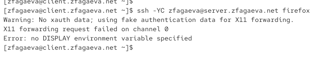{ #fig-020 width=70% }

## Внесение изменений в настройки внутреннего окружения виртуальной машины

На виртуальной машине `server` в каталоге `/vagrant/provision/server` создаю структуру каталогов для хранения конфигурации SSH-сервера и копирую файл `sshd_config`, после чего создаю исполняемый скрипт `ssh.sh` для автоматической настройки SSH, SELinux и межсетевого экрана. В файл `Vagrantfile` добавляю вызов скрипта `provision/server/ssh.sh`, обеспечивающий применение настроек при подготовке виртуальной машины (см. рис. [@fig-021]).

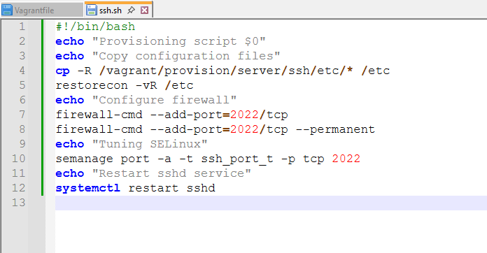{ #fig-021 width=70% }

# Вывод

В ходе лабораторной работы была выполнена настройка безопасного удалённого доступа к виртуальной машине `server` по протоколу SSH. В конфигурационном файле `/etc/ssh/sshd_config` запрещён удалённый вход пользователю `root` с помощью параметра `PermitRootLogin no`. Доступ к серверу ограничен учётными записями `vagrant` и `zfagaeva` с использованием директивы `AllowUsers`.

Настроена работа SSH-сервера через стандартный порт `22` и дополнительный порт `2022`. Для использования дополнительного порта внесены изменения в политику SELinux и настройки межсетевого экрана FirewallD. Работоспособность обоих портов проверена посредством удалённого подключения с виртуальной машины `client`.

Настроена аутентификация по SSH-ключу с использованием параметра `PubkeyAuthentication yes`. Открытый ключ скопирован на сервер с помощью команды `ssh-copy-id`, после чего выполнено успешное подключение без ввода пароля пользователя. Также организован SSH-туннель с перенаправлением локального порта `8080` на порт `80` сервера. Работа туннеля подтверждена открытием приветственной страницы веб-сервера в браузере клиента.

Проверена возможность удалённого выполнения консольных команд `hostname`, `ls -Al` и `mail` через SSH-соединение. Для передачи графического интерфейса удалённых приложений включён параметр `X11Forwarding yes`. При попытке запуска Firefox обнаружена ошибка перенаправления X11, указывающая на необходимость дополнительной настройки графического окружения.

Для автоматизации настройки SSH-сервера создан скрипт `ssh.sh`, содержащий команды копирования конфигурационных файлов, настройки SELinux, открытия дополнительного порта в межсетевом экране и перезапуска службы `sshd`.

# Контрольные вопросы

1. Вы хотите запретить удалённый доступ по SSH на сервер пользователю root и разрешить доступ пользователю alice. Как это сделать?

В конфигурационном файле `/etc/ssh/sshd_config` необходимо установить параметры `PermitRootLogin no` и `AllowUsers alice`. Первый параметр запрещает удалённый вход пользователю `root`, а второй разрешает SSH-подключение только пользователю `alice`. После сохранения изменений необходимо перезапустить SSH-сервер командой `systemctl restart sshd`.

2. Как настроить удалённый доступ по SSH через несколько портов? Для чего это может потребоваться?

Для настройки SSH через несколько портов необходимо в файле `/etc/ssh/sshd_config` указать несколько директив `Port`, например `Port 22` и `Port 2022`. Затем требуется разрешить использование дополнительного порта в SELinux, открыть его в межсетевом экране и перезапустить службу `sshd`. Использование нескольких портов позволяет сохранить резервный способ подключения к серверу, обеспечить совместимость с различными сетевыми настройками и организовать переход на новый порт без потери удалённого доступа.

3. Какие параметры используются для создания туннеля SSH, когда команда ssh устанавливает фоновое соединение и не ожидает какой-либо конкретной команды?

Для создания SSH-туннеля используются параметры `-f`, `-N` и `-L`. Параметр `-f` переводит процесс SSH в фоновый режим, `-N` запрещает выполнение удалённых команд, а `-L` задаёт локальное перенаправление портов. Например, команда `ssh -fNL 8080:localhost:80 user@server.example.com` создаёт фоновое SSH-соединение с перенаправлением локального порта `8080` на порт `80` удалённого сервера.

4. Как настроить локальную переадресацию с локального порта 5555 на порт 80 сервера server2.example.com?

Для настройки локальной переадресации необходимо выполнить команду `ssh -L 5555:localhost:80 user@server2.example.com`. После установления SSH-соединения обращения к адресу `http://localhost:5555` на клиентском компьютере будут передаваться через защищённый туннель на порт `80` сервера `server2.example.com`. Для запуска туннеля в фоновом режиме без выполнения удалённых команд можно использовать параметры `-fN`.

5. Как настроить SELinux, чтобы позволить SSH связываться с портом 2022?

Для разрешения SSH-серверу использовать TCP-порт `2022` необходимо выполнить команду `semanage port -a -t ssh_port_t -p tcp 2022`. Она добавляет порт `2022` в список разрешённых для службы SSH портов с типом безопасности `ssh_port_t`. После изменения политики SELinux необходимо перезапустить службу командой `systemctl restart sshd`. Проверить зарегистрированные порты можно командой `semanage port -l | grep ssh_port_t`.

6. Как настроить межсетевой экран на сервере, чтобы разрешить входящие подключения по SSH через порт 2022?

Для разрешения входящих TCP-соединений через порт `2022` необходимо выполнить команду `firewall-cmd --add-port=2022/tcp`. Чтобы правило сохранялось после перезагрузки сервера, используется команда `firewall-cmd --add-port=2022/tcp --permanent`. После этого необходимо применить постоянные настройки командой `firewall-cmd --reload`. Проверить открытые порты можно командой `firewall-cmd --list-ports`. При этом для работы SSH на порту `2022` также необходимо настроить соответствующее разрешение в SELinux и указать `Port 2022` в конфигурации SSH-сервера.

# Список литературы

1. [OpenSSH. Руководство по настройке SSH-сервера и параметров sshd_config](https://man.openbsd.org/sshd_config.5)

2. [OpenSSH. Использование SSH для удалённого подключения, выполнения команд и перенаправления портов](https://man.openbsd.org/ssh.1)

3. [OpenSSH. Генерация и управление SSH-ключами с помощью ssh-keygen](https://man.openbsd.org/ssh-keygen.1)

4. [Red Hat. Настройка безопасного удалённого доступа по SSH, дополнительных портов и SELinux](https://docs.redhat.com/en/documentation/red_hat_enterprise_linux/10/html/securing_networks/using-secure-communications-between-two-systems-with-openssh)

5. [FirewallD. Настройка межсетевого экрана и открытие TCP-портов](https://firewalld.org/documentation/howto/open-a-port-or-service)

6. [HashiCorp Vagrant. Автоматизация настройки виртуальных машин с использованием Shell Provisioner](https://developer.hashicorp.com/vagrant/docs/provisioning/shell)