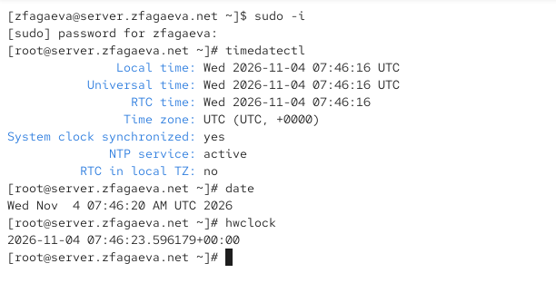
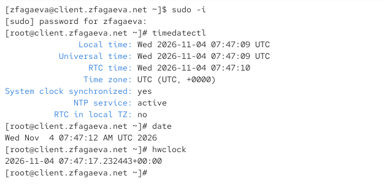
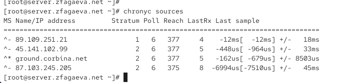
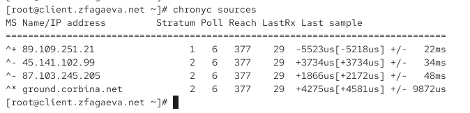
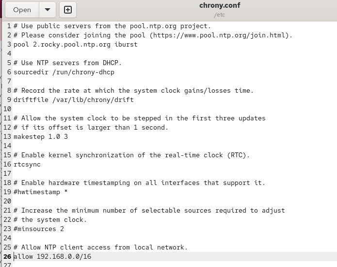
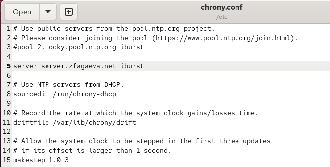
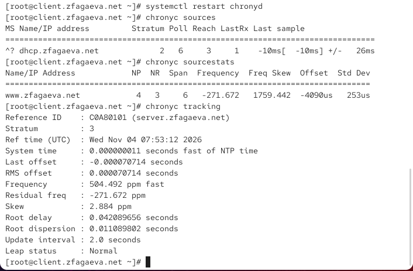
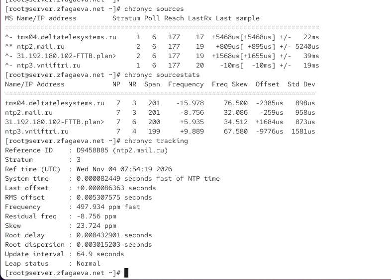
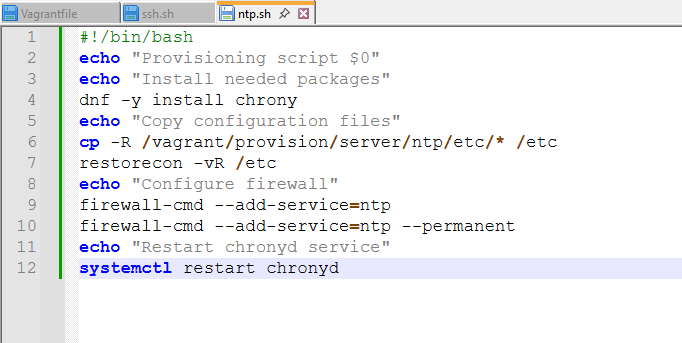
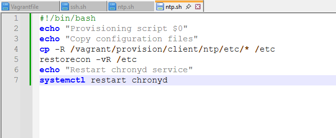

---
## Author
author:
  name: Агаева Зейнаб Фуад кызы
  email: 1032245473@rudn.ru
  affiliation:
    - name: Российский университет дружбы народов
      country: Российская Федерация
      postal-code: 117198
      city: Москва
      address: ул. Миклухо-Маклая, д. 6

## Title
title: Лабораторная работа №12
subtitle: Синхронизация времени
license: CC BY
date: today
date-format: "YYYY-MM-DD"
---

# Цели и задачи работы

## Цель лабораторной работы

Получить практические навыки управления системным и аппаратным временем в Linux, настройки синхронизации времени по протоколу `NTP` с использованием службы `chronyd`, организации локального сервера времени, проверки состояния синхронизации и автоматизации настройки NTP-сервера и клиента средствами `Vagrant`.

# Процесс выполнения лабораторной работы

## Проверяю параметры системного и аппаратного времени на сервере

{ #fig:001 width=70% height=70% }

## Проверяю параметры системного и аппаратного времени на клиенте

{ #fig:002 width=70% height=70% }

## Проверяю источники синхронизации времени на сервере

{ #fig:003 width=70% height=70% }

## Проверяю источники синхронизации времени на клиенте

{ #fig:004 width=70% height=70% }

## Настраиваю NTP-сервер для локальной сети

{ #fig:005 width=70% height=70% }

## Настраиваю клиент для синхронизации времени с локальным сервером

{ #fig:006 width=70% height=70% }

## Проверяю источники и состояние синхронизации времени на клиенте

{ #fig:007 width=70% height=70% }

## Проверяю источники и состояние синхронизации времени на сервере

{ #fig:008 width=70% height=70% }

## Создаю скрипт автоматической настройки NTP-сервера

{ #fig:009 width=70% height=70% }

## Создаю скрипт автоматической настройки NTP-клиента

{ #fig:010 width=70% height=70% }

# Выводы по проделанной работе

## Вывод

В ходе лабораторной работы были изучены команды управления системным и аппаратным временем в Linux. С помощью команд `timedatectl`, `date` и `hwclock` проверены параметры времени на виртуальных машинах `server` и `client`. Установлено, что обе машины используют часовой пояс `UTC`, а служба сетевой синхронизации времени активна.

Выполнена настройка службы `chronyd` для организации синхронизации времени в локальной сети. На сервере в конфигурационный файл `/etc/chrony.conf` добавлена директива `allow 192.168.0.0/16`, разрешающая клиентам получать время от локального NTP-сервера. Настроен межсетевой экран `FirewallD` для обработки NTP-запросов.

На клиенте настроено использование сервера `server.zfagaeva.net` в качестве источника времени. С помощью команд `chronyc sources`, `chronyc sourcestats` и `chronyc tracking` проверены доступные источники, параметры синхронизации и точность системных часов.
