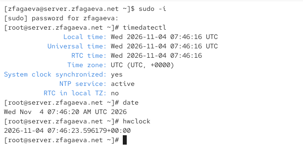
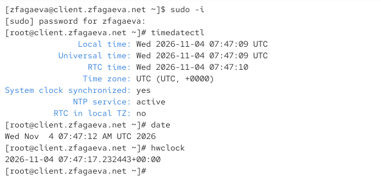
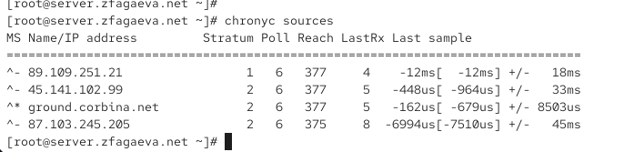
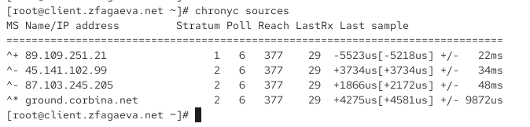
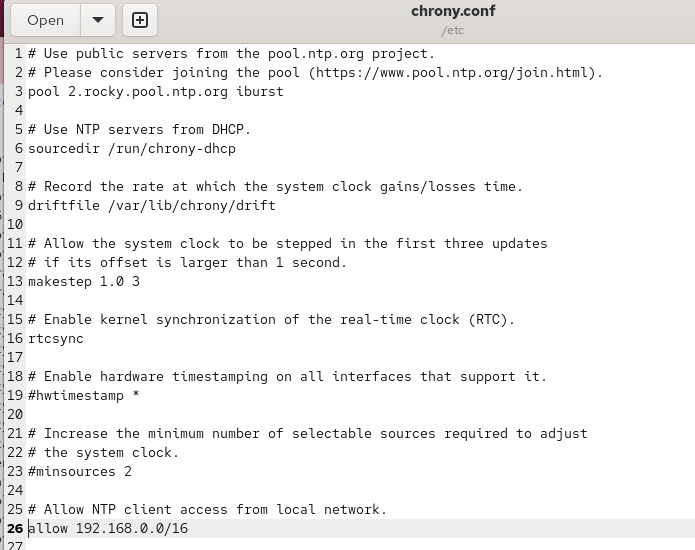
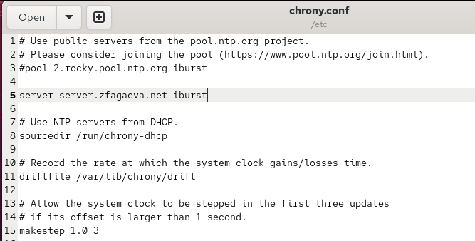
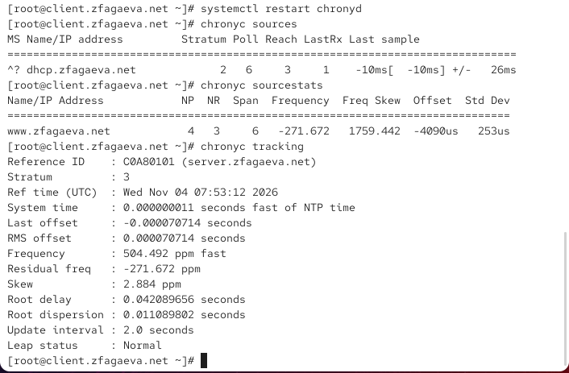
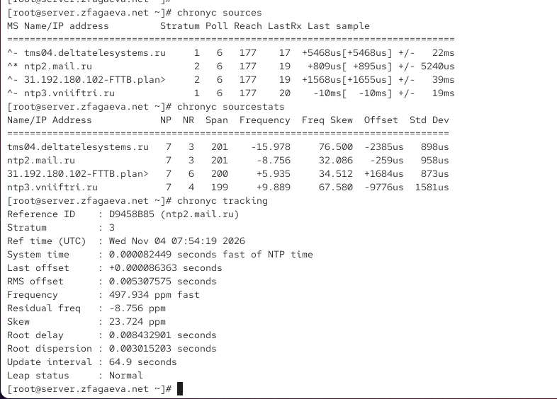
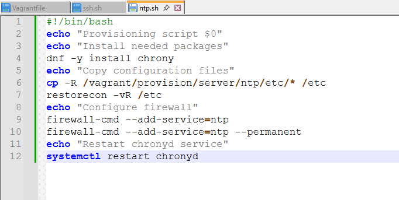
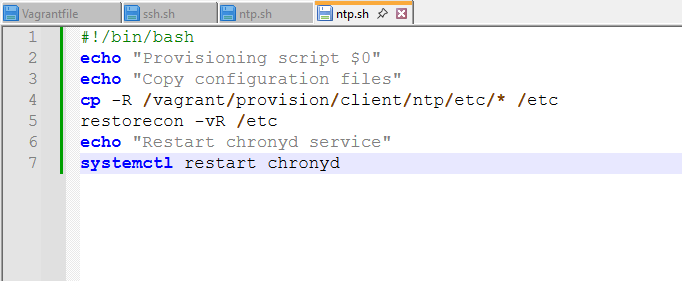

---
## Author
author:
  name: Агаева Зейнаб Фуад кызы
  email: 1032245473@rudn.ru
  affiliation:
    - name: Российский университет дружбы народов
      country: Российская Федерация
      postal-code: 117198
      city: Москва
      address: ул. Миклухо-Маклая, д. 6

## Title
title: "Отчёт по лабораторной работе №12"
subtitle: "Синхронизация времени"
license: "CC BY"
---

# Цель работы

Получение навыков по управлению системным временем и настройке синхронизации времени.

# Выполнение лабораторной работы

## Настройка параметров времени

На виртуальной машине `server` выполняю команды `timedatectl`, `date` и `hwclock` для проверки параметров даты и времени. Команда `timedatectl` показывает, что используется часовой пояс `UTC`, системные часы синхронизированы (`System clock synchronized: yes`), а служба NTP активна (`NTP service: active`). Команда `date` выводит текущее системное время, а `hwclock` — показания аппаратных часов (см. рис. [@fig-001]).

{ #fig-001 width=70% }

На виртуальной машине `client` выполняю аналогичные команды. Клиент также использует часовой пояс `UTC`, сетевая синхронизация времени включена, а системные и аппаратные часы показывают согласованное время. Это подтверждает корректность исходных настроек времени на обеих виртуальных машинах (см. рис. [@fig-002]).

{ #fig-002 width=70% }

## Проверка источников синхронизации времени

На сервере выполняю команду `chronyc sources` для просмотра используемых NTP-источников. В выводе отображаются адреса серверов времени, их уровень `Stratum`, интервалы опроса `Poll`, доступность `Reach` и отклонения времени `Last sample`. Символ `^*` обозначает выбранный источник синхронизации, а `^-` — доступные, но не выбранные источники. В качестве основного источника используется `ground.corbina.net` (см. рис. [@fig-003]).

{ #fig-003 width=70% }

На клиенте также выполняю `chronyc sources`. В результате отображаются четыре внешних источника времени, среди которых основным выбран `ground.corbina.net`. Значение `Reach 377` подтверждает успешное получение последних восьми ответов от источников. Следовательно, до изменения конфигурации клиент синхронизируется с внешними NTP-серверами (см. рис. [@fig-004]).

{ #fig-004 width=70% }

## Настройка сервера синхронизации времени для локальной сети

На сервере открываю конфигурационный файл `/etc/chrony.conf` и добавляю строку `allow 192.168.0.0/16`, разрешающую клиентам указанной подсети получать время от сервера. При этом сохраняю директиву `pool 2.rocky.pool.ntp.org iburst` для синхронизации с внешними источниками. После изменения конфигурации перезапускаю службу командой `systemctl restart chronyd` и разрешаю NTP-трафик через межсетевой экран командами `firewall-cmd --add-service=ntp --permanent` и `firewall-cmd --reload` (см. рис. [@fig-005]).

{ #fig-005 width=70% }

## Настройка клиента для синхронизации времени с сервером

На клиенте открываю файл `/etc/chrony.conf`, комментирую строку `pool 2.rocky.pool.ntp.org iburst` и добавляю директиву `server server.zfagaeva.net iburst`. Теперь клиент настроен на получение времени от локального сервера. Для применения изменений перезапускаю службу командой `systemctl restart chronyd` (см. рис. [@fig-006]).

{ #fig-006 width=70% }

На клиенте выполняю команды `chronyc sources`, `chronyc sourcestats` и `chronyc tracking` для проверки синхронизации. Команда `chronyc sources` отображает доступные источники и их состояние, `chronyc sourcestats` — статистику измерений, а `chronyc tracking` — подробную информацию о синхронизации. В выводе `tracking` источником указан `server.zfagaeva.net`, уровень `Stratum` равен `3`, а значение `Leap status: Normal` указывает на нормальное состояние шкалы времени. При этом обозначение `^?` в списке источников показывает, что их пригодность ещё не подтверждена (см. рис. [@fig-007]).

{ #fig-007 width=70% }

На сервере выполняю аналогичные команды `chronyc sources`, `chronyc sourcestats` и `chronyc tracking`. В выводе отображаются внешние NTP-серверы, статистика измерений и параметры точности системных часов. В качестве опорного источника в `chronyc tracking` указан `ntp2.mail.ru`, уровень синхронизации составляет `Stratum 3`, а состояние `Leap status: Normal` подтверждает отсутствие предупреждений о шкале времени (см. рис. [@fig-008]).

{ #fig-008 width=70% }

## Внесение изменений в настройки внутреннего окружения виртуальных машин

На виртуальной машине `server` создаю каталог `/vagrant/provision/server/ntp/etc`, копирую в него файл `/etc/chrony.conf` и подготавливаю исполняемый скрипт `ntp.sh` для автоматической установки `chrony`, настройки межсетевого экрана и перезапуска службы `chronyd` (см. рис. [@fig-009]).

{ #fig-009 width=70% }

На виртуальной машине `client` создаю каталог `/vagrant/provision/client/ntp/etc`, сохраняю конфигурацию `chrony.conf` и подготавливаю скрипт `ntp.sh` для автоматического применения настроек и перезапуска службы `chronyd` (см. рис. [@fig-010]).

{ #fig-010 width=70% }

# Вывод

В ходе лабораторной работы были изучены команды управления системным и аппаратным временем в Linux. С помощью команд `timedatectl`, `date` и `hwclock` проверены параметры времени на виртуальных машинах `server` и `client`. Установлено, что обе машины используют часовой пояс `UTC`, а служба сетевой синхронизации времени активна.

Изучена работа службы `chronyd` и выполнена проверка источников синхронизации командой `chronyc sources`. На сервере в конфигурационный файл `/etc/chrony.conf` добавлена директива `allow 192.168.0.0/16`, разрешающая клиентам локальной сети получать информацию о времени. Для работы NTP настроен межсетевой экран FirewallD и перезапущена служба `chronyd`.

На клиенте изменена конфигурация `chrony.conf` для использования локального сервера `server.zfagaeva.net` в качестве источника времени. Проверка командами `chronyc sources`, `chronyc sourcestats` и `chronyc tracking` позволила определить состояние источников, уровень синхронизации и точность системных часов.

Для автоматизации настройки NTP созданы скрипты `ntp.sh` для сервера и клиента. Они обеспечивают применение сохранённых конфигурационных файлов, восстановление контекстов SELinux и перезапуск службы `chronyd`. Серверный скрипт дополнительно предусматривает установку пакета `chrony` и настройку межсетевого экрана.

# Контрольные вопросы

1. Почему важна точная синхронизация времени для служб баз данных?

Точная синхронизация времени необходима для правильного определения последовательности транзакций, ведения журналов событий и согласованной работы распределённых баз данных. Расхождения во времени между серверами могут приводить к ошибкам при репликации, нарушению порядка обработки событий и затруднениям при восстановлении данных. Синхронизация обеспечивает согласованность временных меток и упрощает диагностику неисправностей.

2. Почему служба проверки подлинности Kerberos сильно зависит от правильной синхронизации времени?

Протокол Kerberos использует временные метки для проверки подлинности запросов и защиты от повторного использования перехваченных сообщений. При аутентификации сравнивается время клиента и сервера, а допустимое расхождение по умолчанию обычно составляет 5 минут. Если разница превышает установленный предел, сервер отклоняет запрос аутентификации. Поэтому для корректной работы Kerberos необходима синхронизация времени всех участников сети.

3. Какая служба используется по умолчанию для синхронизации времени на RHEL 7?

В Red Hat Enterprise Linux 7 по умолчанию используется служба `chronyd`, входящая в состав пакета `chrony`. Она обеспечивает синхронизацию системного времени по протоколу NTP. Для управления службой используется команда `systemctl`, а для просмотра состояния синхронизации — утилита `chronyc`.

4. Какова страта по умолчанию для локальных часов?

При использовании локальных часов в качестве источника времени в `chrony` значение страты по умолчанию составляет `10`. Оно применяется при включении локального режима с помощью директивы `local`. Высокое значение страты позволяет отличать локальный источник от внешних серверов точного времени, которые обычно имеют более низкий уровень.

5. Какой порт брандмауэра должен быть открыт, если вы настраиваете свой сервер как одноранговый узел NTP?

Для работы NTP необходимо открыть порт `123/UDP`, через который передаются запросы и ответы синхронизации времени. В FirewallD это можно сделать командой `firewall-cmd --add-service=ntp --permanent`, после чего применить изменения командой `firewall-cmd --reload`.

6. Какую строку вам нужно включить в конфигурационный файл chrony, если вы хотите быть сервером времени, даже если внешние серверы NTP недоступны?

В конфигурационный файл `/etc/chrony.conf` необходимо добавить директиву `local stratum 10`. Она разрешает службе `chronyd` использовать локальные системные часы в качестве источника времени при отсутствии доступных внешних NTP-серверов. Это позволяет поддерживать согласованное время между устройствами локальной сети, хотя его точность относительно UTC не гарантируется.

7. Какую страту имеет хост, если нет текущей синхронизации времени NTP?

В протоколе NTP значение страты `16` обозначает отсутствие синхронизации с достоверным источником времени. Узел с этим уровнем считается несинхронизированным и не должен использоваться клиентами как надёжный источник времени. В выводе `chronyc tracking` при отсутствии выбранного источника может отображаться `Stratum: 0`.

8. Какую команду вы бы использовали на сервере с chrony, чтобы узнать, с какими серверами он синхронизируется?

Для просмотра источников синхронизации используется команда `chronyc sources`. Она выводит список NTP-серверов, их адреса, уровни страты, доступность и отклонения времени. Символ `^*` обозначает выбранный источник синхронизации, а `^+` — дополнительные подходящие источники. Для более подробного описания полей можно выполнить `chronyc sources -v`.

9. Как вы можете получить подробную статистику текущих настроек времени для процесса chrony вашего сервера?

Для получения подробной информации о состоянии синхронизации используется команда `chronyc tracking`. Она показывает текущий источник времени, уровень страты, отклонение системных часов, частотную коррекцию и параметры точности. Дополнительно можно выполнить `chronyc sourcestats`, которая выводит статистику измерений для каждого источника времени, включая количество измерений, оценку частотного отклонения и стандартное отклонение.

# Список литературы

1. [Red Hat. Руководство по настройке системного и аппаратного времени в Linux: timedatectl, date и hwclock](https://docs.redhat.com/en/documentation/red_hat_enterprise_linux/7/html/system_administrators_guide/chap-configuring_the_date_and_time)

2. [Red Hat. Настройка синхронизации времени по протоколу NTP с использованием Chrony](https://docs.redhat.com/en/documentation/red_hat_enterprise_linux/7/html/system_administrators_guide/ch-configuring_ntp_using_the_chrony_suite)

3. [Chrony Project. Руководство по настройке конфигурационного файла chrony.conf](https://chrony-project.org/doc/4.0/chrony.conf.html)

4. [HashiCorp. Документация Vagrant: автоматизация настройки виртуальных машин с помощью Shell Provisioner](https://developer.hashicorp.com/vagrant/docs/provisioning/shell)